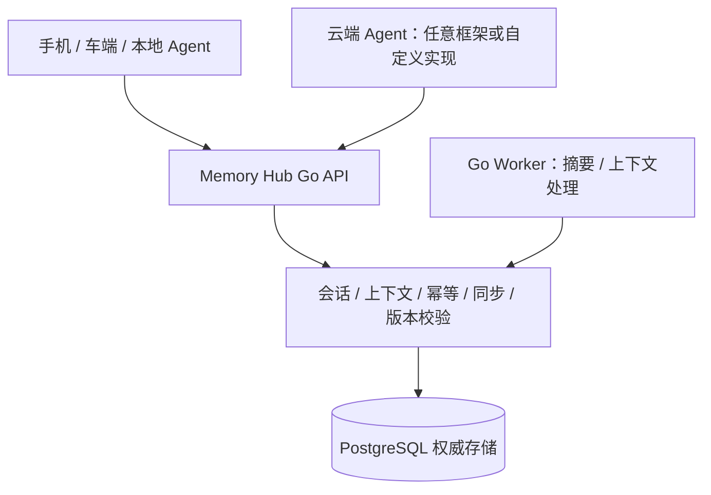

# 云侧会话与上下文系统：开源仓库调研与复用建议

调研日期：2026-10-01。范围：一期云侧的会话持久化、上下文状态、Agent 执行恢复、多设备共享与同步。端侧 SQLite 不在本次选型范围内。

## 1. 结论

**有开源项目在提供独立的云侧记忆/上下文服务，本次已查项目中 Acontext 更接近一期服务目标。tRPC-Agent-Go 是 Agent 开发框架，应归入可选集成参考，不作为 Memory Hub 服务候选。**

Google ADK-Go、Eino 和 LangGraph 同样属于框架或编排库。框架内的 Session Service 是存储接口/实现，其能力不能等同于面向多个设备和多个 Agent 的独立 Memory Hub 服务。本文将服务候选与框架参考分开。

本次检查了官方仓库、文档及部分存储源码，尚未确认有一个候选完整提供 Memory Hub 设计中的“用户级提交顺序 + 消息/上下文/同步记录原子提交 + 设备游标 + 旧 Run 写入隔离”。这些能力需要针对具体版本做 PoC，不能仅凭“持久化”“流式输出”或“共享 Session”认定已经满足。

建议保留现有云侧数据与同步契约，**先验证 Acontext 的服务接口与一期需求的匹配度；自研 Go Memory Hub 时保持独立服务边界，不预设必须使用 Agent 框架。** 框架适配仅在需要接入特定 Agent 运行环境时评估。当前报告未运行候选服务。

## 2. 我们需要的云侧能力

| 能力 | 本项目的具体要求 |
| --- | --- |
| 会话存储 | 用户消息、Agent 回复和工具结果持久化，原始历史可查询，重试不重复写入 |
| 上下文存储 | 当前任务、参数、待确认项、执行结果有结构和版本；关联产生它们的会话事件 |
| 上下文组装 | 组合已确认任务状态、历史摘要与近期消息；重启后可以继续对话 |
| 跨端共享 | 手机、车端与云端 Agent 使用统一用户和逻辑会话身份 |
| 增量同步 | 从设备游标补拉已提交变更，断线恢复、删除传播与全量快照 |
| 并发控制 | 多端同时输入可检测冲突；过期 Agent 结果不能覆盖新上下文 |
| 事务保障 | 消息、上下文变更、同步记录、任务与幂等回执按业务操作原子提交 |
| 服务化 | 有鉴权 API、部署方式和后台任务机制；Go 实现优先 |

“完整上下文”指云侧权威历史和当前状态可以恢复；传给模型的单次 Prompt 仍需要按 Token 预算组装。

## 3. 服务候选与框架参考

下面的项目类别、语言和许可依据各行官方仓库；更细的能力证据见后续章节与 [Reference](reference/cloud-open-source.md)。许可列为仓库主许可，正式引入时仍需复核选定版本及依赖。

### 3.1 独立服务候选

| 项目 | 开源形态 | 主要技术 | 主许可 | 一期定位 |
| --- | --- | --- | --- | --- |
| [Acontext](https://github.com/memodb-io/Acontext) | 可自托管服务，包含 API、处理服务和界面 | Go API + Python Core；部署示例含 PostgreSQL、Redis、RabbitMQ、S3 兼容存储 | Apache-2.0 | 已查项目中更接近独立会话/上下文服务；同步契约需要验证 |
| [Redis Agent Memory Server](https://github.com/redis/agent-memory-server) | 原开源服务器保留在 V0；当前入口介绍托管产品 | V0 为 Python/FastAPI + Redis | 仓库为 Apache-2.0 | 历史服务参考，当前不作为一期首选 |

### 3.2 Agent 框架参考：不参与 Memory Hub 服务排名

| 项目 | 类型 | 可参考内容 | 主许可 |
| --- | --- | --- | --- |
| [tRPC-Agent-Go](https://github.com/trpc-group/trpc-agent-go) | Go Agent 开发框架 | Session 接口、PostgreSQL/MySQL 后端、摘要和 Runner | Apache-2.0 |
| [Google ADK-Go](https://github.com/google/adk-go) | Go Agent 开发框架 | GORM 关系数据库 Session Service、事件与状态模型 | Apache-2.0，内部个别目录有单独许可 |
| [Eino](https://github.com/cloudwego/eino) | Go Agent/工作流框架 | Checkpoint、中断恢复及接入接口 | Apache-2.0 |
| [LangGraph](https://github.com/langchain-ai/langgraph) | Python / JS/TS 有状态编排库 | PostgreSQL Checkpointer、执行恢复 | MIT |

Memory Hub 应能够通过稳定 API 被不同 Agent 框架和手机/车端共同访问，其生命周期和权威数据存储独立于某个 Agent 运行实例。

## 4. 服务候选与框架参考详解

### 4.1 Acontext：最接近可部署的云侧上下文服务

Acontext 当前定位已扩展到 Agent Skill Memory，仍包含会话和上下文工程能力。其服务器目录包含 Go API 和 Python Core；官方部署文件配置了 PostgreSQL、Redis、RabbitMQ 与 S3 兼容对象存储。它适合独立部署后由 Go 业务服务调用，完整采用时需要接受混合技术栈。[仓库](https://github.com/memodb-io/Acontext)、[API 目录](https://github.com/memodb-io/Acontext/tree/main/src/server/api)、[Server 目录](https://github.com/memodb-io/Acontext/tree/main/src/server)、[部署文件](https://github.com/memodb-io/Acontext/blob/main/src/server/docker-compose.yaml)

已经确认的相似能力：

- 会话消息存储，以及读取时的上下文编辑。裁剪可以发生在读取阶段，原始存储消息保持完整，适合作为 Context Assembler 的参考。[Context Editing](https://docs.acontext.io/engineering/editing)
- 从消息异步提取任务及进展，用于观察 Agent 正在做什么。[Task Tracking](https://docs.acontext.io/observe/whatis)
- 会话任务摘要可压缩模型上下文；摘要处理存在异步滞后，需要同时考虑近期原始消息。[Session Summary](https://docs.acontext.io/engineering/session_summary)

与我们的设计需要衔接的部分：

1. 手机/车端的账户鉴权、逻辑会话路由与设备身份仍需接入业务系统。
2. 自动提取的任务进展属于语义分析结果。导航目的地、订单确认和实际工具执行成功等字段，应由用户确认或可信工具结果推进，不能直接作为权威业务状态。
3. 本次所查资料未确认提供符合本项目契约的用户级增量游标、删除同步、上下文 CAS 和 Run fencing，需要专门验证或补充。
4. 若 Acontext 保存消息而 Memory Hub 独立保存同步记录，两次网络写入不能自然形成同一个数据库事务。需要明确唯一权威存储和可靠的变更投递方式。

**适用判断：**如果优先用现成服务体验“保存会话 → 压缩上下文 → 换设备继续聊”，它值得先部署验证。若坚持一期只有 Go + PostgreSQL，完整引入它会增加部署负担；是否可关闭其他功能、减少组件，本次尚未验证。

### 4.2 tRPC-Agent-Go：Agent 框架参考，不是 Memory Hub

tRPC-Agent-Go 已提供 Session Service：以应用、用户与 Session 标识管理事件和状态，并提供摘要能力；文档列出 PostgreSQL、MySQL 等后端。它是可以嵌入 Go 服务的框架。[Session 文档](https://github.com/trpc-group/trpc-agent-go/blob/main/docs/mkdocs/en/session.md)

PostgreSQL Schema 明确区分会话状态、会话事件、会话摘要、应用状态和用户状态，与我们一期“会话 + 上下文”的数据拆分相近。[Schema](https://github.com/trpc-group/trpc-agent-go/blob/main/session/postgres/schema.sql)

因此可以验证复用：Session 接口和事件类型、Runner 及工具调用、摘要生成接口。它提供了会话存储实现，但本项目的设备同步协议与业务一致性仍需衔接。

一个需要实际注意的源码细节：PostgreSQL `AppendEvent` 开启异步持久化时，将事件放入进程内通道后即可返回；这时函数成功不代表数据库已经提交。对外“消息已保存”的 ACK 必须建立在持久提交之上。默认同步模式是否足够满足我们的完整事务，仍要结合适配方案验证。[实现源码](https://github.com/trpc-group/trpc-agent-go/blob/main/session/postgres/service.go)

**可选集成方式：**如果云端 Agent 已经使用该框架，可以评估一个调用 Memory Hub 的 Session Service 适配器。Memory Hub 独立提供权威会话、上下文和同步服务；框架通过适配器访问。应先检查接口能否正确映射写入、重试和版本规则。

直接启用框架自带 PostgreSQL Session 后端，同时在另一套表里独立写业务上下文和同步记录，容易形成重复历史和不完整提交。这种组合应通过事务改造或可靠投递设计后再采用。

还需核对事件窗口、保留期限、摘要策略和删除行为，区分“模型加载窗口”与“原始会话历史保留”。版本升级不得导致旧事件无法读取。

**适用判断：**仅作为 Agent 接入和代码实现参考，不列入 Memory Hub 服务选型。使用 Go 编写 Memory Hub 本身不构成引入这个框架的理由。

### 4.3 Google ADK-Go：带会话存储的 Agent 框架参考

Google ADK-Go 是 Go Agent 框架，主许可为 Apache-2.0。当前源码已有 `session/database`，使用 GORM，可创建、查询会话并持久化事件和分层状态；源码中的关系数据库示例包含 PostgreSQL。[仓库](https://github.com/google/adk-go)、[数据库 Session Service](https://github.com/google/adk-go/blob/main/session/database/service.go)

这意味着它有现实的云侧存储基础，不应再把它描述为“只有内存会话”。但复用数据库连接不等于已支持 Memory Hub 所有表的统一事务，也不等于已经提供设备同步与过期 Run 隔离。

**适用判断：**已有 Agent 采用 ADK-Go 时，评估如何接入 Memory Hub；不作为独立 Memory Hub 服务备选。

### 4.4 Eino：Go Agent 执行恢复组件

Eino 提供 Go Agent、工具和工作流编排。官方中断恢复文档说明，通过 CheckPoint ID 和持久化 CheckPoint Store 可以恢复执行；生产环境需要用共享持久存储替代示例中的内存实现。[仓库](https://github.com/cloudwego/eino)、[中断与恢复文档](https://www.cloudwego.io/docs/eino/core_modules/eino_adk/agent_hitl/)

**适用判断：**当一期需要等待用户确认、恢复工具链或复杂工作流时，值得评估。Checkpoint 保存的是执行现场，本项目的会话历史、设备游标、权威任务上下文仍需由云侧业务服务负责。自定义 PostgreSQL Store 的工作量需要实际验证。

### 4.5 LangGraph：持久化和恢复机制参考

LangGraph 是有状态 Agent 编排库，核心开源仓库为 MIT。其持久化机制按 Thread 保存 Checkpoint，提供状态读取和执行恢复，官方文档列出 PostgreSQL Checkpointer。[仓库](https://github.com/langchain-ai/langgraph)、[Persistence](https://docs.langchain.com/oss/python/langgraph/persistence)

**适用判断：**若愿意让 Agent Worker 使用 Python 或 JS/TS，可以评估；保持全部 Go 时，主要参考其执行状态与持久化接口。这里评估的是开源库，相关托管或部署产品的权限和许可需要另外确认。

### 4.6 Redis Agent Memory Server：注意当前开源版本边界

该仓库当前 README 主要介绍 Redis 托管 Agent Memory；原来的开源服务器保留在 `V0/`，官方明确将其作为研究资料保留，而非受支持的生产发行版。V0 包含基于 Redis 的会话工作记忆和长期记忆能力。[当前仓库说明](https://github.com/redis/agent-memory-server)、[V0 README](https://github.com/redis/agent-memory-server/blob/main/V0/README.md)

**适用判断：**可参考工作记忆与长期记忆分层，不建议把旧版教程中的服务器视为当前正式支持的自托管选项。该路线也与我们一期 PostgreSQL 权威存储的选择不同。

## 5. 哪些能力可以复用，哪些必须验证

“未确认”表示本次资料审查没有确认符合我们的要求，不等同于证明项目完全没有该功能。

| 本项目能力 | 服务能力或框架内参考实现 | 选型前必须验证的内容 |
| --- | --- | --- |
| 会话事件持久化 | Acontext；tRPC-Agent-Go；ADK-Go | 历史完整保留、事件唯一性、查询顺序、升级兼容 |
| 会话/用户状态 | tRPC-Agent-Go、ADK-Go 的分层状态 | 能否表达任务结构、来源版本、CAS 与明确的状态推进规则 |
| 摘要与 Token 裁剪 | Acontext；tRPC-Agent-Go 摘要接口 | 摘要滞后、原文保留、工具消息完整配对、模型输入预算 |
| Agent 中断恢复 | Eino、LangGraph | 持久 Store、跨进程恢复、外部工具幂等及执行结果核验 |
| 跨设备读取同一会话 | 有云侧会话接口即可由业务层组织 | 用户/设备鉴权、会话路由、读到同一已提交版本 |
| 用户级增量同步 | 未确认候选直接满足 | 提交顺序、游标分页、丢通知补拉、快照切换、删除传播 |
| 原子业务 ACK | 候选有存储操作；覆盖范围需核对 | 消息、上下文、sync_changes、Outbox 与幂等回执是否同事务 |
| 旧 Run 写入隔离 | 未确认候选直接满足 | 单一有效 Run、租约、fencing token、旧工具结果的拒绝规则 |

已有会话状态只解决“存什么”，还要确定“何时写入、谁可以覆盖、如何同步”。一次 SSE/WebSocket 断线重连也需要持久游标补拉机制；流式传输本身不能证明同步完整。

## 6. 对现有一期设计的建议

### 6.1 自研路径：独立 Go Memory Hub，对 Agent 框架保持中立

Memory Hub 负责会话、业务上下文、摘要、同步和提交规则，通过 API 向调用方提供数据与上下文组装结果。Agent 负责模型交互和工具执行；外部结果只有通过权限、版本和来源验证后才能推进权威状态。

手机和车端也可以运行本地 Agent；候选服务还需要核查端模型预算、可缓存 Bundle、离线记录导入和过期建议重校验。弱网使用本地缓存分支，云端生成模型不是前置依赖。

已有框架内部的 Session/Checkpoint 可以作为实现参考，但不能替代整个服务。需要接入某个框架时，再选择 HTTP 客户端或 Session 适配器；一期 Memory Hub 不强制依赖框架 Runner。

### 6.2 快速服务体验路径：Go 接入层 + Acontext

可以验证 Go 业务接入层调用 Acontext 保存、读取和裁剪会话的可行性。重点验证两个模拟设备读取同一 Session，以及重启后继续对话。

正式保留这一路线之前，要设计消息与业务同步的可靠衔接：谁是权威存储、ACK 表示哪个提交完成、重试如何去重、变更如何补发。直接双写两个独立服务不能满足现有一期的原子提交契约。

### 6.3 现阶段无需引入多个记忆引擎

之前的 [三层总体调研](memory-system-design.md) 覆盖长期画像、事实召回与记忆演进。本次进一步筛选一期会话/上下文基础设施。长期记忆候选暂不加入一期关键写入链路，避免重复持久化与不必要的部署组件。

## 7. 选型 PoC 与验收

以下是 Memory Hub 服务候选及自研方案的验收检查，本次尚未实施。候选服务或参考组件需要固定 tag 或 commit SHA，并记录运行版本、依赖、数据库迁移和模型配置。

| 场景 | 验收要求 |
| --- | --- |
| 同用户双设备 | A 发送消息，B 读取同一逻辑会话和已确认上下文；其他用户无法访问 |
| 重启恢复 | 服务与 Worker 重启后，消息、状态、摘要来源仍可恢复 |
| 网络重试 | 同一请求重复提交只形成一条业务事件；相同幂等键不同内容被拒绝 |
| 提交前故障 | 未提交事务不返回持久 ACK，不产生可同步的半成品状态 |
| 提交后响应丢失 | 重试得到原提交结果，设备可补拉对应变更 |
| 多端并发 | 两端从相同上下文版本修改同一字段时，冲突被检测或按明确规则处理 |
| 旧 Run 延迟完成 | 新输入使旧 Run 失效；旧回复/工具结果不能推进新上下文 |
| 同步中断 | 通知丢失仍能通过游标补拉，分页不跳过已提交变更 |
| 历史与摘要 | 超出模型窗口后原文仍可查询；摘要落后时保留近期消息 |
| 工具恢复 | 明确工具调用 ID 与执行状态；重试有副作用的工具前核验幂等或结果 |
| 删除与隔离 | 消息删除后相关摘要和同步副本按规则处理；设备撤权后不能继续获取数据 |

Acontext 通过接口和一致性验证后，再判断是否作为服务基础及需要哪些扩展；无法满足时继续自研独立 Go Memory Hub。tRPC-Agent-Go 等框架的接入另行评估，不影响 Memory Hub 服务的核心选型。

## 8. 调研边界

- 本次依据官方仓库、官方文档和部分源码，没有安装服务、运行示例或做压测。
- 链接指向动态主分支；网页索引时间不同，本文不能作为固定版本的源码审计结论。
- 未用 Star 数量、README 的成熟度宣传或长期记忆评测排名推断同步正确性。
- 一期云侧详细设计仍以 [现有设计文档](phase1-go-cloud-service-design.md) 为准；此报告补充开源复用路径，正式依赖需经过上述 PoC。
