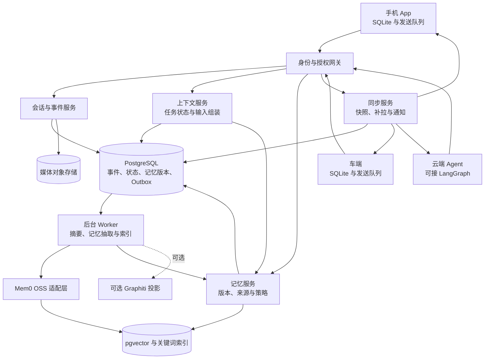
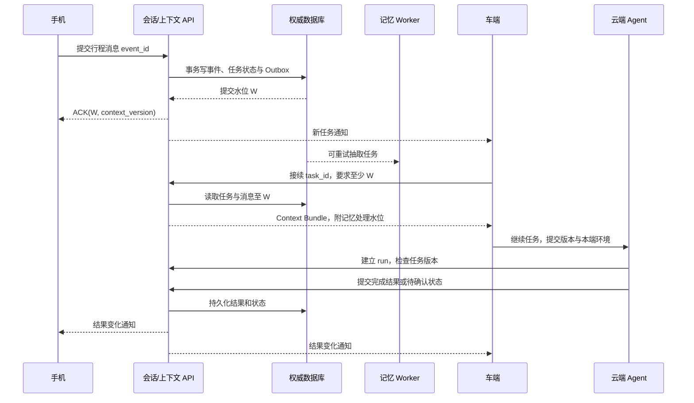

# 手机 App、车端与云端 Agent 的三层记忆系统：开源调研与选型设计

> 调研日期：2026-10-01。本文基于项目官方仓库、官方文档和原始评测项目，未进行部署压测。开源能力、托管服务能力和本文提出的工程设计分别说明；性能数值均为建议验收目标，不是已测结果。

## 1. 推荐结论

推荐采用 **“统一事件日志 + 上下文服务 + 可替换长期记忆引擎”**，将系统明确拆成会话、上下文、记忆三层。

首期组合：

| 层级或能力 | 推荐选型 | 承担的职责 |
| --- | --- | --- |
| 会话层 | 自建 Session Service + PostgreSQL | 原始消息、工具事件、会话关系、跨端顺序、幂等与审计 |
| 上下文层 | 自建 Context Service + PostgreSQL；云端运行时可接 LangGraph | 当前目标、任务状态、结构化槽位、摘要、上下文组装、运行恢复 |
| 记忆层 | Mem0 OSS，通过自建适配层接入 | 长期事实抽取和相关记忆检索 |
| 记忆权威记录 | PostgreSQL 中自有的记忆版本表 | 来源、当前有效状态、更正、撤销、权限与生命周期 |
| 检索存储 | 首期 pgvector + 独立关键词检索 | 向量检索、准确词匹配；中文召回单独验证 |
| 同步 | 自建同步 API + 事务 Outbox + WebSocket/SSE | 快照、增量、补拉、版本水位与端侧确认 |
| 端侧 | SQLite + 本地发送队列 | 已授权上下文缓存、弱网与断网暂存 |
| 缓存 | Valkey，可按需要引入 | 热数据、连接状态、通知；持久化事实仍由数据库负责 |

**Hindsight 是首期长期记忆引擎的对照候选；Graphiti 是复杂时序关系查询的后续候选。** 若 PoC 表明 Hindsight 在中文事实更新、时间问答和集成成本上更合适，可在适配层内替换 Mem0，保持三层和同步协议稳定。

这是一项初步工程选型，依据是能力边界和系统复杂度。正式上线前，必须通过第 13 节的业务 PoC；不以各项目宣传的基准分数直接判定优劣。

核心原则：**跨端接续依赖同步提交的会话事件和任务状态；长期记忆抽取可以异步进行。** 用户从手机切到车端时，即使长期记忆尚未更新，也应能继续刚才的任务。

## 2. 需求解释与设计假设

### 2.1 本方案的默认假设

- 同一用户在手机、车端和云端 Agent 之间有统一身份；设备和 Agent 另有独立身份与权限。
- 用户可以继续同一个会话，也可以新开会话继续同一个任务。
- 默认联网时由云端协调；车端和手机需要弱网缓存。完全断网期间允许本地有限对话。
- 云端 Agent 可以后台执行任务，并在用户不在线时产生新的状态和结果。
- 首期采用单写入区域；多区域部署先按用户归属到一个写入区域，不做无约束的跨区域同时写入。
- 用户量、峰值并发、端侧模型能力和历史保留期尚未提供，本文不据此虚构容量或固定成本。

### 2.2 “完整上下文”的可实现定义

完整上下文包括：

1. 当前会话已提交的相关消息与工具结果。
2. 当前任务的目标、约束、进度、未完成事项和已确认操作。
3. 与当前问题相关且获授权的历史事件与长期记忆。
4. 本端实时环境，例如车辆位置、行驶状态、手机当前页面。
5. 明确的版本水位、来源和缺失信息说明。

系统应保证：**授权范围内的完整历史可按需读取，单轮模型输入在预算内组装，关键状态不会因为摘要或检索遗漏而丢失。** 长历史不要求每轮全部放进模型窗口。

需要区分三个保证：

| 场景 | 系统承诺 |
| --- | --- |
| 在线切换设备 | 获取截止某个已提交水位的一致上下文；必要时等待或重建关键状态 |
| 记忆抽取尚未完成 | 当前消息和任务状态仍可见；返回记忆处理水位 |
| 完全离线 | 获取本地最后同步版本与本端新增内容；恢复联网后收敛 |

完全断网的设备无法知道其他端刚产生的内容。因此“所有设备任何时刻都拥有最新完整上下文”不能作为离线模式承诺。

## 3. 当前开源社区方案调研

### 3.1 候选项目对比

以下部署复杂度与适配判断为本文分析；开源协议指所列核心仓库，依赖和托管产品需分别核对。

| 项目 | 核心设计与开源边界 | 主要存储/部署方式 | 协议 | 对本需求的判断 |
| --- | --- | --- | --- | --- |
| **Mem0 OSS** | 事实抽取、实体作用域、检索；当前迁移方案采用 ADD-only 抽取，OSS 图记忆已移除 | 可作为库或自托管服务；支持 pgvector 等后端 | Apache-2.0 | 首期记忆引擎候选；同步、任务状态和严格事实更正由业务层承担。[仓库](https://github.com/mem0ai/mem0)、[OSS 概览](https://docs.mem0.ai/open-source/overview)、[迁移说明](https://docs.mem0.ai/migration/oss-v2-to-v3) |
| **Letta / MemGPT** | 有状态 Agent；当前活跃源码转到 Letta Code，记忆采用 MemFS/Git 等机制；旧 V1 服务在 archive 分支 | 当前 Agent harness、App Server、本地或云端模式 | Apache-2.0 | 适合整套 Agent 运行时选型，接入现有多端产品需评估运行时耦合。[旧仓库状态](https://github.com/letta-ai/letta)、[当前仓库](https://github.com/letta-ai/letta-code)、[当前记忆文档](https://docs.letta.com/agent-sdk/memory) |
| **Memobase** | 用户画像 + 事件时间线；按用户缓冲消息，再批处理为记忆 | 官方示例采用 PostgreSQL/pgvector、Redis 与 API 服务 | Apache-2.0 | 画像主导的个人助手候选；实时任务接续需要补上下文层。[仓库](https://github.com/memodb-io/memobase)、[部署示例](https://github.com/memodb-io/memobase/blob/main/src/server/docker-compose.yml) |
| **Graphiti** | 实体、关系、来源 Episode 与事实有效时间；语义、关键词、图遍历检索 | 自带图数据库后端接入，如 Neo4j/FalkorDB | Apache-2.0 | 复杂关系和历史状态候选；用户、会话和同步服务需自行实现。[仓库与架构](https://github.com/getzep/graphiti) |
| **LangGraph** | Checkpointer 持久化线程执行状态，Store 保存跨线程业务数据 | 生产可用 PostgreSQL Checkpointer；是运行编排框架 | MIT | 云端任务执行与恢复组件；自动记忆抽取仍需另建。[仓库](https://github.com/langchain-ai/langgraph)、[持久化文档](https://docs.langchain.com/oss/python/langgraph/persistence) |
| **MemOS** | 统一记忆管理、多模态、Memory Cube、异步摄取与反馈更正 | 自托管服务示例使用 Neo4j + Qdrant；本地插件另用 SQLite | Apache-2.0 | 多模态/知识库/技能记忆候选；不同入口的能力不能混用。[仓库与部署入口](https://github.com/MemTensor/MemOS) |
| **Hindsight** | Memory Bank；retain/recall/reflect；语义、关键词、图关系和时间检索 | 自托管服务或嵌入方式；主要存储为 PostgreSQL | MIT | 长期记忆首期对照候选；多端同步仍需业务层实现。[仓库](https://github.com/vectorize-io/hindsight)、[存储架构](https://hindsight.vectorize.io/developer/storage) |

### 3.2 可以借鉴的设计模式

#### Mem0：可嵌入的长期记忆组件

通过 `add/search` 等接口连接现有应用，便于把记忆能力封装为独立服务。当前 OSS 迁移文档描述的是单次 ADD-only 抽取：信息变化时新事实与旧事实并存，检索负责排序；这不等于业务字段已经完成严格覆盖和失效处理。[官方迁移说明](https://docs.mem0.ai/migration/oss-v2-to-v3)

本方案借鉴其抽取和检索能力，同时增加自有的有效状态、来源及版本管理。pgvector 是其官方支持的后端之一。[pgvector 接入文档](https://docs.mem0.ai/components/vectordbs/dbs/pgvector)

#### Letta：记忆与 Agent 状态结合

旧 MemGPT/V1 方案中的核心记忆块、历史消息和归档记忆，是三层划分的重要参考。旧 V1 文档仍可用于理解这些概念，但不应据此设计新项目的当前接口。[V1 状态模型](https://docs.letta.com/v1-sdk/concepts/stateful-agents)

当前 Letta 文档采用 Git 支持的 MemFS：`system/` 下内容进入每轮提示，其他记忆按需读取。其托管共享记忆仓库属于云服务能力，自托管可以使用自己的 Git remote。对消费级多端产品，Git 记忆共享仍需搭配业务事件、权限和任务并发控制。[当前记忆文档](https://docs.letta.com/agent-sdk/memory)

#### Memobase：画像与事件分开

稳定画像适合启动时读取，经历和时间线适合按问题检索。其缓冲与 flush 机制有利于把记忆加工移出实时响应链路；但跨端刚产生的消息不能只等缓冲区处理后才可见。[官方仓库说明](https://github.com/memodb-io/memobase)

#### Graphiti：事实需要时间和来源

同一个关系在不同时间可能有不同值，应能回答“现在是什么”和“当时是什么”。本方案即使首期不用图数据库，也保留 `valid_from/valid_to` 和源事件引用，为以后引入时序图提供输入。[Graphiti 架构](https://github.com/getzep/graphiti)

#### LangGraph：对话状态与长期数据分别持久化

Checkpointer 的 thread scope 与 Store 的跨线程 scope，很适合支撑“当前任务状态”和“跨会话记忆”的边界。端侧同步的对象应是公共业务状态；运行时 Checkpoint 可保留在云端，并通过引用接续。[持久化文档](https://docs.langchain.com/oss/python/langgraph/persistence)

#### MemOS：按权限组合记忆空间

Memory Cube 的隔离、共享和组合思路，可用于用户、车辆、家庭、项目和 Agent 的不同记忆空间。自托管服务、本地插件和云 API 需要分别评估；本地插件的 SQLite 部署不能直接代表自托管服务的依赖规模。[MemOS 官方说明](https://github.com/MemTensor/MemOS)

#### Hindsight：召回与反思分离

把事实写入、信息召回和更深入的反思分成不同操作，适合为车端设置低延迟读取路径，为云端设置后台加工路径。它的 PostgreSQL 架构也便于首期控制存储依赖数量。[官方仓库](https://github.com/vectorize-io/hindsight)、[存储文档](https://hindsight.vectorize.io/developer/storage)

### 3.3 选型时必须识别的当前变化

1. **Mem0 OSS 的图记忆不能按旧教程配置。** 当前迁移文档明确移除了 `enable_graph` 和外部图存储路径；实体匹配不等于具有类型关系的时序图。本方案的可选图引擎独立接 Graphiti。[迁移说明](https://docs.mem0.ai/migration/oss-v2-to-v3)
2. **Letta 的活跃源码已迁移。** 新项目应评估 `letta-ai/letta-code`，不要以退休 V1 服务作为默认新建基础。[仓库状态](https://github.com/letta-ai/letta)
3. **Graphiti 和 Zep 托管服务的边界不同。** Graphiti 的用户与会话管理需要自行实现；Zep 的当前底层还包含专有 Context Graph Engine。不能把 Zep 服务的完整能力算到 Graphiti OSS 上。[官方对比](https://github.com/getzep/graphiti#zep-vs-graphiti)
4. **榜单分数不能横向直接相减。** 模型、数据版本、检索预算、提示和是否使用托管优化都可能不同；Mem0 仓库也明确标注部分成绩来自托管平台。[Mem0 基准范围说明](https://github.com/mem0ai/mem0#new-memory-algorithm-april-2026)

## 4. 具体选型方案

### 4.1 为什么首期选择 Mem0 OSS

- 需求覆盖多个现有入口，更适合将记忆做成独立组件。
- 首期重点是用户偏好、明确事实和经历召回，可以先用事实检索完成。
- 官方支持 pgvector，能够与会话和上下文存储放在同一 PostgreSQL 集群中的不同 schema，降低首期运维负担。[官方接入方式](https://docs.mem0.ai/components/vectordbs/dbs/pgvector)
- 当前变化通过固定版本和适配层隔离；生命周期和事实冲突规则由自有服务掌握。

**采用范围：** 使用 OSS 引擎，不把 Mem0 托管图能力、托管性能或管理界面作为本方案的前提。首期也不把其用户 ID 过滤视为完整身份鉴权系统。

### 4.2 备选和升级条件

| 条件 | 推荐调整 | 原因 |
| --- | --- | --- |
| 中文、多轮纠错、时间问答的 PoC 中 Hindsight 更优，适配成本可接受 | 替换长期记忆引擎为 Hindsight | 三层与同步服务继续使用自有协议 |
| 产品主要需要稳定用户画像，任务接续很少 | 重点评估 Memobase | 画像和事件组织与需求更直接对应 |
| 人物、家庭、车辆、地点之间的多跳关系成为主要需求 | 加入 Graphiti 投影 | 对时序关系进行结构化检索 |
| 决定采用完整有状态 Agent 产品运行时 | 单独评估 Letta Code | Agent 身份、运行、记忆共同管理；需评估迁移范围 |
| 多模态、知识库组合和技能沉淀成为重点 | 评估 MemOS | 同时验证自托管入口的能力和依赖 |
| 已有稳定云端 Agent 框架 | 保留既有框架 | 只接自有 Context API，无需强制迁移到 LangGraph |

### 4.3 首期不需要同时部署所有组件

最小部署为：应用服务、后台 Worker、PostgreSQL/pgvector、媒体对象存储、端侧 SQLite。

同步可靠性可先由数据库 Outbox 与补拉协议提供。Valkey 用于缓存和通知，图数据库及独立消息平台可在负载、消费者数量或查询需求明确后加入。

## 5. 三层职责与数据边界

### 5.1 层级定义

| 维度 | 会话 Session | 上下文 Context | 记忆 Memory |
| --- | --- | --- | --- |
| 回答的问题 | 用户和 Agent 说了什么、做了什么？ | 现在正在处理什么，下一步需要什么？ | 将来跨会话仍值得记住什么？ |
| 核心数据 | 原始消息、工具调用与结果、设备来源、分支 | 任务目标、槽位、约束、摘要、未完成事项、检查点引用 | 用户事实、偏好、经历、关系、经批准的流程经验 |
| 时间跨度 | 一段对话及其历史 | 一个活动任务，可跨多段会话 | 多段会话与长期使用周期 |
| 写入方式 | 显式业务事件，默认追加 | 同步更新关键状态；异步摘要 | 受控抽取、用户显式编辑、更正与撤销 |
| 一致性 | 已提交事件按规则有序、重试不重复 | 版本控制，关键状态满足最低水位 | 异步加工，查询检查有效性与权限 |
| 云端存储 | PostgreSQL 事件表 | PostgreSQL 状态、快照与运行检查点 | 自有版本表 + 派生检索索引 |
| 端侧副本 | 授权会话的近期事件 | 活动任务快照与事件增量 | 获授权的有限画像和记忆子集 |
| 失效方式 | 保留期、用户删除或内容撤销 | 任务完成归档、设备环境 TTL、重建 | 更正、到期、撤销、删除 |

### 5.2 用一个例子说明三层

用户在手机上说：“明早八点去虹桥机场，尽量避开收费路。”

- **会话：** 保存这句话、当时的时间/时区、来源设备以及后续回复。
- **上下文：** 保存机场行程任务，出发时间解析结果、目的地、当前规划约束、路线状态和待确认事项。
- **记忆：** 只有明确表达长期偏好，或经合适规则确认后，才形成“通常偏好少收费路线”。“这次避开收费路”默认只约束当前任务。

车端继续说“那就按刚才的路线走”，必须读取同一个任务的上下文。即使长期偏好抽取失败，路线和待确认状态仍可恢复。

### 5.3 不同作用域

```text
tenant_id / user_id
  ├── user_memory                  用户长期记忆
  ├── task_id                      任务，可跨会话和设备
  │    ├── context_version         公共业务上下文版本
  │    └── runtime_checkpoint_ref  云端执行检查点引用
  ├── conversation_id / branch_id  逻辑会话及并发分支
  │    └── event_id / conv_seq     消息和工具事件
  ├── device_id / connection_id    设备及临时连接
  └── agent_id / run_id            Agent 及单次执行
```

设备连接结束不表示逻辑会话结束；更换 Agent 不自动更换用户记忆空间。车端新开会话继续行程时，新 `conversation_id` 可以绑定既有 `task_id`。

用户不同活动任务分别维护上下文；“工作汇报”和“导航”可以共享授权用户偏好，但目标、槽位与工具状态保持各自作用域。

## 6. 总体架构



这里的 PostgreSQL 业务表是权威数据；摘要、向量索引和图投影属于可以重建的派生数据。物理上可以同集群部署，但业务表与引擎管理表采用不同 schema 和服务权限。

三端通过同一套业务 API 接入。云端 Agent 也需要声明自己代表哪个用户、任务和权限作用域，不直接以数据库管理员权限读取全部用户内容。

## 7. 建议的数据模型

### 7.1 核心表

| 表 | 主要字段 | 关键约束/用途 |
| --- | --- | --- |
| `user_stream_heads` | tenant_id、user_id、committed_seq、policy_epoch | 每用户提交水位；事务内锁定并递增 |
| `conversations` | conversation_id、user_id、task_id、status | 逻辑会话归属与接续关系 |
| `conversation_branches` | branch_id、conversation_id、head_seq、fork_event_id | 会话分支和分支内顺序 |
| `session_events` | event_id、user_seq、conv_seq、event_type、device_id、run_id、payload、parent_event_ids | 追加事件；设备重试幂等 |
| `task_states` | task_id、version、state_json、covered_user_seq | 当前结构化业务状态 |
| `context_snapshots` | snapshot_id、task_id、version、covered_user_seq、summary_through_seq、summary、schema_version | 版本化快照；摘要覆盖范围独立记录 |
| `agent_runs` | run_id、task_id、base_context_version、status、owner、fencing_token、checkpoint_ref | 控制并发执行与恢复 |
| `memory_versions` | memory_id、version、content、fact_key、valid_from、valid_to、status、source_refs、recorded_user_seq、scope | 记忆权威版本及更正历史 |
| `memory_engine_refs` | engine、engine_item_id、memory_id、memory_version、index_epoch、status | 引擎结果映射与投影水位 |
| `outbox` | outbox_id、event_id、topic、payload_ref、delivery_state、attempts | 与业务修改一起提交的可靠后台任务 |
| `consumer_progress` | consumer_name、partition_key、processed_watermark、completed_jobs | 派生处理连续水位与重试记录 |
| `device_sync_state` | user_id、device_id、subscription_id、cursor、policy_epoch、last_seen_at | 每设备同步进度 |

必要约束：

- `UNIQUE(tenant_id, user_id, event_id)`：去重事件。
- `UNIQUE(tenant_id, user_id, user_seq)`：用户事件流内顺序唯一。
- `UNIQUE(conversation_id, branch_id, conv_seq)`：分支内顺序唯一。
- `UNIQUE(consumer_name, job_id)` 或等价状态表：防止后台任务重复生效。
- 记忆版本与任务状态更新在业务事务中写入对应变更事件及 Outbox。

### 7.2 事件示例

以下为本方案定义的协议示例，不是 Mem0 或 LangGraph 的原生格式。

```json
{
  "event_id": "evt_01",
  "schema_version": 1,
  "tenant_id": "tenant_a",
  "user_id": "user_123",
  "conversation_id": "conv_airport",
  "branch_id": "main",
  "task_id": "task_airport",
  "device_id": "phone_01",
  "agent_id": null,
  "event_type": "user_message",
  "client_event_time": "2026-10-01T20:10:00+08:00",
  "timezone": "Asia/Shanghai",
  "parent_event_ids": ["evt_previous"],
  "base_context_version": 17,
  "payload": {
    "text": "明早八点去虹桥机场，尽量避开收费路"
  },
  "server_assigned": {
    "user_seq": 1024,
    "conv_seq": 38,
    "committed_at": "2026-10-01T12:10:01Z"
  }
}
```

客户端提交时不携带可信的 `server_assigned` 内容；这些值由服务端赋予。`user_id`、设备身份和授权作用域必须根据认证信息校验，不能仅相信请求体。

相对时间保存原始表达和解析依据；本例的“明早”按事件发生时的用户时区解析为 2026-10-02，不能在后续重放时按重放当天重新计算。

### 7.3 记忆示例

```json
{
  "memory_id": "mem_route_preference",
  "version": 3,
  "user_id": "user_123",
  "type": "preference",
  "fact_key": "navigation.route_preference",
  "content": "用户通常优先选择少收费路线",
  "status": "active",
  "scope": "user:navigation",
  "source_refs": [
    {"event_id": "evt_confirmed_preference", "quote": "以后路线都优先少收费"}
  ],
  "assertion_kind": "explicit_user_statement",
  "valid_from": "2026-10-01T12:15:00Z",
  "valid_to": null,
  "recorded_user_seq": 1040,
  "expires_at": null,
  "sensitivity": "normal"
}
```

`valid_from/valid_to` 描述事实适用时间；记录序号和记录时间描述系统何时知道它。模型评分可保留作为辅助特征，但未经校准的分数不当作事实正确概率。

## 8. 上下文如何获取与组装

### 8.1 上下文服务输出

上下文服务返回一个带来源清单的 Context Bundle：

```text
系统规则与当前用户输入
  + 当前任务结构化状态与未完成事项
  + 未压缩的近期相关消息和完整工具调用/结果对
  + 较早会话的可追溯摘要
  + 相关、有效且获授权的长期记忆
  + 本端实时环境及其过期时间
  + 需要时按引用补读的原始历史
```

每次返回附带：

```json
{
  "as_of_user_seq": 1042,
  "task_context_version": 18,
  "task_state_covered_user_seq": 1042,
  "summary_through_seq": 1000,
  "memory_processed_through_seq": 1030,
  "policy_epoch": 6,
  "included_event_ids": ["evt_01", "evt_route_result"],
  "included_memories": [{"memory_id": "mem_route_preference", "version": 3}],
  "truncated_sections": [],
  "missing_dependencies": [],
  "schema_version": 1
}
```

水位是“连续处理到哪一步”，不能取某个 Worker 已处理的最大序号：例如 1020 尚未完成而 1030 已完成，就不能声称 1030 之前全部完成。

### 8.2 读取流程

1. 校验用户、设备、Agent 与任务权限，确定可读作用域。
2. 选定本轮读取水位 `W`；若调用者要求 `min_user_seq`，先确保关键状态覆盖该水位。
3. 读取任务状态和最近事件。关键状态投影落后时，从最近快照重放增量，或短暂等待；超时明确返回缺失状态。
4. 读取历史摘要，并补上 `summary_through_seq` 之后的原始事件。
5. 从长期记忆引擎检索候选，回查权威记忆表中的版本、有效时间、来源与权限。
6. 对人名、地点、订单号等精确内容使用独立关键词召回，再与向量候选融合。
7. 合入本端环境，按预算组装，输出版本与来源清单。
8. 如果任务需要执行工具，运行前重新检查任务版本和执行权限。

选定一致视图时可采用 PostgreSQL 的一致快照；检索候选的生成可以在事务外进行，随后按选定视图回查权威记录。不要在长数据库事务中等待模型调用。[PostgreSQL 隔离级别](https://www.postgresql.org/docs/current/transaction-iso.html)

### 8.3 模型预算

示例：总窗口 32K tokens，预留输出 4K，输入上限 28K。

| 内容 | 示例输入预算 |
| --- | --- |
| 系统规则与工具定义 | 2K |
| 当前用户输入 | 2K |
| 当前任务状态和约束 | 4K |
| 近期消息 | 10K |
| 历史摘要 | 4K |
| 长期记忆 | 4K |
| 关键工具结果 | 2K |
| **合计** | **28K** |

真实预算随模型、工具定义和输入长度动态计算。压缩时优先减少低相关历史和冗余结果；当前输入、关键约束和未完成工具状态应保留。工具调用及其结果成对处理，摘要保留原事件引用。

遗漏信息时，Agent 可通过受控接口读取更早消息或原始结果。任务状态应尽量结构化，避免仅凭摘要恢复“是否已预约”“是否已经导航”等关键结论。

### 8.4 中文检索注意事项

Mem0 当前默认 NLP 示例包含英文 spaCy 模型，其迁移文档还说明关键词和实体信号主要为语义候选加权。因此中文姓名、地名和编号需要单独验证，并增加独立关键词召回通道，不能仅凭“hybrid”名称判断召回完整性。[官方迁移与退化说明](https://docs.mem0.ai/migration/oss-v2-to-v3)

pgvector 的近似索引结合过滤可能出现召回数量不足；首期可在每用户授权子集内做精确搜索，再按数据量验证近似索引、迭代扫描或分区。权限过滤始终执行，不因补足 Top-K 放宽作用域。[pgvector 过滤与多租户说明](https://github.com/pgvector/pgvector#filtering)

## 9. 跨端同步机制

### 9.1 同步对象与频率

| 对象 | 处理方式 | 端侧使用方式 |
| --- | --- | --- |
| 用户最终消息、助手最终结果 | 事件提交后立即可补拉 | 展示并追加本地会话 |
| 任务约束、槽位、取消、更改 | 与变更事件同事务更新 | 接续和防止旧任务执行 |
| 流式回复片段、ASR 临时结果 | 短时传输，带 run/turn 标识 | 临时展示；最终内容再持久化 |
| 会话摘要 | 后台加工，发布新版本 | 旧摘要配合原始增量继续使用 |
| 长期记忆 | 后台抽取；显式更正/撤销同步生效 | 拉取获授权副本或失效通知 |
| 实时位置、车况、屏幕状态 | 本端提供，按场景共享，设置短 TTL | 当轮环境输入 |

车辆刚产生的位置不直接成为永久用户记忆；需要长期保存的行程事件应经过明确的业务规则。

### 9.2 提交顺序：事务内赋号

对一个用户，所有可同步的业务修改经过同一提交入口：

1. 根据 `event_id` 检查是否已经提交；同 ID 不同内容返回冲突。
2. 锁定该用户的 `user_stream_heads` 行；按固定顺序锁定会话分支/任务行。
3. 校验父事件、基准版本、任务权限和运行 fencing token。
4. 在事务内递增 `user_seq`，并分配需要的 `conv_seq`。
5. 写入事件，更新关键任务状态，写入变更日志与 Outbox。
6. 提交后返回 ACK；后台投递可以重试。

自然语言理解与业务事务分成两步：先提交原始消息，递增任务版本并标记 `pending_interpretation`；再由对话处理流程在事务外解析意图，携带预期版本提交结构化命令。消息 ACK 表示原文已持久化，不表示所有槽位已经解析完成。新输入尚未处理时，相关 run 必须重新校验，不能按旧槽位继续产生外部操作；新设备读取原文、待解析状态和已确认字段，由当前对话流程完成解释。显式结构化修改则可在首次事务中直接更新字段。

**用户计数器更新和事件插入在同一事务内完成，并通过行锁串行化。** 这样较大水位不会先可见，而较小水位对应的事务还没提交。普通数据库 sequence/自增 ID 不保证提交顺序，不能直接当可靠同步游标。

这里采用每用户短事务，模型生成在事务外。单用户事件极高频时再评估分区提交协议；所有服务保持同一锁顺序并处理死锁重试。[PostgreSQL 锁机制](https://www.postgresql.org/docs/current/explicit-locking.html)

### 9.3 通知与可靠补拉

- WebSocket/SSE 推送“有新数据”及相关标识，用于降低延迟。
- 可靠状态通过 `GET /sync/changes?cursor=...` 补拉；推送失败不会使事件丢失。
- Outbox 与业务事件同事务提交；后台任务按至少一次投递设计。
- 客户端按 `event_id` 去重；分支事件缺口通过补拉修复。
- 本地数据库应用一批增量与更新游标在同一个本地事务完成；之后再确认接收进度。
- Outbox 被标记“已投递”不等于设备“已应用”；各端游标独立管理。

同步游标建议为服务端签名的不透明 token，绑定用户、订阅范围和 `policy_epoch`。分页返回的 `next_cursor` 代表本页扫描结束位置；即使本页事件因权限过滤后为空，也必须能够继续前进。

### 9.4 首次接入与断线恢复

1. 认证设备并确定订阅的会话、任务和记忆作用域。
2. 在一致快照中读取用户已提交水位 `W`。
3. 返回截止 `W` 的授权会话状态、活动任务、可用记忆及各投影处理水位。
4. 快照体积较大时，分页均绑定同一快照版本，不能每页换水位。
5. 端侧原子安装快照，然后从 `W` 之后拉增量。
6. 建立实时通知连接；建立期间产生的变化仍由增量补拉覆盖。
7. 游标已超出保留窗口时返回 `snapshot_required`，重新建立快照。

端侧首次快照可以只缓存近期事件、摘要和活动任务；更早历史通过分页接口获取。缓存范围和可访问的完整历史范围分别定义。

分页快照建议先物化为短期、不可变的 `snapshot_id`，或固定到可读取的版本集合，避免跨多个 HTTP 请求保持长数据库事务。快照绑定用户、设备、作用域和权限版本；每页再次鉴权，权限变化后返回重新同步要求。

### 9.5 跨端接续时序



车端建立会话前，客户端先将已接收变化应用到要求水位，再发送下一轮输入。云端 Agent 也从 Context Service 获取至少该水位的业务上下文。

### 9.6 离线恢复

断网时：

- 使用最后授权快照和本端追加事件，显示数据时间或离线状态。
- 新事件保留设备本地顺序、父事件和 `base_context_version`。
- 本地生成的助手回复标记为离线生成结果，避免恢复后与云端结果混淆。
- 涉及跨端共享状态的修改暂存为命令提案，不能直接覆盖云端权威状态。

恢复联网时：

1. 重新认证并检查权限版本。
2. 将本地暂存事件按依赖顺序上送，服务端返回逐项 ACK 或冲突。
3. 对基于旧上下文的命令做重新校验；有冲突的进入分支或待确认流程。
4. 拉取期间所有云端增量及最新任务状态，必要时安装新快照。
5. 重新组装上下文，清除已 ACK 的本地发送队列。

客户端发生时间用于理解内容，云端提交顺序用于同步；离线消息不会按不可信设备时钟插回已经完成的对话中，也不会自动触发可能已过期的预约或导航操作。

### 9.7 建议的业务 API

以下为自建接口示意，三端均使用同一鉴权和版本规则：

| 接口 | 用途 | 关键参数/响应 |
| --- | --- | --- |
| `POST /conversations` | 创建逻辑会话 | 可绑定既有 task_id |
| `POST /conversations/{id}/events` | 提交消息或工具事件 | event_id、branch_id、父事件、基准版本；返回提交水位 |
| `GET /conversations/{id}/events` | 分页补读原始历史 | 分支和历史游标，逐项鉴权 |
| `GET /tasks/active` | 查询可接续任务 | 返回目标、状态与最近活动，避免仅凭最新一条消息选任务 |
| `POST /tasks/{id}/handoffs` | 创建接续凭证 | 用户、目标设备、最低水位、期限、允许的接续能力 |
| `POST /tasks/{id}/resume` | 接续或接管执行 | handoff token、预期任务版本；接管时更新租约与 fencing token |
| `POST /context/assemble` | 获取 Context Bundle | task_id、conversation_id、min_user_seq、预算、本端环境 |
| `GET /sync/snapshot` | 首次或过期游标恢复 | 返回 snapshot_id、水位、权限版本 |
| `GET /sync/changes` | 可靠补拉 | cursor、limit；返回 next_cursor |
| `POST /sync/ack` | 确认本地已应用 | 设备和已应用游标 |
| `PATCH /memories/{id}` | 用户显式更正 | 预期版本、内容、适用范围 |
| `DELETE /memories/{id}` | 撤销和清理记忆 | 返回删除版本与清理状态 |

接续凭证是短期签名授权，只指向会话/任务和版本，不塞入完整私人上下文。查看任务与接管执行分别授权；手机到车端的主动接续可使用此凭证，车端主动打开则从授权活动任务列表选择。

## 10. 并发、冲突与任务恢复

### 10.1 并发处理规则

| 并发情况 | 处理方式 |
| --- | --- |
| 多端查看同一会话 | 共享逻辑会话及已提交状态 |
| 多端先后发送消息 | 服务端赋顺序；每个回复关联明确输入事件 |
| 多端基于同一旧回复同时发起不同意图 | 保存因果关系；排队或创建分支 |
| 手机与车端同时修改目的地 | `expected_context_version` 条件更新；冲突返回最新状态 |
| 不同任务同时进行 | 独立 `task_id`；共享获授权长期记忆 |
| Agent 生成期间用户修改任务 | 旧 run 标记失效；执行前检查，结果提交时再检查 |
| 记忆事实互相矛盾 | 按来源、适用时间和作用域处理，必要时保留冲突待确认 |

不要把“最新提交的消息”机械理解为“用户最终意图”：尤其是离线旧消息晚到时，应检查因果关系与版本。

### 10.2 单任务执行控制

- 活动任务使用带期限的执行租约；租约记录和递增 fencing token 由权威数据库维护。
- 更新任务状态和提交结果必须携带当前 token；过期执行者即使重新联网，也不能覆盖新状态。
- LangGraph 等运行时 Checkpoint 用于恢复执行；公共任务状态和事件记录用于跨端展示及接续。
- 简单任务无需引入复杂运行图；已有 Agent 框架可以保持，使用相同业务协议。

### 10.3 工具操作幂等

工具调用持久化 `operation_id`、输入版本和执行状态。支持幂等键的外部接口复用同一个键；不支持的接口需要查询实际结果或由业务协调确认。

状态可以采用：

```text
planned → authorized → executing → succeeded / failed / unknown
```

超时但外部操作可能成功时，保存 `unknown`，先查证再重试。不能仅靠消息去重宣称所有外部工具实现了 exactly-once。

车控、订单等执行还需校验工具能力与当前任务授权；历史记忆中的“用户通常同意”不构成本轮执行授权。

### 10.4 不同类型数据的冲突策略

- 原始消息：保留事件与分支，避免覆盖。
- 任务关键槽位：乐观版本控制，冲突明确返回。
- 设备实时环境：按来源设备和 TTL 保存，优先使用本端当前观测。
- 长期事实：按业务事实键、来源与有效时间解决；推断不得无条件覆盖用户显式更正。
- 自由文本摘要：从权威事件重建，或根据版本重新生成，不直接合并两个摘要字符串。

## 11. 记忆写入、检索与更正

### 11.1 写入流水线

```text
已提交会话事件
  → 按用户/会话收集完整语义窗口
  → Mem0 OSS 抽取候选事实并建立候选索引
  → 自建适配层读取结果，补充类型、来源和适用时间
  → 校验来源、去重、权限、临时性与冲突
  → 提交 memory_versions + 变更事件 + Outbox
  → 发布可服务的引擎映射/更新投影
  → 更新连续处理水位，通知相关设备
```

**Mem0 的 `add` 会产生并存储记忆，不能假设它原生提供“只抽取且不写入”的事务接口。** 首期可让其索引中的候选保持不可直接服务，经过自有记忆表接受后，才登记到 `memory_engine_refs`；检索结果必须经过该映射回查。

适配层还需要保存任务输入、返回结果和引擎条目 ID，处理“引擎已成功、业务事务尚未成功”的重试与孤儿条目。按来源和规范化内容设置业务去重键，定期对账清理未接受条目；未经校验的条目不能进入端侧缓存或模型输入。

抽取 Worker 只消费约定的原始消息、已验证工具事件等来源类型，跳过自身产生的记忆变更事件，避免循环提炼。对不需要抽取的事件也记录扫描完成；处理水位按输入窗口的连续完成状态计算。原始窗口、任务结果和删除规则应足够支持重建，不能只保存不可回溯的向量。

来源追踪、事实版本化和候选发布是本方案需开发的能力，不能当作 Mem0 已有的跨系统事务保证。其自定义抽取说明允许限定事实类型，但提示词本身不能代替应用侧校验。[官方自定义抽取文档](https://docs.mem0.ai/open-source/features/custom-instructions)

### 11.2 哪些内容进入长期记忆

| 内容 | 默认处理 |
| --- | --- |
| “以后优先少收费路线” | 用户明确长期偏好，可以形成偏好记忆 |
| “这次不要收费路” | 当前任务约束 |
| “我上周去了杭州” | 经历记忆，保存对应时间 |
| “我现在在停车场” | 环境上下文，短 TTL |
| “帮我预约成功了吗？” | 查询意图，不能提炼为预约已成功 |
| 助手说“预约好了”，但工具未成功 | 记录助手消息；不能登记预约成功事实 |
| 工具返回预约成功与订单号 | 当前任务状态；按用途沉淀经历并保存工具来源 |
| 推测用户偏好 | 标记推断，低优先级或待确认，不自动覆盖明确偏好 |
| 密钥、令牌、验证码 | 从记忆抽取与模型上下文中排除 |

记忆抽取输入可包含用户和助手消息，但事实接受规则区分“用户声明”“工具已验证”“助手转述”和“系统推断”。

### 11.3 更正与当前事实

用户说“以后路线先看时间，收费无所谓”时：

1. 立即把明确更正写入当前上下文，并撤销与其冲突的旧默认偏好。
2. 在记忆权威表中关闭旧版本有效区间，写新版本。
3. 同事务发布记忆变更和索引更新任务。
4. 旧索引还未删除时，检索网关也会因版本失效而拦截旧事实。
5. 各端缓存按记忆版本和权限版本失效。

对“现在偏好什么”读取当前有效版本；对“去年偏好什么”按事实有效时间检索。模糊或互相矛盾的声明保存冲突状态，不强制选择一个值。

### 11.4 记忆引擎适配边界

业务层可定义以下接口；它们是自建契约，不是对某个项目原生 API 的承诺：

```text
ingest(source_window, scope, job_id) → candidate_refs
recall(query, scopes, budget, time_filter) → candidate_refs
reconcile(memory_id, version, state) → projection_status
purge(memory_id, deletion_epoch) → purge_status
health() → engine_version, capabilities, processing_watermark
```

接口返回的是候选 ID 与证据，最终文本由权威记录组装。直接调用引擎生成的回答也必须经过来源和有效性校验，首期不用于关键任务状态判断。

替换引擎时，从已授权原始事件和已接受记忆版本建立新投影；双读观察差异，达到验收门槛后切换。Embedding 模型变更使用新的 `index_epoch`，重新索引后切换，不在同一向量空间中混用不同模型。

## 12. 多端权限、删除与保留

### 12.1 访问边界

| 作用域 | 示例 | 默认共享规则 |
| --- | --- | --- |
| 用户公共偏好 | 语言、通常路线偏好 | 获授权的个人设备与 Agent |
| 用户敏感记忆 | 私人内容 | 按设备、场景和用户授权限制 |
| 车辆状态 | 油量、电量、车况 | 对应车辆与驾驶任务 |
| 家庭共享信息 | 共享车辆安排 | 单独家庭成员 ACL |
| Agent 运行内部状态 | 检查点、诊断记录 | 云端内部或指定 Agent |

共享车辆应区分当前认证用户、访客和其他乘员。账号相同也不意味着车内应主动播报全部私人记忆；语音输出采用适合当前场景的权限规则。

候选检索前施加作用域过滤，结果回查时再次鉴权。缓存键至少包含用户、任务、版本和 `policy_epoch`，避免复用越权上下文。

### 12.2 删除闭环

用户删除一条记忆时：

1. 权威表写入撤销状态和删除版本，在线查询立即停止返回。
2. 推送失效事件，清除端侧副本、服务缓存、向量与图投影。
3. 追踪派生摘要和其他记忆的来源依赖，重建或删除相关内容。
4. 若原始事件仍保留，保存禁止再次提炼的规则，避免后台重放复活已删除记忆。
5. 若要求删除原始内容，执行源事件内容擦除/脱敏和媒体清理，保留必要的无内容删除标识。
6. 备份恢复后先应用删除登记，再对外开放查询；备份内容按明确保留期清理。

默认追加事件不代表用户内容永远不可删除。端侧离线期间无法立即收回其已缓存内容，因此本地缓存需要期限和到期限制；重新联网或权限变化时优先处理撤销。

### 12.3 保留与遗忘

首期将保留期配置化，不在缺少产品约束时固定天数：

- 原始消息和媒体按产品保留期。
- 活动任务持续保留；完成任务转为归档。
- 设备环境使用短 TTL，不作为通用长期记忆。
- 事实按到期时间、被更正状态、用户删除和用途限制处理。
- 检索排序可以考虑相关性与新近性；低频使用不等于错误，不能直接删除重要已确认事实。

## 13. PoC 与验收方案

### 13.1 对照方案

至少比较：

1. **基线 A：** 原始会话 + 结构化任务状态 + 摘要，不接自动长期记忆。
2. **候选 B：** 相同基础设施 + Mem0 OSS 适配层。
3. **候选 C：** 相同基础设施 + Hindsight 适配层。

如果关系/时间推理是主要需求，再增加 Graphiti 候选。统一抽取模型、生成模型、Embedding、检索预算和测试输入；分别记录引擎原生能力与自建补充能力。

公开评测可用 [LoCoMo](https://github.com/snap-research/locomo) 和 [LongMemEval](https://github.com/xiaowu0162/LongMemEval) 作参考，但不能覆盖车端权限、离线恢复与同步正确性。

### 13.2 业务测试集

建议建立经过脱敏的中文测试集，每条样本标注期望事实、来源、有效时间、任务状态与端侧可见范围。至少包含：

| 测试场景 | 核心检查 |
| --- | --- |
| 手机提出行程，车端继续 | 目的地、时间、约束和确认状态准确 |
| 记忆 Worker 暂停后切端 | 当前任务仍完整可接续 |
| 手机修改目的地，车端旧任务仍执行中 | 旧执行者不能提交有效结果或继续旧操作 |
| 多端同时对话 | 回复归属和分支清晰，任务不串扰 |
| 断网后重复上传 | 原始事件和业务操作不重复生效 |
| 离线旧消息晚于新更正到达 | 旧意图不自动覆盖新状态 |
| 摘要滞后或包含错误 | 关键字段依权威状态；可回读原文 |
| 长期偏好多次更正 | 当前答案使用新版本，历史查询使用对应旧版本 |
| 中文姓名、同音地点、订单号 | 精确召回与来源正确 |
| 访客、共享车辆、用户切换 | 不出现其他用户或未授权信息 |
| 删除后索引延迟、重建、备份恢复 | 删除内容不重新出现 |
| 工具超时且实际成功 | 查询实际结果，防止重复执行 |
| 断线、丢推送、分页空结果、游标过期 | 最终补拉收敛，必要时重建快照 |
| Worker 乱序完成 | 连续水位正确，不虚报处理完成 |

### 13.3 建议指标

下表为首期 PoC 建议门槛，需结合实际网络和硬件校准；没有进行实测。

| 指标 | 建议目标或判定方式 |
| --- | --- |
| 用户之间/未授权作用域泄露 | 测试集内 0 次；作为发布阻断项 |
| 已 ACK 的事件丢失、重复业务生效 | 故障注入测试内 0 次 |
| 关键任务槽位跨端一致 | 确定性测试 100% |
| 过期 run 产生有效写入 | 0 次 |
| 在线提交到另一端可见 | 稳定网络下 P95 ≤ 1 秒，包含同步耗时 |
| 上下文组装 | 数据已提交时 P95 ≤ 300ms，排除生成模型耗时 |
| 默认长期记忆召回 | P95 ≤ 200ms；无法达标时报告分阶段延迟和降级策略 |
| 后台记忆提炼 | 常规负载下 P95 ≤ 30 秒；不能阻塞任务接续 |
| 已删除记忆在线返回 | 权威撤销提交后为 0；离线端单列处理 |
| 长期记忆准确率、纠错率 | 与基线和候选比较；重点评估错误记忆造成的任务失败 |
| 成本 | 每千轮抽取、摘要、Embedding、检索及生成成本分项统计 |

首期决定采用哪一个引擎时，先通过权限与同步的硬门槛，再比较记忆质量、P95 延迟、处理积压和集成维护成本。若自动记忆没有改善任务完成率，可先上线三层基础设施，继续离线调优抽取规则。

### 13.4 运行观测与降级

重点监测各端游标落后量、关键状态待解析时间、摘要/记忆连续处理水位、Outbox 最老未完成任务、版本冲突率、过期 run 拒绝数、索引孤儿数和删除清理积压。每次生成记录其 Context Bundle 来源清单，便于定位“未同步”“未召回”“旧版本”或“摘要错误”。

记忆引擎不可用时，使用任务状态、近期消息和可用历史；摘要不可用时补读原始增量。关键任务状态尚未确认或执行权限无法验证时，保留对话能力并暂停相关外部操作。降级清单写入 Bundle，避免模型把缺失信息当作已知事实。

## 14. 实施阶段与演进

| 阶段 | 交付物 | 完成条件 |
| --- | --- | --- |
| 1. 会话和接续基础 | 统一身份、事件表、任务状态、同步游标、端侧缓存 | 手机→车端→云端同任务可接续 |
| 2. 上下文服务 | 摘要、结构化状态、历史补读、版本清单、检查点引用 | 长会话、任务中断和多端切换不丢关键状态 |
| 3. 长期记忆 PoC | Mem0/Hindsight 适配层、记忆权威表、来源、更正与删除 | 通过中文记忆及生命周期测试 |
| 4. 故障与权限验证 | 并发、重试、断网、丢通知、越权、备份恢复测试 | 通过发布硬门槛 |
| 5. 规模化与高级能力 | 按需引入图投影、独立事件平台、向量分片、多区域 | 由实际容量或关系查询需求触发 |

### 14.1 容量与成本估算方式

在缺少业务规模时，先按下面变量采样：

```text
每日事件量 = 日活用户 × 每用户轮次 × 每轮事件数
历史存储量 ≈ 每日事件量 × 平均事件字节数 × 保留天数
向量基础空间 ≈ 记忆数量 × 向量维数 × 每维字节数
模型成本 = 抽取调用 + 摘要调用 + Embedding + 可选反思调用
```

索引、元数据、副本和备份会增加空间，不能只用向量基础空间估算总成本。语音、图片等大对象另计；原始媒体存对象存储，事件表保存权限和引用。

模型调用按完整语义窗口批处理，不能简单逐 token 抽取。高频重复内容先做幂等和业务去重，显式更正优先处理。

### 14.2 多区域演进

首期给每个用户设置写入归属区域，所有端经网关路由到该区域。区域切换需要写入租约/代际控制，防止两个区域同时作为权威写入者；故障切换能力和可接受数据丢失窗口单独验收。

如将来需要跨区域离线多写，必须重新定义因果顺序、任务执行协调和冲突策略，不能直接沿用单写入区域的最新水位承诺。

### 14.3 正式冻结依赖

PoC 通过后固定引擎版本或 commit SHA、数据库扩展版本、抽取模型和 Embedding 模型，并保存：

- 原始源事件、已接受记忆及引擎 ID 映射。
- 抽取提示版本、上下文 schema 和迁移脚本。
- 测试数据版本、检索预算、实际运行配置与结果。
- 引擎 API 契约测试、索引重建和回滚方案。

上线升级先重跑契约与关键业务用例，尤其关注 Mem0 的新旧接口和 Letta 当前/历史架构差异。

## 15. 待产品确认的参数

这些参数会影响容量与上线策略，但不阻碍当前方案落地 PoC：

| 参数 | 当前默认假设 | 对方案的影响 |
| --- | --- | --- |
| 峰值并发、日活与每用户轮次 | 尚未确定 | 服务规模、索引和 Worker 数量 |
| 车端离线能力 | 缓存 + 有限本地对话 | 本地模型、缓存体积和可执行工具范围 |
| 跨端继续方式 | 同会话继续或新会话绑定同任务 | UI 接续入口与任务选择 |
| 车辆用户身份与访客模式 | 必须能明确区分 | 端侧可见范围与播报策略 |
| 历史及媒体保留期 | 配置化 | 存储、删除与备份策略 |
| 模型与数据部署区域 | 尚未确定 | 抽取/Embedding 服务和网络延迟 |
| 已有 Agent 框架 | 可保留 | 是否需要接 LangGraph Checkpointer |

## 16. 主要参考资料

文中项目能力均链接至相关原始来源；以下为便于复查的资料索引。除资料所描述的项目能力外，三层业务协议、同步算法、数据模型与验收目标均为本文设计。

| 主题 | 官方来源 |
| --- | --- |
| Mem0 开源范围 | [仓库](https://github.com/mem0ai/mem0)、[OSS 概览](https://docs.mem0.ai/open-source/overview) |
| Mem0 当前算法、接口和图记忆变化 | [OSS 迁移说明](https://docs.mem0.ai/migration/oss-v2-to-v3) |
| Mem0 配置与抽取 | [pgvector](https://docs.mem0.ai/components/vectordbs/dbs/pgvector)、[自定义指令](https://docs.mem0.ai/open-source/features/custom-instructions) |
| Letta 当前与历史源码 | [旧仓库说明](https://github.com/letta-ai/letta)、[Letta Code](https://github.com/letta-ai/letta-code) |
| Letta 记忆 | [当前记忆模型](https://docs.letta.com/agent-sdk/memory)、[V1 状态模型，仅作历史参考](https://docs.letta.com/v1-sdk/concepts/stateful-agents) |
| Memobase | [仓库](https://github.com/memodb-io/memobase)、[部署示例](https://github.com/memodb-io/memobase/blob/main/src/server/docker-compose.yml) |
| Graphiti 与 Zep 边界 | [Graphiti](https://github.com/getzep/graphiti) |
| LangGraph | [仓库](https://github.com/langchain-ai/langgraph)、[持久化](https://docs.langchain.com/oss/python/langgraph/persistence)、[记忆概念](https://docs.langchain.com/oss/python/concepts/memory) |
| MemOS | [仓库](https://github.com/MemTensor/MemOS) |
| Hindsight | [仓库](https://github.com/vectorize-io/hindsight)、[存储架构](https://hindsight.vectorize.io/developer/storage) |
| 数据库事务 | [PostgreSQL 隔离级别](https://www.postgresql.org/docs/current/transaction-iso.html)、[锁](https://www.postgresql.org/docs/current/explicit-locking.html) |
| 向量与缓存基础组件 | [pgvector](https://github.com/pgvector/pgvector)、[Valkey](https://github.com/valkey-io/valkey) |
| 公开记忆评测 | [LoCoMo](https://github.com/snap-research/locomo)、[LongMemEval](https://github.com/xiaowu0162/LongMemEval) |
