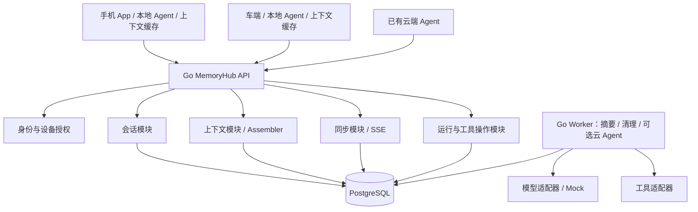
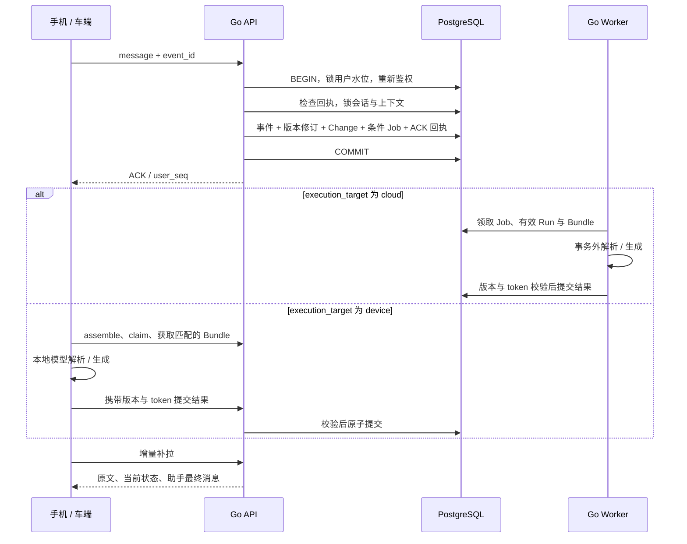

# MemoryHub 一期云侧详细设计：Go 会话与上下文服务

版本：1.3 ｜ 日期：2026-10-01 ｜ 状态：设计稿，可用于 Demo 开发与评审。

当前实施基线已更新为 [一期设计 v2](phase1-memory-system-design-v2.md)。本文保留核心 DDL 与 Go 示例；输入处理、离线冲突、reported 历史、Run 来源校验和新增时间表以 v2 为准。

本文属于设计的云侧大块，当前重点实施 Go 服务。交付内容是云侧详细设计、DDL、接口契约和 Go 实现骨架；尚未实现、编译、部署或压测服务。整体边界见 [一期总览](phase1-memory-system-design.md)，端侧职责与后续简单 Demo 见 [端侧简要方案](phase1-edge-demo-design.md)。端侧具体缓存、离线队列、原生 App 和车机实现不属于当前云侧交付。

## 1. 目标、边界与关键决策

### 1.1 一期解决的问题

同一用户在手机 App、车端和云端 Agent 之间切换时，能够读取同一逻辑会话的历史，恢复同一任务的当前状态，并继续交互。先做好会话与上下文，不建设跨无关会话的长期偏好提炼或知识图谱。

**Agent 可以运行在手机、车辆或云端。MemoryHub 是独立的上下文与会话服务，向各类 Agent 提供 Context Bundle、记录写入、版本校验和同步。云端模型执行是可选能力；弱网/离线车端可以基于已缓存 Bundle 使用本地模型处理请求。**

| 决策 | 一期选择 | 原因 |
| --- | --- | --- |
| 云侧开发语言 | Go | HTTP 服务、后台任务、连接管理采用统一工程 |
| 服务形态 | 模块化单体；API、Worker 两种启动模式 | 共享业务规则，减少分布式事务；Demo 可以同进程运行 |
| 主数据库 | PostgreSQL，一个实例、分表 | 保存会话、上下文、同步日志与后台任务 |
| MySQL | 可替代实现；一期只实现一种数据库适配 | 一期能力不依赖向量检索；避免为了兼容同时维护两套 SQL |
| 端侧接入 | 上下文获取、在线端 Agent、离线执行导入契约；Demo 后续实施 | 云侧验收先模拟端 Agent；本地模型、缓存和队列另行实施 |
| 同步 | HTTP 快照 / 增量 + SSE 通知 | 增量是可靠数据通道，通知是低延迟提示 |
| 后台任务 | PostgreSQL Outbox + 租约 Worker | 业务修改与任务创建原子提交 |
| 模型调用 | 端侧本地模型、外部云 Agent、可选 Go Worker | 上下文读取不调用生成模型；云端关闭 Agent Worker 后仍可服务端 Agent |
| 大文件 | 二阶段启用对象存储 | 最小 Demo 只使用文字；媒体元数据预留引用 |
| Redis / Kafka / 向量库 | 一期不作为依赖 | 小规模 Demo 无需增加这些运维组件 |

Go 使用受支持的稳定版本，依赖在实际开发时固定到 `go.mod` / `go.sum`；本文不声明某个具体补丁版为最新版本。

### 1.2 交付范围

云侧必须实现：会话创建与历史、用户消息幂等提交、上下文结构化状态、来源追踪、可缓存的 Context Bundle、在线端 Agent 执行权与结果提交、离线执行记录导入与重校验、快照 / 增量 / SSE、后台摘要、删除与隔离。云端 Agent 执行器可选，执行权和写入规则由 MemoryHub 统一维护。

当前验收使用 Go 集成测试或 HTTP 测试驱动模拟手机 / 车辆 device_id，不依赖端侧 App 或本地数据库。SQLite、发送队列、客户端同步应用和断网 / 重启恢复放在端侧文档，后续单独实现。

Demo 首先使用文本输入和无副作用工具，例如时间或路线查询 Mock。涉及导航启动、预约、支付等真实外部动作时，必须实现工具授权、外部幂等 / 查询结果和未知结果处理后再接入。

“完整上下文”表示授权历史可以补读、当前任务状态可以恢复、给模型的输入可以按预算组装，不表示每轮把所有历史塞进模型窗口。离线设备只能看到已同步内容。

在线从云端获取指定水位的权威上下文；离线用缓存上下文和本地新事件形成临时分支。离线分支可以本地回复，但不能被视为已提交到全局状态，也不能保证包含其他设备在断网期间的新修改。

### 1.3 业务对象

- **会话 Conversation**：一段逻辑对话，可以跨设备；换连接不创建新会话。
- **上下文 Context**：当前工作状态。普通聊天是会话作用域，业务任务是任务作用域。
- **事件 Event**：用户消息、助手最终回复、工具调用 / 结果、中断等事实。
- **运行 Run**：Agent 对一次输入或一组尚未解释输入的处理尝试。
- **端侧执行 DeviceExecution**：端 Agent 上报的本地执行记录与状态建议；离线记录没有有效云端租约，需导入和重校验。
- **同步变化 Change**：一次已提交业务变更的公开投影，供设备补拉。

新会话继续旧任务时，显式绑定已有任务上下文。多个会话绑定同一个上下文仍保持各自历史，模型组装时按来源关系读取。

## 2. 总体架构



### 2.1 进程与模块职责

| 模块 | 输入 | 输出 | 禁止承担的职责 |
| --- | --- | --- | --- |
| transport/http | HTTP、认证后的 Principal | DTO、状态码、SSE | 不直接拼业务事务 |
| session | 消息与会话命令 | 事件、会话序号 | 不让客户端伪造工具成功 |
| contextstate | 合法状态命令 | 当前状态、版本、修订记录 | 不执行模型推理 |
| assembler | 上下文 ID、最低水位、预算 | Context Bundle | 不修改业务状态 |
| sync | 授权范围、游标 | 快照、Changes、通知 | 不依赖 SSE 的可靠投递 |
| run | 领取、续租、取消、结果 | 有效执行权、运行状态 | 不把租约当成外部工具事务 |
| worker | 已提交 Outbox Job | 解析、回复、摘要、清理 | 不在 SQL 锁内调用模型 |
| store/postgres | 类型化查询、事务 | 数据与数据库错误 | 不自行判断用户业务权限 |

所有会改变用户公开状态的代码必须走统一 `MutationService`，由它维护锁顺序、版本、水位和同步变化。单独续租和 Job 调度属于内部运行维护，不产生公开上下文版本。

### 2.2 推荐 Go 工具

| 项目 | 选择 | 使用方式 |
| --- | --- | --- |
| HTTP | 标准库 `net/http` | API 与 SSE；用显式路由注册和中间件 |
| JSON / 日志 | `encoding/json`、`log/slog` | 类型化 DTO；结构化日志默认不写消息正文 |
| PostgreSQL | `pgx/v5` + `pgxpool` | 显式 SQL、连接池、事务 [R1] |
| 查询代码生成 | `sqlc`，可选 | 从查询 SQL 生成 Go 类型；事务使用生成的 `WithTx` [R2] |
| 数据库迁移 | `golang-migrate` 或团队现有工具 | 独立迁移命令；启动 API 不竞态执行迁移 [R6] |
| 标识 | 随机 UUID 的字符串表示 | ID 用于去重；同步按提交序号，时间线按事件时间与因果关系 |
| 认证 | 对接现有 JWT / OIDC | 校验签名、issuer、audience、过期时间与权限；Demo 使用专门的开发凭证签发命令 |
| 模型与工具 | 自建 Go interface | Provider Adapter 实现；先提供可重复的 Mock |

不使用通用 ORM 隐藏关键锁操作。普通查询可以代码生成，用户水位、版本条件和 Job 领取仍要能直接评审 SQL。

## 3. 数据隔离、版本与一致性规则

### 3.1 身份与查询隔离

`tenant_id`、`user_id` 从已验证凭证取得，不能信任请求体中的用户 ID。`device_id` 必须属于该用户且未撤销；云端 Agent 使用服务 audience / scope，端 Agent 使用绑定用户、设备和 agent 实例的设备凭证及 `context:read` / `device_agent:execute` 权限，不能使用内部服务凭证。

Scope Resolver 在 Demo 中只实现“本人明确绑定设备的个人数据范围”，scope_key 从服务端设备记录读取，不允许客户端自选更宽范围。正式接共享车辆时新增设备到允许 context_id 的授权映射与撤销事务；在该映射和逐操作过滤完成前，不向共享车端开放服务。

数据库主键与外键均带 `tenant_id, user_id`，阻止跨用户错误关联；SQL 查询也显式带这两个条件。不存在与越权对象统一返回 404。请求内容中的 `actor_type`、成功结果与管理员字段不允许由普通设备自由提交。

端 Agent 通过专用接口报告助手回复和工具观察结果，服务端设置 actor 与 origin，并校验允许的事件类型、来源和 owner。已认证设备可以证明记录由该设备上报，不能据此证明外部工具执行成功；需要可信回执或业务规则核验。

最小 Demo 只给用户明确绑定的个人手机和个人车辆开放统一用户数据范围。公共 / 共享车辆只授权选定任务，不能沿用全用户同步范围；同步范围以服务端保存的 `scope_key` 标识，游标绑定该范围。范围内任何可见性变化都增加 `policy_epoch` 并要求重新快照。

### 3.2 版本含义

| 字段 | 含义 | 更新场景 |
| --- | --- | --- |
| `user_seq` | 用户公开变更提交顺序 | 每次公开业务 Mutation 分配一次 |
| `conv_seq` | 会话事件在云端追加的顺序 | 每个新增事件递增一次；不作为真实发生顺序 |
| `context_version` | 影响下一步行为的状态版本 | 新输入、字段确认、取消、执行位置切换、接受的工具结果 |
| `summary_version` | 已发布历史压缩版本 | 摘要覆盖范围有效推进 |
| `source_revision` | 上下文来源集合的版本 | 绑定 / 移除来源、来源删除 |
| `fencing_token` | 上下文有效执行权代次 | 领取、接管、输入中断、取消 |
| `policy_epoch` | 用户可见性版本 | 授权变更、删除、设备撤销 |

内部 Job 续租、Agent 续租不递增 `context_version`。摘要不改变业务字段，不使有效 Run 因纯压缩而失效。

### 3.3 提交顺序

所有公开写事务按固定顺序锁：

```text
user_stream_heads → conversations（ID 顺序）→ contexts（ID 顺序）
→ agent_runs → tool_operations → 本次关联 Job
```

单用户公开写在一行水位锁下串行化。高频写入时这会限制单用户吞吐，一期接受这个取舍；不同用户可以并行。

`committed_seq` 在事务内更新，回滚也回滚序号更新。事务 T2 必须等待 T1 的水位锁释放，之后才能分配该用户下一序号，因此读取已提交流不会跳过较晚提交的低序号。**不能把 PostgreSQL sequence / 自增 ID 当成提交游标。** 这是本设计的算法；隔离与行锁语义来自官方文档。[R3][R4]

每个 Mutation 对应一个 `sync_changes` Envelope，可以包含多个事件和实体更新；同事务中的多个事件共享 `user_seq`，但各有不同 `conv_seq`。因此只对 `sync_changes` 的用户序号做唯一约束。

### 3.4 三种一致性

1. **单次写入原子性**：事件、上下文修订、同步 Change、后台 Job、幂等回执同事务提交。
2. **读取一致性**：快照与 Bundle 从主库短 `REPEATABLE READ` 事务读取同一水位，不在该事务内调用模型。
3. **跨端同步契约**：云侧保存可重放 Changes、签发游标并支持重复补拉；调用方完整应用变化后再推进游标。端侧具体应用方式见端侧文档。

一期所有一致性读取走主库。将来引入只读副本时，必须处理 `min_user_seq` 和副本延迟，不能把主库 ACK 后的最低可见性承诺交给未追平的副本。

### 3.5 提交日志与真实时间线分开

user_seq/conv_seq 保证可靠同步和日志重放；展示层不再直接按 conv_seq 表达发生先后。端侧和云 Agent 捕获事件发生时间、时钟分段/单调时间、跨批流序号与因果父引用，云侧评估校准时间和误差后构建独立 timeline。

同流和明确因果顺序优先保证；不同设备的可信误差区间不重叠时可以判定物理先后，重叠或无可靠时间源时标记先后不确定。离线补传允许插入历史展示位置，但不改写提交序号，不让旧状态建议覆盖当前 Context。

时序扩展、probe/calibration、排序图、固定水位分页、晚到刷新与摘要失效详见 [会话时间线补充设计](phase1-timeline-ordering-design.md)。本版本增加的是设计契约，尚未实现授时或保证特定精度。

## 4. 存储模型与 PostgreSQL DDL

会话与上下文共用一个数据库。以下是一期核心结构，可作为首版迁移的起点；上线前仍需结合实际字段验证迁移、索引和查询计划。ID 使用 `text` 存放 UUID 字符串，应用限制长度和格式；示例中的简短 ID 便于阅读。

### 4.1 用户水位与设备

```sql
CREATE TABLE user_stream_heads (
    tenant_id text NOT NULL,
    user_id text NOT NULL,
    committed_seq bigint NOT NULL DEFAULT 0 CHECK (committed_seq >= 0),
    min_available_seq bigint NOT NULL DEFAULT 1,
    policy_epoch bigint NOT NULL DEFAULT 1,
    updated_at timestamptz NOT NULL DEFAULT now(),
    PRIMARY KEY (tenant_id, user_id)
);

CREATE TABLE devices (
    tenant_id text NOT NULL,
    user_id text NOT NULL,
    device_id text NOT NULL,
    kind text NOT NULL CHECK (kind IN ('phone', 'car', 'web')),
    status text NOT NULL DEFAULT 'active'
        CHECK (status IN ('active', 'revoked')),
    scope_key text NOT NULL,
    created_at timestamptz NOT NULL DEFAULT now(),
    last_seen_at timestamptz,
    PRIMARY KEY (tenant_id, user_id, device_id),
    FOREIGN KEY (tenant_id, user_id)
        REFERENCES user_stream_heads (tenant_id, user_id)
);
```

`min_available_seq` 是当前可以补拉的最早 Change 序号。同步日志清理只能截断前缀；当 `cursor.seq < min_available_seq - 1` 时要求重新快照。

### 4.2 上下文、会话和来源

```sql
CREATE TABLE contexts (
    tenant_id text NOT NULL,
    user_id text NOT NULL,
    context_id text NOT NULL,
    scope_type text NOT NULL CHECK (scope_type IN ('conversation', 'task')),
    task_id text,
    status text NOT NULL DEFAULT 'active',
    context_version bigint NOT NULL DEFAULT 0,
    summary_version bigint NOT NULL DEFAULT 0,
    source_revision bigint NOT NULL DEFAULT 1,
    latest_input_seq bigint NOT NULL DEFAULT 0,
    latest_change_seq bigint NOT NULL DEFAULT 0,
    state_json jsonb NOT NULL DEFAULT '{}',
    execution_target text NOT NULL DEFAULT 'device'
        CHECK (execution_target IN ('device', 'cloud')),
    fencing_token bigint NOT NULL DEFAULT 0,
    active_run_id text,
    created_at timestamptz NOT NULL DEFAULT now(),
    updated_at timestamptz NOT NULL DEFAULT now(),
    deleted_at timestamptz,
    PRIMARY KEY (tenant_id, user_id, context_id),
    FOREIGN KEY (tenant_id, user_id)
        REFERENCES user_stream_heads (tenant_id, user_id),
    CHECK (scope_type <> 'task' OR task_id IS NOT NULL)
);

CREATE TABLE conversations (
    tenant_id text NOT NULL,
    user_id text NOT NULL,
    conversation_id text NOT NULL,
    context_id text NOT NULL,
    title text NOT NULL DEFAULT '',
    status text NOT NULL DEFAULT 'active'
        CHECK (status IN ('active', 'archived', 'deleted')),
    head_seq bigint NOT NULL DEFAULT 0,
    latest_change_seq bigint NOT NULL DEFAULT 0,
    created_at timestamptz NOT NULL DEFAULT now(),
    updated_at timestamptz NOT NULL DEFAULT now(),
    deleted_at timestamptz,
    PRIMARY KEY (tenant_id, user_id, conversation_id),
    FOREIGN KEY (tenant_id, user_id, context_id)
        REFERENCES contexts (tenant_id, user_id, context_id)
);

CREATE TABLE context_sources (
    tenant_id text NOT NULL,
    user_id text NOT NULL,
    context_id text NOT NULL,
    conversation_id text NOT NULL,
    bound_at_seq bigint NOT NULL,
    removed_at_seq bigint,
    PRIMARY KEY (tenant_id, user_id, context_id, conversation_id),
    FOREIGN KEY (tenant_id, user_id, context_id)
        REFERENCES contexts (tenant_id, user_id, context_id),
    FOREIGN KEY (tenant_id, user_id, conversation_id)
        REFERENCES conversations (tenant_id, user_id, conversation_id)
);

CREATE TABLE context_revisions (
    tenant_id text NOT NULL,
    user_id text NOT NULL,
    context_id text NOT NULL,
    version bigint NOT NULL,
    user_seq bigint NOT NULL,
    cause_event_id text,
    schema_version integer NOT NULL DEFAULT 1,
    state_json jsonb NOT NULL,
    execution_target text NOT NULL
        CHECK (execution_target IN ('device', 'cloud')),
    created_at timestamptz NOT NULL DEFAULT now(),
    PRIMARY KEY (tenant_id, user_id, context_id, version),
    FOREIGN KEY (tenant_id, user_id, context_id)
        REFERENCES contexts (tenant_id, user_id, context_id)
);

CREATE INDEX conversations_recent_idx
    ON conversations (tenant_id, user_id, updated_at DESC, conversation_id);
CREATE INDEX contexts_active_idx
    ON contexts (tenant_id, user_id, status, updated_at DESC);
CREATE INDEX sources_by_conversation_idx
    ON context_sources (tenant_id, user_id, conversation_id);
```

新建普通会话时同时创建上下文、version=0 的初始修订和来源关系。创建另一段会话绑定旧上下文时，只允许任务作用域；会话作用域不能被第二段会话隐式复用。

execution_target 属于影响行为的配置，随 context_version 更新并保存在修订中，公开 Context 投影和 Bundle 也携带该字段。

一期绑定发生后，该上下文可以读取绑定会话中当前获授权的完整历史；`bound_at_seq` 是关系变更的同步时间，不是自动过滤此前消息的下限。

### 4.3 原始事件

```sql
CREATE TABLE conversation_events (
    tenant_id text NOT NULL,
    user_id text NOT NULL,
    event_id text NOT NULL,
    conversation_id text NOT NULL,
    context_id text NOT NULL,
    user_seq bigint NOT NULL,
    conv_seq bigint NOT NULL,
    event_type text NOT NULL,
    actor_type text NOT NULL CHECK (actor_type IN ('user', 'agent', 'system', 'tool')),
    device_id text,
    run_id text,
    turn_id text,
    reply_to_event_id text,
    status text NOT NULL DEFAULT 'final',
    content_json jsonb NOT NULL,
    metadata_json jsonb NOT NULL DEFAULT '{}',
    source_time timestamptz,
    accepted_at timestamptz NOT NULL DEFAULT now(),
    deleted_at timestamptz,
    PRIMARY KEY (tenant_id, user_id, event_id),
    UNIQUE (tenant_id, user_id, conversation_id, conv_seq),
    FOREIGN KEY (tenant_id, user_id, conversation_id)
        REFERENCES conversations (tenant_id, user_id, conversation_id),
    FOREIGN KEY (tenant_id, user_id, context_id)
        REFERENCES contexts (tenant_id, user_id, context_id)
);

CREATE INDEX events_by_context_idx
    ON conversation_events (tenant_id, user_id, context_id, user_seq, event_id);
```

`context_id` 保存事件写入当时的上下文归属，用于审计；Assembler 读取来源时以当前 `context_sources` 为准，避免后续显式关联漏掉历史。原始追加日志/同步稳定排序使用 `(user_seq, conversation_id, conv_seq)`。用户对话时间线与模型历史段使用独立的事件时间/因果读模型，详见第 3.5 节及时间线补充设计。

`metadata_json` 保存 timezone、observed_context_version、offline、client_parent_event_id 和 requires_revalidation 等语义与重放信息。来源时间和元数据落库，不能只用于当次 Handler 后丢弃。

消息、端 Agent 结果与离线事件 DTO 增加 timing 子对象，保存 origin/boot/clock_segment、stream_seq、monotonic_ns、calibration_ref 和 causal_parent_event_ids，规范化后落入 metadata_json。校准后的时间区间/time_quality 由云侧评估生成，不接受设备自行声明 bounded；新增评估追加 event_time_assessed，不重写原始事件。

事件类型注册表至少包含：`user_message`、`assistant_message`、`tool_call`、`tool_result`、`run_interrupted`、`context_command`、`device_execution_reconciled`、`event_time_assessed`。客户端消息接口只能写 `user_message`，其他类型使用有权限的服务端路径。临时 ASR 与流式 token 不逐条写成权威事实。

### 4.4 摘要

```sql
CREATE TABLE context_summaries (
    tenant_id text NOT NULL,
    user_id text NOT NULL,
    context_id text NOT NULL,
    summary_version bigint NOT NULL,
    source_revision bigint NOT NULL,
    covered_user_seq bigint NOT NULL,
    source_event_ids jsonb NOT NULL,
    summary_json jsonb NOT NULL,
    prompt_version text NOT NULL,
    status text NOT NULL CHECK (status IN ('published', 'invalidated')),
    created_at timestamptz NOT NULL DEFAULT now(),
    PRIMARY KEY (tenant_id, user_id, context_id, summary_version),
    FOREIGN KEY (tenant_id, user_id, context_id)
        REFERENCES contexts (tenant_id, user_id, context_id)
);
```

一期摘要从关联会话中读取一个稳定前缀，只覆盖 `user_seq <= covered_user_seq` 的完整事件窗口。窗口中的未完成工具链、尚未解释输入和中断输出不被当作完成事实。不能只记录最高序号却跳过中间重要消息；发布的摘要必须带完整来源集合。来源集合变化后失效重建，当前结构化字段始终高于摘要中的旧字段。

### 4.5 同步变化与幂等回执

```sql
CREATE TABLE sync_changes (
    tenant_id text NOT NULL,
    user_id text NOT NULL,
    user_seq bigint NOT NULL,
    change_type text NOT NULL,
    scope_refs jsonb NOT NULL,
    policy_epoch bigint NOT NULL,
    payload_json jsonb NOT NULL,
    created_at timestamptz NOT NULL DEFAULT now(),
    PRIMARY KEY (tenant_id, user_id, user_seq),
    FOREIGN KEY (tenant_id, user_id)
        REFERENCES user_stream_heads (tenant_id, user_id)
);

CREATE TABLE mutation_receipts (
    tenant_id text NOT NULL,
    user_id text NOT NULL,
    request_id text NOT NULL,
    operation text NOT NULL,
    request_hash bytea NOT NULL,
    response_json jsonb NOT NULL,
    user_seq bigint NOT NULL,
    created_at timestamptz NOT NULL DEFAULT now(),
    PRIMARY KEY (tenant_id, user_id, request_id),
    FOREIGN KEY (tenant_id, user_id)
        REFERENCES user_stream_heads (tenant_id, user_id)
);

CREATE TABLE device_sync_state (
    tenant_id text NOT NULL,
    user_id text NOT NULL,
    device_id text NOT NULL,
    scope_key text NOT NULL,
    applied_seq bigint NOT NULL DEFAULT 0,
    policy_epoch bigint NOT NULL,
    updated_at timestamptz NOT NULL DEFAULT now(),
    PRIMARY KEY (tenant_id, user_id, device_id, scope_key),
    FOREIGN KEY (tenant_id, user_id, device_id)
        REFERENCES devices (tenant_id, user_id, device_id)
);
```

`request_id` 在整个用户 Mutation 命名空间唯一。用户消息使用 event_id；命令使用 command_id；创建会话使用 Idempotency-Key。Hash 覆盖操作类型、目标对象和规范化 DTO，不包含服务器收到时间。保留字符串原意，不做破坏语义的文本归一化。

同 ID、同请求返回原 ACK；同 ID、不同请求返回 409。幂等检查发生在对象授权之后，已删除对象的旧回执不得返回包含已删除内容的数据。回执只保存无正文 ACK，Demo 不清理回执；正式保留期必须覆盖支持的重试窗口。

`sync_changes` 是有内容的公开投影，不是只存 event_id 的通知表。否则旧 Change 引用最新可变状态会破坏重放顺序。公开投影不保存凭证、内部检查点或隐藏推理过程。

### 4.6 Outbox Job

```sql
CREATE TABLE outbox_jobs (
    job_id text PRIMARY KEY,
    tenant_id text NOT NULL,
    user_id text NOT NULL,
    kind text NOT NULL,
    dedupe_key text NOT NULL,
    payload_json jsonb NOT NULL,
    state text NOT NULL DEFAULT 'pending'
        CHECK (state IN ('pending', 'running', 'done', 'dead')),
    attempts integer NOT NULL DEFAULT 0,
    lease_token bigint NOT NULL DEFAULT 0,
    lease_owner text,
    lease_until timestamptz,
    available_at timestamptz NOT NULL DEFAULT now(),
    last_error_code text,
    created_at timestamptz NOT NULL DEFAULT now(),
    updated_at timestamptz NOT NULL DEFAULT now(),
    UNIQUE (tenant_id, user_id, kind, dedupe_key),
    FOREIGN KEY (tenant_id, user_id)
        REFERENCES user_stream_heads (tenant_id, user_id)
);

CREATE INDEX jobs_pending_idx ON outbox_jobs (available_at, job_id)
    WHERE state = 'pending';
CREATE INDEX jobs_expired_idx ON outbox_jobs (lease_until, job_id)
    WHERE state = 'running';
```

Job 类型：`agent_wakeup`、`summarize_context`、`purge_content`。SSE 通过轮询已提交用户水位唤醒，无需为每条消息持久化一个通知 Job。Job payload 只保存 ID / 水位，不复制大量正文。

### 4.7 Agent 运行与工具操作

```sql
CREATE TABLE agent_runs (
    tenant_id text NOT NULL,
    user_id text NOT NULL,
    run_id text NOT NULL,
    context_id text NOT NULL,
    trigger_event_id text NOT NULL,
    executor_kind text NOT NULL CHECK (executor_kind IN ('device', 'cloud')),
    executor_device_id text,
    base_context_version bigint NOT NULL,
    accepted_context_version bigint NOT NULL,
    fencing_token bigint NOT NULL,
    attempt integer NOT NULL DEFAULT 1,
    status text NOT NULL CHECK (status IN
        ('running', 'succeeded', 'failed', 'cancelled', 'superseded')),
    lease_owner text NOT NULL,
    lease_until timestamptz NOT NULL,
    checkpoint_ref text,
    last_error_code text,
    created_at timestamptz NOT NULL DEFAULT now(),
    updated_at timestamptz NOT NULL DEFAULT now(),
    CHECK ((executor_kind = 'device' AND executor_device_id IS NOT NULL)
        OR (executor_kind = 'cloud' AND executor_device_id IS NULL)),
    PRIMARY KEY (tenant_id, user_id, run_id),
    FOREIGN KEY (tenant_id, user_id, context_id)
        REFERENCES contexts (tenant_id, user_id, context_id)
);

CREATE UNIQUE INDEX one_running_run_per_context_idx
    ON agent_runs (tenant_id, user_id, context_id)
    WHERE status = 'running';

CREATE TABLE tool_operations (
    tenant_id text NOT NULL,
    user_id text NOT NULL,
    operation_id text NOT NULL,
    context_id text NOT NULL,
    run_id text NOT NULL,
    tool_name text NOT NULL,
    input_context_version bigint NOT NULL,
    external_idempotency_key text NOT NULL,
    state text NOT NULL CHECK (state IN
        ('planned', 'awaiting_authorization', 'executing',
         'succeeded', 'failed', 'unknown', 'cancelled')),
    input_json jsonb NOT NULL,
    result_json jsonb,
    observed_at timestamptz,
    updated_at timestamptz NOT NULL DEFAULT now(),
    PRIMARY KEY (tenant_id, user_id, operation_id),
    UNIQUE (tenant_id, user_id, tool_name, external_idempotency_key),
    FOREIGN KEY (tenant_id, user_id, context_id)
        REFERENCES contexts (tenant_id, user_id, context_id),
    FOREIGN KEY (tenant_id, user_id, run_id)
        REFERENCES agent_runs (tenant_id, user_id, run_id)
);
```

`active_run_id`、Run 的 context_id、版本和 token 的匹配由同一 Mutation 事务维护。过期运行接管时先处置旧 running 记录再领取新 token，不能依赖只看 lease 时间的部分唯一索引。

device Run 的 executor_device_id 必须与认证设备一致，lease_owner 由设备/agent 实例派生；cloud Run 绑定服务实例。客户端不能指定任意 owner，服务端提交校验不能仅凭 run_id 或 token。

工具结果保存实际观察事实。迟到结果即使属于过期 Run，也可能证明外部操作已成功：允许受限的 reconciliation 路径记录其审计结果和提醒，但不让它覆盖当前任务目标或生成当前成功回复。

### 4.8 端侧离线执行记录

```sql
CREATE TABLE device_executions (
    tenant_id text NOT NULL,
    user_id text NOT NULL,
    execution_id text NOT NULL,
    device_id text NOT NULL,
    conversation_id text NOT NULL,
    context_id text NOT NULL,
    base_context_version bigint NOT NULL,
    base_source_revision bigint NOT NULL,
    base_policy_epoch bigint NOT NULL,
    imported_context_version bigint NOT NULL,
    base_was_current boolean NOT NULL,
    status text NOT NULL CHECK (status IN
        ('imported', 'reconciled', 'needs_revalidation', 'rejected')),
    trace_json jsonb NOT NULL,
    proposal_json jsonb NOT NULL,
    created_at timestamptz NOT NULL DEFAULT now(),
    updated_at timestamptz NOT NULL DEFAULT now(),
    PRIMARY KEY (tenant_id, user_id, execution_id),
    FOREIGN KEY (tenant_id, user_id, device_id)
        REFERENCES devices (tenant_id, user_id, device_id),
    FOREIGN KEY (tenant_id, user_id, conversation_id)
        REFERENCES conversations (tenant_id, user_id, conversation_id),
    FOREIGN KEY (tenant_id, user_id, context_id)
        REFERENCES contexts (tenant_id, user_id, context_id)
);
```

trace/proposal 是未经自动采纳的设备上报内容。trace 只包含可展示消息、工具观察和因果关系，不保存隐藏推理、凭证或模型内部 KV Cache。单批最多 100 个事件且受 256 KiB 请求上限约束；超限按因果顺序拆成多个导入批次，保留真实缓存基准，父事件先导入。后续批次因前次导入推进版本而进入重校验；整段历史导入后用最新 Bundle 重解释，不伪造新基准或自动跨批合并旧建议。

原始对话仍写 `conversation_events`，设备执行表负责基准、导入结果和状态建议。一个导入事务可以追加多个事件：同一 user_seq，不同 conv_seq。`metadata_json` 保存 origin=device_agent、execution_id、local_seq、parent_event_id、离线标记和 trust_level=reported；设备时间不决定全局提交顺序；经校准的时间和因果关系决定独立的展示时间线。

离线助手与工具事件使用 status=reported。历史可展示并明确标注“端侧历史/待重校验”，默认不进入其他 Agent 的执行上下文；采纳关系由执行记录状态及第 8.5 节的系统事件表示，不修改原文或原始来源标签。用户原文保留并加入待解释列表。删除与内容清理也必须覆盖该表的 trace/proposal。

## 5. 上下文状态契约

```json
{
  "schema_version": 1,
  "goal": {"text": "规划去杭州的行程", "source_event_id": "evt_01"},
  "slots": {
    "destination": {
      "value": "杭州",
      "status": "confirmed",
      "source_event_ids": ["evt_01"]
    },
    "departure_time": {
      "value": "2026-10-03T08:00:00+08:00",
      "status": "confirmed",
      "source_event_ids": ["evt_01", "evt_02"]
    }
  },
  "constraints": [],
  "pending_actions": [],
  "pending_interpretation_event_ids": [],
  "last_handled_input_seq": "12",
  "task_status": "awaiting_confirmation"
}
```

| 字段 | 规则 |
| --- | --- |
| goal | 当前目标；不能由历史摘要覆盖 |
| slots | 只接受注册字段；value 必须匹配该任务的字段 schema |
| status | `proposed` / `confirmed` / `invalidated`；确认方式由业务规则决定 |
| source_event_ids | 必须属于当前获授权来源；删除来源后字段重新校验 |
| constraints | 当前任务作用域；一期不自动升级为长期偏好 |
| pending_actions | 指向真实 operation_id，不以模型文字当执行结果 |
| pending_interpretation_event_ids | 输入已保存但语义尚未接受；阻止旧计划继续执行 |
| last_handled_input_seq | 本上下文已解释输入的最高水位，不等于全用户水位 |
| task_status | `active` / `awaiting_confirmation` / `completed` / `cancelled` / `needs_revalidation` |

字段名称必须按任务类型注册，不能让模型任意生成 SQL 字段名。未知字段返回 schema 错误，保留原消息并进入澄清。

需要用户确认的槽位提案保存在 state_json.pending_proposals 中，包含 proposal_id、字段、候选值、来源和创建版本；确认命令只能引用当前仍有效提案。提案数量与状态大小有上限，过期 / 被替代提案失效。

相对日期使用事件发生时间、时区和时间质量解释；时间估计不可靠时保持待确认。source_time 保留原始值，云端提交顺序仍按 user_seq，对话展示按时间线读模型。设备时间偏差、离线过期输入或时区缺失时标记不确定，不直接执行定时操作。

## 6. HTTP API 契约

### 6.1 通用规则

- 路径前缀 `/v1`，JSON 使用 snake_case，时间为 RFC3339，服务端以 UTC 存储。
- `Authorization: Bearer ...`；`X-Request-ID` 仅用于追踪，不能替代幂等 ID。
- 创建资源和删除使用 `Idempotency-Key`；消息 / 命令 ID 在 body 中，二者如同时出现必须一致。
- 默认 JSON body 上限 256 KiB，文本消息上限 32 KiB，历史分页最大 200 条；超过限制返回明确错误。
- 64 位序号与版本在 JSON 中使用十进制字符串，避免 JS 客户端大整数精度问题。
- 客户端不能自行指定 user_seq、conv_seq、actor_type、owner 或分配 fencing_token；Run 续租/提交只能回传服务器已签发的 token，不能借此改变执行权。
- 增量、快照和历史必须标注授权范围；历史分页不是端侧已完整缓存历史的声明。

### 6.2 供设备调用的云侧接口

| 方法与路径 | 用途 | 一期关键语义 |
| --- | --- | --- |
| `POST /v1/conversations` | 创建会话 | 普通聊天新建上下文，或显式绑定任务上下文 |
| `GET /v1/conversations` | 会话列表 | keyset 分页，排序键 updated_at + ID；列表分页不作为同步通道 |
| `GET /v1/conversations/{id}` | 会话元数据 | 返回 context_id、head_seq、状态 |
| `POST /v1/conversations/{id}/messages` | 用户消息 | 幂等持久化；返回 ACK，Agent 异步处理 |
| `GET /v1/conversations/{id}/events` | 原始追加日志 | after_conv_seq 或 before_conv_seq，二者互斥 |
| `GET /v1/conversations/{id}/timeline` | 真实时间线读模型 | 固定水位分页，时间估计/误差和因果排序；先后不确定时明示 |
| `POST /v1/time/probes`、`POST /v1/time/calibrations` | 设备时间校准 | 认证时间探测、校准证据持久化；不产生执行权 |
| `POST /v1/contexts` | 创建任务上下文 | task_id 来自业务模块或服务生成 |
| `GET /v1/contexts/{id}` | 当前结构化上下文 | 当前版本，不做模型调用 |
| `GET /v1/contexts/active` | 可接续任务列表 | 只返回授权活动对象 |
| `POST /v1/contexts/{id}/assemble` | 上下文组装 | min_user_seq、输入预算、短期设备环境 |
| `POST /v1/contexts/{id}/commands` | 结构化用户命令 | 白名单命令 + expected_context_version，不能直接替换 state_json |
| `POST /v1/runs/{id}/cancel` | 取消指定运行 | 只影响目标 run；旧 ID 不得取消后来启动的 run |
| `GET /v1/runs/{id}` | 运行公共状态 | 不返回 owner 凭证、内部检查点 |
| `POST /v1/sync/snapshot` | 初次 / 重置同步 | 有界、单响应的一致快照 |
| `GET /v1/sync/changes` | 增量补拉 | 签名 cursor、limit，返回 next_cursor |
| `POST /v1/sync/ack` | 确认已应用 | 单调推进，不超过服务签发水位 |
| `GET /v1/sync/notifications` | SSE 变化通知 | 提示最高水位，内容仍走补拉 |
| `DELETE /v1/conversations/{id}` | 删除会话 | 立即拒绝读取，异步内容清理 |

`messages` 取代前文泛化的客户端 `/events` 写接口，使普通设备无法上传伪造的助手 / 工具事件。历史仍使用 `/events` 读取。

端 Agent 不通过普通 `/messages` 伪装助手消息，使用第 6.7 节的受限结果/离线导入接口。上下文读取和组装面向获授权的手机、车端与云端 Agent 开放，不要求使用云端模型。

### 6.3 创建与消息示例

```json
{
  "title": "杭州行程",
  "execution_target": "device",
  "scope_type": "task",
  "context_id": "ctx_trip"
}
```

上例表示绑定已存在且获授权的任务上下文；缺省 context_id 时 `POST /conversations` 创建会话级上下文，不允许调用者同时指定矛盾的 scope_type。任务上下文先通过 `/contexts` 创建。

新上下文默认 execution_target=device；创建时可显式选择 cloud。绑定已有任务时采用该任务已有配置，传入不一致目标返回 409。`set_execution_target` 是需版本校验的用户命令，切换时使旧 Run 失效；切到 cloud 且仍有 pending 输入时才创建 agent_wakeup，切到 device 后云端 Job 不再领取执行权。端侧离线执行不会暗中切换云端配置。

用户消息请求：

```json
{
  "event_id": "evt_02",
  "device_id": "phone_01",
  "content": {"type": "text", "text": "改成后天早上八点"},
  "observed_context_version": "7",
  "source_time": "2026-10-01T10:00:00+08:00",
  "timezone": "Asia/Shanghai",
  "offline": false,
  "client_parent_event_id": "evt_01"
}
```

ACK，首次提交返回 202，重复提交返回 200 和相同的业务回执：

```json
{
  "event_id": "evt_02",
  "conversation_id": "conv_trip",
  "context_id": "ctx_trip",
  "conv_seq": "5",
  "user_seq": "21",
  "context_version": "8",
  "interpretation_status": "pending",
  "requires_revalidation": false
}
```

ACK 不表示新日期已解析或工具已成功。`observed_context_version` 是阅读基准，不是阻止保存原文的强 CAS：原文可以接受，版本落后时标记重校验；结构化命令则必须严格 CAS。

未知 client_parent_event_id 返回 409 `parent_not_committed`，客户端先提交父输入，再依赖它提交后续输入。父输入属于其他用户或不可见会话时返回 404。

### 6.4 结构化命令

```json
{
  "command_id": "cmd_confirm_01",
  "conversation_id": "conv_trip",
  "expected_context_version": "9",
  "type": "confirm_slot",
  "args": {"slot": "departure_time", "proposal_id": "proposal_01"}
}
```

用户命令仅支持 `confirm_slot`、`cancel_task`、`resume_task`、`set_execution_target` 等注册动作。proposal_id 引用当前服务器保存的提案，不能依靠用户随意提交 source_event_id 伪造来源。Agent 内部解释命令使用另一组受限命令，如 `interpret_inputs`、`record_tool_outcome`。

命令会写入来源会话的 `context_command` 事件并更新状态、版本、同步 Change。用户命令如改变行为，应使旧 run 失效；cloud 模式继续执行创建新的唤醒 Job，device 模式由端 Agent 重新领取。恢复已取消任务必须显式确认当前字段，不直接执行取消前的外部操作。

### 6.5 错误契约

```json
{
  "error": {
    "code": "context_version_conflict",
    "message": "上下文已更新，请获取最新状态后重试",
    "request_id": "req_01",
    "retryable": false,
    "details": {"current_context_version": "10"}
  }
}
```

| HTTP | code | 客户端动作 |
| --- | --- | --- |
| 400 | invalid_argument / invalid_cursor | 修正请求，不原样无限重试 |
| 401 | unauthenticated | 刷新身份；失败时停止同步 |
| 403 | device_revoked / insufficient_scope | 清除相应本地授权数据或停止操作 |
| 404 | resource_not_found | 不暴露其他用户对象的存在 |
| 409 | idempotency_key_reused | 新请求使用新 ID，不能覆盖原事件 |
| 409 | context_version_conflict / stale_run | 获取新状态，重建计划 |
| 409 | run_busy / execution_requires_revalidation | 等待有效 Run 结束，或获取新 Bundle 重解释；不原样重放建议 |
| 409 | snapshot_required / policy_changed | 清除失效范围并重新快照 |
| 409 | parent_not_committed | 先提交父事件 |
| 413 | payload_too_large | 缩小文本或改为文件引用 |
| 422 | context_budget_exceeded / schema_mismatch | 调整窗口、拆分任务或澄清字段 |
| 429 | rate_limited | 按 Retry-After 退避 |
| 503 | database_unavailable / watermark_not_ready | 同 ID 有界重试，不显示已成功 |

`watermark_not_ready` 在主库正常读取时不应频繁发生；如客户端传入超出当前服务签发范围的水位，应先返回 400，而不是无限等待。

### 6.6 云端 Agent 适配接口

内置 Go Worker 直接调用同一 Service 方法，不绕一圈 HTTP。已有独立云端 Agent 通过下列受限内部接口接入；它与内置 Worker 只能竞争领取同一上下文执行权，不能各自生成并随意提交。

| 接口 | 输入要点 | 行为 |
| --- | --- | --- |
| `POST /internal/v1/contexts/{id}/runs/claim` | claim_request_id、触发事件、服务实例标识 | 无有效 Run 才领取；返回 run_id、attempt、token、accepted_version、租约期限 |
| `POST /internal/v1/runs/{id}/renew` | owner、attempt、token | 条件续租；过期 / 被替代返回 stale_run |
| `POST /internal/v1/runs/{id}/interpretations` | completion_request_id、expected_version、token、结构化 Proposal | 校验来源与 schema 后条件接受解释 |
| `POST /internal/v1/runs/{id}/results` | completion_request_id、expected_version、token、最终回复、operation_refs | 有效运行才允许提交当前结果 |
| `POST /internal/v1/runs/{id}/fail` | owner、token、公开错误码 | 记录失败；不把模型错误文本原样暴露给设备 |
| `POST /internal/v1/operations/{id}/reconcile` | 受权工具观察结果、外部查证凭据 | 记录迟到 / 未知操作事实，不修改过期规划 |

只接受 Agent service audience 和相应 scope；owner 绑定认证的服务实例，不能由请求任意冒充其他执行者。提交幂等 ID 与 Run / attempt / 步骤关联；相同 ID 不同结果仍返回冲突。独立 Agent 不能直接写数据库来绕过 MutationService。

### 6.7 手机/车端 Agent 接口

端 Agent 使用设备凭证调用公共接口；云端服务接口仍保留不同的 audience。两组接口复用同一个 Run/Mutation 规则，不能通过变换入口获得第二份有效执行权。

| 接口 | 行为 |
| --- | --- |
| `POST /v1/contexts/{id}/assemble` | 获取当前状态、摘要、近期/待解释事件、来源与水位；支持端模型预算和缓存元数据，第 9.5 节详述 |
| `POST /v1/device-agent/contexts/{id}/runs/claim` | claim_request_id、expected_context_version；仅 device 目标允许领取，返回有效 Run 和租约 |
| `POST /v1/device-agent/runs/{id}/renew` | request_id、attempt、token；owner 从设备凭证派生，按条件续租 |
| `POST /v1/device-agent/runs/{id}/interpretations` | request_id、expected_version、token、Proposal；按来源和字段规则接受解释 |
| `POST /v1/device-agent/runs/{id}/observations` | request_id、expected_version、token、工具调用/观察；保存设备报告与注册工具的 operation，不自动确认外部成功 |
| `POST /v1/device-agent/runs/{id}/results` | request_id、expected_version、token、最终回复、工具观察引用；有效 Run 才能提交当前结果 |
| `POST /v1/device-agent/runs/{id}/fail` | request_id、token、错误码；结束本次端运行，保留未处理输入 |
| `POST /v1/device-agent/executions` | execution_id、缓存基准、按 local_seq 排列的事件与状态建议；仅导入离线记录，不直接采用建议 |
| `GET /v1/device-agent/executions/{id}` | 原设备或明确授权调用方读取导入状态、基准和 Proposal；其他设备只读取获授权的公共状态投影 |
| `POST /v1/device-agent/executions/{id}/reconcile` | request_id、expected_context_version；在未变化且来源有效的前提下重校验建议，否则返回 409 |

claim 前先提交用户消息，再获取其 ACK 所对应的最新 Bundle；expected_context_version 使用接受原文后的版本。claim 幂等回执返回同一运行身份，调用方仍需检查当前租约，不能把旧回执当成当前有效执行权。领取成功后 assemble 携带 run_id、expected_context_version，要求返回与 Run 匹配的 Bundle；竞态导致版本变化时返回 stale_run，重新读取，不使用旧 Bundle 执行权威写入。

离线导入响应示意：

```json
{
  "execution_id": "local_exec_01",
  "records_persisted": true,
  "state_applied": false,
  "status": "imported",
  "imported_context_version": "12",
  "user_seq": "35",
  "requires_revalidation": true
}
```

该 ACK 仅证明端记录已经云端持久化。租约过期的端运行可将尚未提交的输出作为离线执行记录导入，不继续使用过期 token。设备上报的 operation 观察只作为报告；外部副作用的成功推进仍要求专用可信查证路径。

普通设备身份默认不含 device_agent:execute；权限必须在设备注册/授权流程明确授予。撤销设备、删除会话或撤销来源后，禁止通过离线导入复活内容。

## 7. 云侧写入与事务算法

### 7.1 接收用户消息



一次用户输入事务步骤：

1. Handler 校验 body、认证 Principal、内容与 ID 格式。
2. 开始主库 `READ COMMITTED` 写事务，锁用户水位；重查设备状态和目标权限。
3. 查询幂等回执。同请求直接结束并返回已有 ACK；不同请求拒绝。
4. 锁会话，再锁 context，校验没有删除 / 归档限制和来源关系。
5. 分配本次 `user_seq = committed_seq + 1`，事件 `conv_seq = head_seq + 1`。
6. 插入原文；追加待解释 event_id；递增 context_version，保存完整修订。
7. fencing_token 递增，旧 running Run 标记 superseded，清空 active_run_id。
8. 将旧计划尚未执行的工具标记需要重校验；已 executing 的工具只能记录取消意图，不能声称外部操作已取消。
9. 插入一个 Change，包含原事件与当前上下文公开状态；仅 execution_target=cloud 且任务允许继续处理时创建唯一 agent_wakeup Job；device 模式由端 Agent 领取处理，已取消/完成任务不自动恢复。
10. 插入无正文 ACK 回执，更新用户水位与会话最近变更时间，COMMIT。

通知只有提交后才能发送。API 进程在 COMMIT 后崩溃不影响持久化；客户端同 ID 重试读取回执。

如果输入改变旧行为，在未解释前阻止旧计划执行。服务器不会把旧槽位悄悄改成模型猜测的新值，而是返回原文和 pending 状态。

### 7.2 模型解析与状态接受

1. Worker 领取当前上下文有效 Run，确定本次待解释事件集合与基准版本 V。
2. 读取原文、当前结构化状态及相关来源，事务外调用 Model Interpreter。
3. 解析成类型化 Proposal；检查字段 schema、来源、时间、权限和不确定性。
4. 同一短事务检查 run_id、lease_owner、fencing_token、lease_until 和 V。
5. 接受的字段更新后 context_version 变成 V+1，同事务将 Run 的 accepted_context_version 更新为 V+1。
6. 只移除本次真正解释完成的 pending IDs；遇到歧义则写待澄清状态和助手询问。
7. 新输入已使版本变化时，结果作废，Job 重试以当前状态处理；不能由模型结果修改 Run 自己的版本以绕过检查。

同一 Run 的被接受进展可以推进自身 accepted_context_version。其他端输入 / 用户命令会更新 token 并失效该 Run，不能靠数值“追平”重新获得执行权。

### 7.3 助手最终输出

把 assistant_message、可展示结果、业务状态迁移、Run 成功状态和同步 Change 原子提交。若回复不改变业务字段且 pending 已清空，仅追加事件并更新 Run 公共状态，不强制递增 context_version。

消息关联 `reply_to_event_id` / `trigger_event_id` 和 Run；同一完成步骤的确定性 completion_request_id 保存回执。模型请求超时重试可能产生不同文本，但只能有一个有效完成事务生效。

流式输出可在 HTTP 流中显示，每段带 run_id / attempt / chunk_seq；端侧在输入变更或收到 superseded 后停止显示该 Run 的新片段。只有最终事件是跨端权威记录。最小 Demo 可先只实现最终回复，避免将 token 流当成持久化同步。

### 7.4 Go 事务骨架

以下片段说明事务边界，省略了业务类型定义与实际 store 方法，不能作为已完成的可编译服务。

```go
type Principal struct {
    TenantID string
    UserID   string
    DeviceID string
    AgentID  string
    AgentKind string // device 或 cloud，由已验证凭证决定
}

type MutationResult struct {
    UserSeq int64
    ACK     json.RawMessage
    Change  json.RawMessage
}

// ApplyFn 内只能执行数据库操作和纯计算，不得调用模型或外部工具。
type ApplyFn func(context.Context, pgx.Tx, int64) (MutationResult, error)

func (s *MutationService) Execute(
    ctx context.Context, p Principal, req MutationRequest, apply ApplyFn,
) (MutationResult, error) {
    tx, err := s.pool.BeginTx(ctx, pgx.TxOptions{
        IsoLevel: pgx.ReadCommitted,
    })
    if err != nil { return MutationResult{}, err }
    defer func() {
        cleanup, cancel := context.WithTimeout(context.Background(), 2*time.Second)
        defer cancel()
        _ = tx.Rollback(cleanup)
    }()

    head, err := s.store.LockUserHead(ctx, tx, p.TenantID, p.UserID)
    if err != nil { return MutationResult{}, err }
    // 幂等回执也不能绕过当前设备与对象读取权限。
    if err = s.authz.CheckMutation(ctx, tx, p, req); err != nil {
        return MutationResult{}, err
    }
    receipt, found, err := s.store.FindReceipt(ctx, tx, p, req.ID)
    if err != nil { return MutationResult{}, err }
    if found {
        if !bytes.Equal(receipt.RequestHash, req.Hash) {
            return MutationResult{}, ErrIdempotencyKeyReused
        }
        return receipt.Result(), nil // 只读退出；defer 结束事务。
    }

    seq := head.CommittedSeq + 1
    result, err := apply(ctx, tx, seq)
    if err != nil { return MutationResult{}, err }
    result.UserSeq = seq
    if err = s.store.InsertChange(ctx, tx, p, seq, result.Change); err != nil {
        return MutationResult{}, err
    }
    if err = s.store.InsertReceipt(ctx, tx, p, req, result); err != nil {
        return MutationResult{}, err
    }
    if err = s.store.SetCommittedSeq(ctx, tx, p, seq); err != nil {
        return MutationResult{}, err
    }
    if err = tx.Commit(ctx); err != nil {
        // 网络故障可能使 COMMIT 结果不确定；调用者用相同请求 ID 再查。
        return MutationResult{}, err
    }
    s.notifier.Hint(p.TenantID, p.UserID, seq) // 可丢失，不影响持久化。
    return result, nil
}
```

Apply 实现必须按统一顺序锁对象，ACK 在事务中基于最终版本构建。创建新用户水位行由用户 / 设备注册流程完成，不将不可信消息请求当用户注册入口。

死锁 / 序列化失败可对整个纯数据库事务有界重试；默认最多 3 次并抖动退避。普通 409、授权错误、参数错误不自动重试。模型和外部工具执行不能放入这一重试闭包。

### 7.5 关键 SQL

```sql
-- 用户水位；公开写事务的第一个业务锁。
SELECT committed_seq, policy_epoch
FROM user_stream_heads
WHERE tenant_id = $1 AND user_id = $2
FOR UPDATE;

-- 命令条件更新；持锁校验之外再保留 SQL 条件防止错误调用。
UPDATE contexts
SET state_json = $4,
    context_version = context_version + 1,
    latest_change_seq = $5,
    updated_at = now()
WHERE tenant_id = $1 AND user_id = $2 AND context_id = $3
  AND context_version = $6 AND deleted_at IS NULL
RETURNING context_version;
```

更新返回 0 行必须解释为不存在或版本冲突，不能继续写“成功”事件。校验 fencing 的提交路径还需要在同事务中检查 active_run_id 与 Run 有效租约。

## 8. Agent 租约、恢复与工具边界

### 8.1 执行权状态

```text
无有效 Run → running → succeeded / failed / cancelled / superseded
                    ↘ 租约过期 → 接管同一逻辑 Run，attempt 与 token 递增
```

上下文最多一个 running Run，涵盖云端与在线端 Agent。离线本地执行是临时分支，不占用或延长云端 Run。租约默认 30 秒，每 10 秒续租，时间判断使用数据库当前时间。有效性必须同时满足：

有效租约判断使用 `clock_timestamp()`，避免将事务开始时的 `now()` 误认为长时间等待后的当前时刻；同样约束 Job 的完成与续租检查。领取 SQL 中的 now() 只在短调度事务里使用。

```text
context.active_run_id == run.run_id
context.fencing_token == run.fencing_token == caller.token
context.context_version == run.accepted_context_version == caller.expected_version
run.status == running
run.lease_owner == caller.owner
run.lease_until > database_current_time
```

不能只比较版本或只比较 Run ID。租约也不等于可长期持有的数据库行锁。

### 8.2 领取与输入合并

cloud 模式每条输入生成唯一 agent_wakeup Job；device 模式不生成云端执行 Job。云端领取 Job 后：

- pending 为空，且没有待恢复工作：旧 Job 直接完成。
- 已有未过期有效 Run：当前 Job 延后，不另开模型请求。
- 旧 Run 租约过期：检查其工具操作；可以接管时 attempt / token 递增，从可确认边界继续。
- 有新 pending：处理到当前版本的所有未解释原文，trigger_event_id 使用最新输入；不能遗漏此前尚未解释输入。

云端 Worker 在领取时重查 execution_target；device 模式的旧唤醒 Job 只结束调度，不执行模型。在线端 claim 同样检查目标、设备权限与已有有效 Run；同一上下文另一设备正在处理时返回 run_busy，不能自动抢占。切换执行位置使用显式命令并使旧 Run 失效，弱网时不自动启动第二个云端执行器。

Job 是唤醒信号，Run 是业务执行实体；不能把一个 Job 尝试次数直接当作 Agent 一次运行。不同任务上下文可以并发。

### 8.3 续租与取消

续租可以直接条件 UPDATE agent_runs，但必须联查 Context 当前 active_run_id 和 token；不得在已经被新输入失效的 Run 上续租。取消 / 接管则走 MutationService 并增加 token。

停止进程内模型请求是尽力取消；接入模型如果无法取消，结果到达后仍由提交检查拒绝。取消已发出的外部动作必须使用外部工具的实际取消 / 查证接口。

### 8.4 工具调用流程

1. 保存 planned operation 与注册工具的合法参数，记录输入上下文版本。
2. 有副作用时等待授权；授权与用户 / 设备 / 任务范围绑定。
3. 执行前检查有效 Run，再以事务将 operation 改为 executing。
4. 在事务外调用工具，固定 external_idempotency_key；成功保存实际结果。
5. 结果回写时重新检查版本与 token；迟到结果进入 reconciliation。
6. 超时进入 unknown，先查询外部结果；不支持查询且不支持幂等的工具需要人工或用户确认，不能盲目重放。

检查执行权和实际发出外部请求之间仍有竞态。只有外部服务接受 fencing token / 原子条件或可取消协议时才能进一步收紧；一期不能承诺用户修改之后绝不会出现已经在途的动作。真实动作接入必须明确这一边界。

对同一已成功 operation，Run 接管后直接复用结果，不能生成新 key 重做。工具不存在受控完成边界时，不承诺恢复隐藏的 Agent 内部执行步骤。

### 8.5 弱网/离线端 Agent 的导入与重校验

本地模型使用“缓存 Bundle + 本地用户新输入 + 本地执行记录”继续交互。保持 base_context_version、source_revision、policy_epoch、已同步水位和 parent_event_id；本地分支序号与云端版本分开，不能自行增加 cloud context_version 或延长 Run 租约。

恢复联网后先刷新身份并补拉当前授权状态，然后分两步处理：

**A. 导入记录。**执行一笔 Mutation：

1. 检查设备 Agent 权限、会话/上下文未删除、来源范围和批次大小，按 execution_id 检查回执。
2. 在用户水位、会话与上下文锁下，比较设备基准与导入前的 context_version、source_revision、policy_epoch，保存 base_was_current。
3. 验证因果父引用存在于当前授权历史或本批先前事件，事件图无环。event_id 已存在时只接受一致的原始内容、归属和来源，跳过重复事件；不一致时整批 409，不修改旧正文。
4. 依 local_seq 追加新用户/助手/工具记录，分配云端 conv_seq；助手和工具使用 reported 标记，禁止自由上传 actor/全局序号或可信成功状态。
5. 有新用户输入时，将其加入 pending，递增一次 context_version，撤销旧 Run/token，保存修订；批次若仅有端回复/观察，不推进业务版本。保存 imported_context_version、trace 和 Proposal。
6. 原子写入 Change、执行记录和 ACK。基准过期时 status=needs_revalidation；基准未过期也仅 status=imported，state_applied=false。需要云侧处理的 pending 仅在 cloud 目标且任务允许继续处理时安排唤醒，已取消/完成任务不自动恢复。

请求重试返回原导入回执，不能重复追加事件。不同 execution_id 引用同一事件仍需事件级去重。不能修改云端已分配的提交序号；对话展示允许按校准后的事件时间与因果关系插入晚到记录，当前业务状态仍经版本校验，不能据历史时间自动回滚。

**B. 重校验状态建议。**另一笔 Mutation 只有同时满足以下条件才接受：

- base_was_current=true，记录来源、当前权限与 policy_epoch/source_revision 仍有效。
- expected_context_version 等于当前版本，也等于该批 imported_context_version；没有其他端输入、命令或有效 Run 插入期间。
- 当前 execution_target=device，没有未结束的有效 Run；过期 Run 先通过统一规则失效。
- 任务仍允许继续处理；cancelled/completed 任务不得由离线导入自动恢复，先走显式用户命令与确认。
- Proposal 字段合法、来源可核验，离线相对时间没有过期/时区歧义，工具事实满足对应业务确认规则。

通过后保存结构化修订，context_version 递增，execution 状态改为 reconciled，追加 `device_execution_reconciled` 系统事件和 Change；只清除本批实际完成解释的 pending IDs。接受关联单独记录，不修改原消息正文。导入的助手历史仍保留 origin 与 reported 标签，Assembler 根据执行记录的接受状态决定是否纳入，并保留“设备报告”来源属性。

如果采纳使已导入的 reported 事件首次进入上下文来源，同事务递增 source_revision，失效旧摘要和相关未发布摘要任务，并安排重建。否则旧摘要可能已跨过这些事件的 user_seq，却没有包含新采纳内容。Change 必须携带新的来源版本和执行记录状态；过期本地 Bundle 在重连后刷新。

条件不满足时返回 409 context_version_conflict / execution_requires_revalidation，保留已导入记录，不采用过期建议。端 Agent 获取最新 Bundle 后通过新的在线 Run 重解释 pending，或让用户重新确认；旧版本建议不能换一个 expected_version 后原样强行提交。无歧义字段可生成新提案，但一期不自动逐字段合并离线分支。

例如：车端缓存 V7 后离线修改时间；手机已在线把目的地更新到 V8。车端恢复联网可上传本地对话，但其 V7 状态建议不会覆盖 V8。已发生的本地导航等动作仍作为设备观察保留，无法通过拒绝同步撤销；真实副作用另走授权与查证规则。

在线端一旦租约到期或无法确认续租成功，停止承诺云端执行权，后续输出进入本地分支。网络故障下不提供跨设备互斥的本地执行承诺；云端仅保证有效提交与状态采纳受控。

## 9. Context Assembler 与摘要

### 9.1 Context Bundle

```json
{
  "context_id": "ctx_trip",
  "context_version": "10",
  "summary_version": "2",
  "source_revision": "1",
  "as_of_user_seq": "25",
  "policy_epoch": "1",
  "state": {
    "schema_version": 1,
    "task_status": "awaiting_confirmation",
    "pending_interpretation_event_ids": []
  },
  "history_summary": {
    "covered_user_seq": "15",
    "content": "用户准备去杭州，讨论过出发时间。",
    "source_event_ids": ["evt_01"]
  },
  "recent_events": [
    {"event_id": "evt_02", "type": "user_message", "text": "改成后天"}
  ],
  "operations": [],
  "environment": {
    "device_id": "car_01",
    "observed_at": "2026-10-01T10:05:00+08:00",
    "expires_at": "2026-10-01T10:06:00+08:00"
  },
  "manifest": {
    "prompt_version": "context_v1",
    "included_event_ids": ["evt_02"],
    "omitted_ranges": [],
    "missing_dependencies": [],
    "estimated_input_tokens": 1200,
    "token_count_mode": "provider_tokenizer",
    "schema_version": 1
  }
}
```

这是协议形状示例，不是完整行程数据。公共 Bundle 只返回设备获授权部分；云端 Agent Bundle 的内部能力字段由不同凭证授权，内部检查点不发送给手机或车辆。

### 9.2 组装算法

1. 验证模型配置、调用主体和 context 权限，拒绝未知模型预算。
2. 在主库短 `REPEATABLE READ` 事务读取用户水位 W、policy_epoch、当前 Context 和来源关系。
3. `min_user_seq <= W` 才满足最低可见水位；取合法当前 summary，验证 source_revision。
4. 读取摘要稳定覆盖前缀之后的相关事件，加上 pending 原文、未完成操作及必需来源。
5. 数据读取完结束事务；接收当轮环境并校验采集时间 / TTL。
6. 按预算装配系统规则、工具定义、当前输入、结构化状态、原文 / 摘要与工具内容。
7. 执行模型调用前 / 结果提交前再次校验 Run 有效性，读取一致不代表长时间内状态不会改变。

未 reconciled 的离线助手/工具 reported 事件默认从可执行 Bundle 中排除；用户原文始终按 pending/历史规则保留。接受关系由 device_executions 与系统事件核验。事件保留设备报告标签，即使对话已被采纳，也不能将无可信证据的工具成功作为权威业务事实。

如果等待最低水位，需要先结束旧读事务再重新开始；不能在同一个 Repeatable Read 快照中等待看见新提交。

优先级从高到低：系统约束与必要工具定义、当前输入、待解释输入、当前目标 / 关键约束、未完成工具关系、近期完整消息组、有效历史摘要、更早相关原文。

未完成工具调用和结果组成依赖组，不能只保留 tool_result 却丢失其调用信息。大结果裁剪应保留原始引用与显式省略说明，不把裁剪内容当完整结果。

Assembler 选定授权来源和固定读取水位后，对历史集合按时间线规则排序，保留父依赖及时间质量；窗口裁剪仍需保留完整消息/工具依赖组。当前结构化状态和待解释输入优先级不变，不能因为某条晚到消息显示在较早时间，就自动回滚任务目标。

### 9.3 Token 预算

`input_budget = model_window - output_reserve - safety_margin`。客户端只能在服务器模型允许范围内申请预算，不能任意声明模型有更大窗口。

默认示例：16K 窗口、4K 输出预留、512 安全预留，输入最多 11,776 tokens。预算采用对应模型 tokenizer；没有精确 tokenizer 时，使用保守估算、明确标注计数模式并预留更大空间，不能声称已精确满足模型限制。

必需内容超预算返回 `context_budget_exceeded`。摘要缺失且长历史不可完整放入时可以读必要片段并标记不完整；涉及关键未解决状态不能确认时暂停执行，等待补读或摘要，不悄悄丢失关键约束。

### 9.4 摘要任务

摘要触发采用 token / 数据大小阈值，不使用“固定 20 条消息”等规则假设每条等长。Demo 示例阈值为候选历史超过 6K tokens，至少保留最近两个完整轮次；阈值配置化。

摘要使用同样的来源接受规则，未重校验的端侧助手/工具报告不作为事实提炼；可记录“用户已提出、尚待解释”的事项，不能据设备报告宣称工具成功。

Job 输入：context_id、source_revision、拟覆盖稳定水位、prompt_version。Worker 在事务外读取确定来源并生成结构化摘要，输出 goals / decisions / unresolved_items / key_results / source_event_ids。

发布走 MutationService：校验当前来源与删除状态、旧 summary_version、覆盖水位单调前进；插入 summary，更新 contexts.summary_version，写公开 Change。**不更新业务 context_version，不更新有效 Run 的 accepted_context_version。**

任务完成次序颠倒时，旧任务不能覆盖更大的已发布水位。来源变化或源事件删除时旧任务直接废弃。摘要事实校验至少检查 source IDs、字段类型、工具成功来源和未完成事项；无法证明的结论保持待确认。

最小 Demo 使用原始稳定窗口重新生成摘要，暂不采用不断叠加旧摘要的成本优化，以降低累积误差。

摘要仍按提交水位选择稳定来源集合，在集合内部按时间线排序。时间评估改变已摘要来源时，递增 source_revision 并使旧摘要/相关 Bundle 失效，重新生成；原始 source_time 和已有提交序号不改写。

### 9.5 面向端 Agent 的上下文获取与缓存

`POST /v1/contexts/{id}/assemble` 是手机、车端和云 Agent 共用的上下文获取接口，只读取和组装，不领取 Run，不启动生成模型，也不要求云端替端侧解析请求。

请求示意：

```json
{
  "min_user_seq": "35",
  "model_profile_id": "car-local-8k",
  "input_budget_tokens": 5000,
  "output_reserve_tokens": 2048,
  "include_recent_events": true,
  "cache_purpose": "offline_context"
}
```

model_profile_id 引用云侧注册的端模型配置，包含窗口和 tokenizer/估算方式。预算只影响返回内容大小；不提供端模型权重、KV Cache 或供应商内部会话。端模型不在注册表时先通过配置接入，不能靠请求声明无限预算；没有精确 tokenizer 时保守估算并由端侧再计数。

响应除第 9.1 节字段，增加以下内容：

| 字段 | 含义 |
| --- | --- |
| bundle_id、content_hash | 本次 Bundle 标识和内容摘要；用于缓存对应关系，不作为执行权凭证 |
| execution_target | 当前任务配置的执行位置：device / cloud |
| freshness.generated_at、validated_at | 云端生成时间，以及此次校验时间；本地不能自行更新 validated_at |
| cache.max_age_seconds | 建议缓存重校验间隔，示例 300 秒；不是离线期间内容正确或权限持续有效的保证 |
| manifest.model_profile_id、schema_version | 模型配置与公共 Bundle 协议版本 |
| manifest.offline_usable、requires_refresh | 按任务策略判断是否可用于本地交互；不授权外部副作用 |
| manifest.incomplete、missing_dependencies、omitted_ranges | 表达原文范围缺失或依赖不完整，不能把裁剪后的 Bundle 声称为全部历史 |

content_hash 按规范化的静态 Bundle 内容和版本计算，不包含当轮位置、临时环境和时间戳；它用于识别内容，不证明端模型基于该输入执行正确。环境单独保留 TTL，过期后重新采集，不能把旧车辆位置复用成实时位置。

端侧缓存至少保存 state、合法 summary、近期/待解释原文、必要工具关系、context_version、summary_version、source_revision、policy_epoch、scope_key、as_of_user_seq 与 manifest。scope_key 从当前设备授权派生。Bundle 只代表指定上下文的读取水位；**不能用 Bundle 的 as_of_user_seq 更新全用户同步 cursor**，否则会跳过其他会话变更。

刷新策略：

1. 进入或切换任务时获取 Bundle，按用户/设备 scope/context 分开缓存；先已有云侧输入 ACK 的 min_user_seq，再获取对应水位。
2. 在线新一轮前校验缓存；已有 Changes 表明相关 state、summary、source 或 policy 变化时重新 assemble，必要时补读原始历史。
3. 在线权威写入需要 claim，并使用匹配其 accepted_context_version 的 Bundle；单纯读取不接管当前执行者。
4. 弱网超过端侧配置的获取期限时，允许 offline_usable 的任务基于缓存和本地新增事件继续；显示“本地处理/上下文截至某时刻”，不等待云端生成回复。
5. 无缓存、关键依赖不完整、任务策略要求联网或已经收到撤权/删除通知时，暂停依赖该上下文的执行，补读或澄清；独立的一般问答可从空本地上下文开始。
6. 恢复联网按权限校验 → 快照/增量补拉 → 离线记录导入 → 状态重校验 → 新 Bundle 执行。缓存有效期过后不能推断云端版本仍未改变；离线处理的是本地分支。

云侧先用请求驱动模拟两个本地 Agent 的 Bundle 读取、续租失败、导入和冲突。不要求当前实现车端模型、本地 SQLite 或离线 UI。

## 10. 云侧同步服务设计

### 10.1 Change Envelope

```json
{
  "user_seq": "21",
  "change_type": "message_accepted",
  "policy_epoch": "1",
  "operations": [
    {
      "op": "append_event",
      "conversation_id": "conv_trip",
      "event": {
        "event_id": "evt_02",
        "conv_seq": "5",
        "type": "user_message",
        "text": "改成后天"
      }
    },
    {
      "op": "upsert_context",
      "context_id": "ctx_trip",
      "context_version": "8",
      "summary_version": "0",
      "state": {"pending_interpretation_event_ids": ["evt_02"]}
    }
  ]
}
```

实际 `upsert_context` 携带完整公开 state 与生命周期字段，上例简写。实体投影另带 `entity_user_seq`，端侧依此避免较老投影覆盖新投影；摘要独立按 summary_version 合并。每个 operation 单独带服务端 scope_refs 并分别授权过滤，不能只因一个 envelope 包含授权任务就把其中其他会话发给车端。

支持 operation：`upsert_conversation`、`append_event`、`upsert_context`、`publish_summary`、`upsert_run`、`upsert_operation`、`upsert_device_execution`、`tombstone`。执行记录投影只含来源、状态和关联事件 ID，历史正文从事件获取，Proposal/trace 仅原设备或明确授权调用方可读取。数据库内容 schema 版本与同步协议 schema 版本分别管理。 消息或追加时间评估可携带 timeline_changed 提示，端侧刷新对应会话时间线；仍按 user_seq 推进同步进度，时间线分页 cursor 单独管理。

### 10.2 游标

游标是签名的不透明 token，包含以下概念字段：

```json
{
  "version": 1,
  "tenant_id": "tenant_demo",
  "user_id": "user_demo",
  "device_id": "phone_01",
  "scope_key": "user_owned_devices",
  "policy_epoch": "1",
  "seq": "21",
  "issued_at": "2026-10-01T02:00:00Z",
  "expires_at": "2026-10-08T02:00:00Z",
  "key_id": "cursor_key_1"
}
```

使用独立密钥签名，固定允许算法，支持 key_id 轮换。它不是认证凭证，也不把 base64 当成加密；每次仍校验身份、设备、scope 和当前 policy_epoch。日志不得完整记录 token。

### 10.3 一期快照：有界、单响应

为降低 Demo 复杂度，一期先不用多页可变快照。`POST /sync/snapshot` 在同一短一致读事务中读取：

- 授权范围内的会话元数据；Demo 上限 100 段。
- 活动 Context、公共未完成 Run / Operation、合法摘要。
- 每段会话最近 20 条事件，并附 `earlier_history_available` 与历史边界。
- 水位 W、policy_epoch 和从 W 继续的签名 cursor。

响应构建为有界 JSON，默认最大 2 MiB。超过对象数或响应大小返回 `snapshot_too_large`，不能漏掉对象后仍发完整快照游标。此时再建设物化不可变分页快照，不在一期临时分页可变查询。

快照不会把数据库事务跨网络响应保持打开，读取 / 组装超出预算时结束事务并返回可重试错误；不能为了等待慢客户端长期持有一致快照。

云侧响应包含快照水位与游标，并标记近期事件之外仍可读取的历史范围。调用方安装成功后从 W 继续补拉；端侧缓存替换、待发数据保留和本地事务规则见 [端侧简要方案](phase1-edge-demo-design.md)。

快照后任何 `user_seq > W` 的变更通过增量补上。快照不返回所有历史全文，通过 earlier_history_available 与历史边界明确这一点；完整原文继续由历史接口读取。

### 10.4 增量补拉

在同一短一致读事务中确定 W、policy_epoch 和 retention floor；扫描 `cursor.seq < user_seq <= W` 的 Change，最多扫描 limit 条，默认 100、上限 200。

1. 游标过期、epoch 变化或低于保留窗口，返回 snapshot_required。
2. 按 user_seq 升序扫描；每个 operation 按当前 scope 过滤。
3. next_cursor 指向**最后扫描的序号**，即使这一页没有可见 operation 也推进。
4. 没有剩余扫描记录则可推进到 W；has_more 根据扫描水位与 W 判断。
5. 页与页之间 W 可以前进；由于公开变更按提交顺序串行分配，不会跳过未提交的较低序号。

增量还设置 2 MiB 响应上限，达到大小预算就停止扫描并返回最后完整处理 Envelope 的 cursor；一个 Envelope 不跨页拆分。业务写入先限制公开 Envelope 最大 1 MiB，确保至少能完整返回一条；超过限额先缩小状态 / 工具结果或保存受控内容引用，不提交设备永远无法接收的 Change。

```json
{
  "changes": [],
  "next_cursor": "opaque_signed_cursor",
  "scanned_through_seq": "25",
  "server_watermark": "25",
  "policy_epoch": "1",
  "has_more": false
}
```

云侧保证 Envelope 可重放、事件 ID 稳定、版本与水位明确；调用方需完成一页应用后再 ACK。端侧去重、状态合并和游标保存的实现转到端侧文档，当前通过测试驱动验证服务返回的数据契约。

ACK 只能说明客户端声明已应用，不是服务器已验证端侧事务。它用于诊断与同步管理；不能因为所有在线端 ACK 就立即删除全部历史或让长期离线设备失去恢复路径。

### 10.5 SSE 与多 API 实例

SSE 消息只包含水位和权限版本：

```text
event: changes_available
data: {"watermark":"25","policy_epoch":"1"}

```

客户端收到后从本地签名 cursor 补拉，不能把通知 watermark 或 Last-Event-ID 直接当已应用游标。连接建立后立即发送当前水位，以补上“先补拉、后连接”的空档。

最小 Demo API 内维护 Hub；每 1 秒按在线用户批量查询用户水位，向对应连接发提示。Handler 每 15 秒 heartbeat，连接写缓冲有界，慢客户端断开后重连。HTTP 正常请求退出数据库后再发送 SSE，连接不长期占用 pgx 连接。

API 扩到两实例时，每个实例独立轮询本实例在线用户，仍不需要 Redis 广播。规模变大后可替换通知后端为 PostgreSQL NOTIFY 或 Redis Pub/Sub；它们继续作为提示，不能替代 sync_changes。[R7]

轮询同时检查设备撤销 / policy_epoch，发现变化发送 reset 并终止旧连接。云侧不规定真实端的功耗策略；后续简单端侧 Demo 先用 2 秒增量轮询，接 SSE 与兜底补拉时再独立调整。

### 10.6 云侧处理旧输入与任务接续

云侧消息契约保留 observed_context_version、source_time、timezone、offline 和 parent_event_id，便于未来端侧离线输入回传。当前只用构造请求验证这些字段，不实现端侧持久队列。

原文属于旧版本时可以可靠保存，但标记 requires_revalidation，不能凭过期输入自动执行旧路线或恢复已取消任务。已删除会话拒绝新写和旧消息重放，旧 event_id 不得复活内容。未知父事件返回 parent_not_committed，由调用方先提交父输入。

接续通过授权会话 / 活动任务接口和相同 context_id 实现；读取上下文不接管 Run，在线端侧和云侧执行器都受租约与 fencing 约束。弱网本地分支按第 8.5 节导入，不能把过期租约当离线执行权。定向设备接管和 handoff token 留作增强接口，不作为当前前置依赖。

### 10.7 云侧与端侧验收边界

当前云侧验收：用两个测试设备 Agent 身份获取 Bundle、领取/续租/提交、导入离线记录与重校验；验证快照水位、重复补拉、丢通知、旧游标和授权撤销。后续端侧 Demo 验证本地 Mock、断网分支、缓存合并和重连；真实本地模型、持久队列与进程恢复另行验收。

## 11. Worker 调度、重试与故障恢复

### 11.1 领取 SQL

以下领取只操作 Job，不拿用户业务锁；领取事务提交后才进入业务处理，避免锁顺序倒置。`SKIP LOCKED` 用于队列分工，不用于业务一致读。[R4]

```sql
WITH candidates AS (
    SELECT job_id
    FROM outbox_jobs
    WHERE (state = 'pending' AND available_at <= now())
       OR (state = 'running' AND lease_until <= now())
    ORDER BY available_at, job_id
    FOR UPDATE SKIP LOCKED
    LIMIT $1
)
UPDATE outbox_jobs AS j
SET state = 'running',
    attempts = attempts + 1,
    lease_token = lease_token + 1,
    lease_owner = $2,
    lease_until = now() + make_interval(secs => $3),
    updated_at = now()
FROM candidates AS c
WHERE j.job_id = c.job_id
RETURNING j.*;
```

一次只领取有空闲并发槽位的数量，不能领取 100 个后只有两个 Worker 执行导致后面的租约自动过期。

完成 / 续租 / 重试必须条件匹配 `job_id + lease_owner + lease_token + state=running + 未过期`。旧 Worker 不能把接管后的任务标为完成。业务结果由 Mutation 回执、Run fencing 或摘要发布条件额外保障，Job 租约不能替代这些检查。

### 11.2 重试策略

| 场景 | 处理 |
| --- | --- |
| 临时网络、模型 429 / 5xx | 指数退避 + 抖动，遵守 Retry-After |
| 模型结构错误 | 有界结构修复重试；最终标记 failed 并保留原输入 |
| 已被新输入替代 | 旧结果废弃；唤醒当前 pending，旧 Job 可完成 |
| 摘要来源已删除 | 作废 Job，不重试发布旧摘要 |
| 工具结果未知 | reconciliation，不按普通网络错误直接重放 |
| 参数 / schema 错误 | dead；记录无正文错误码供定位 |
| 连续失败超过配置 | dead；人工重试必须复用原业务幂等身份 |

Demo 重试间隔起点 1 秒、上限 60 秒、最多 8 次。运行处理较长时定时续租；取消 signal.Context 后停止领取新 Job，等待有限时间完成可提交部分，不把进程退出当作业务成功。

### 11.3 Go Worker 结构

```go
type JobHandler interface {
    Handle(ctx context.Context, job ClaimedJob) error
}

type Worker struct {
    Jobs        JobStore
    Handlers    map[string]JobHandler
    Concurrency int
    Owner       string // 每进程启动生成新随机值。
}

// Run 的实现约束：
// 1. 用固定数量 goroutine / semaphore 控制并发。
// 2. 短事务 claim 后释放连接，再调用 Handler。
// 3. Handle 期间独立续租；续租失败取消本次 context。
// 4. 无论 context 是否取消，最终提交仍校验 token。
// 5. Done / Retry 更新必须带 claim token，检查受影响行数。
// 6. panic 在任务边界恢复并记录错误；不绕过业务幂等。
```

默认 Agent 并发 2、摘要并发 1、数据库短任务并发 2；根据模型限流与数据库连接预算调整，不无限创建 goroutine。

### 11.4 故障矩阵

| 故障注入位置 | 预期恢复 |
| --- | --- |
| 原文写入后、COMMIT 前杀 API | 整个事务回滚，客户端同 ID 重试 |
| COMMIT 后、ACK 前杀 API | 回执存在，重试返回原序号 |
| Job claim 后杀 Worker | 租约过期后重领，旧 claim 无法完成新 claim |
| 模型返回后、状态提交前杀 Worker | 重建 / 重试，最多一个有效结果生效 |
| 新输入到达时旧 Run 正在生成 | token 更新，旧完成被拒绝 |
| 工具外部成功、结果入库前杀 Worker | 查询外部结果并补记，不能直接再执行 |
| 摘要发布前删除来源 | 发布校验失败，不能出现内容复活 |
| SSE 丢失 / API 重启 | 已提交 Change 保留，补拉收敛 |
| 调用方未 ACK 即断连 | 云侧仍可用原 cursor 重放；本地应用恢复由端侧实现 |

## 12. Go 工程结构与核心接口

```text
memoryhub/
├── cmd/
│   ├── memoryhub/main.go       # -mode=api|worker|all
│   └── devtoken/main.go        # 仅开发环境签发测试身份
├── internal/
│   ├── app/                   # 配置、依赖组装、启动、关闭
│   ├── auth/                  # Principal、鉴权、设备与 scope
│   ├── transport/http/        # routes、DTO、错误映射、SSE
│   ├── mutation/              # 水位锁、事务、回执与 Change
│   ├── session/               # 会话、消息、历史
│   ├── contextstate/          # 状态 schema、命令与来源
│   ├── assembler/             # Bundle、预算、依赖组
│   ├── sync/                  # 快照、游标、增量、Hub
│   ├── run/                   # 租约、fencing、取消与接管
│   ├── deviceagent/           # 设备 Agent、离线执行导入与重校验
│   ├── tool/                  # operation、外部执行与查证
│   ├── worker/                # 领取、续租、退避、Handler
│   ├── model/                 # mock、provider、tokenizer
│   ├── summary/               # 提示、来源校验与发布
│   ├── store/postgres/        # pgx 与类型化查询
│   └── telemetry/             # 指标、trace、日志脱敏
├── migrations/                # 顺序 SQL 迁移
├── queries/                   # 可选 sqlc 输入
├── api/openapi.yaml           # 实现阶段交付
├── tests/integration/         # 使用真实 PostgreSQL 的关键事务测试
├── deploy/compose.yaml        # 实现阶段的本地 Demo
├── go.mod
└── go.sum
```

只在模块边界定义接口，不为每一张表创建复杂抽象。共享事务使用 pgx.Tx / sqlc DBTX；业务服务不自行开第二条数据库连接写同一个 Mutation。

```go
type ContextReader interface {
    Assemble(context.Context, Principal, AssembleRequest) (ContextBundle, error)
}

type Interpreter interface {
    Interpret(context.Context, ContextBundle) (InterpretationProposal, error)
}

type ReplyGenerator interface {
    Generate(context.Context, ContextBundle) (AssistantReply, error)
}

type Summarizer interface {
    Summarize(context.Context, SummaryInput) (SummaryProposal, error)
}

type TokenCounter interface {
    Count(context.Context, ModelInput) (TokenCount, error)
}

type ToolAdapter interface {
    Validate(json.RawMessage) error
    Execute(context.Context, ToolRequest) (ToolOutcome, error)
    Lookup(context.Context, string) (ToolOutcome, error)
}
```

接口的具体 DTO 在业务模块定义。Model Adapter 不直接更新 DB，Tool Adapter 不决定上下文状态迁移；它们只返回可校验结果。

Mock Interpreter 只识别少量固定 Demo 命令，不假装具有真实语义理解。Mock 工具记录外部幂等键，可设置“成功但超时”用于恢复测试；真实 Provider 接入后复用同一状态协议。

## 13. 部署、连接与配置

### 13.1 最小拓扑

```text
Go 集成测试 / HTTP 测试驱动（两个设备 Agent 身份）
          ↓ HTTPS / 本地 HTTP
一台云服务器：memoryhub -mode=all
          ↓ TLS / 同地域内网
一个托管 PostgreSQL 实例
          ↓
云端模型 API（可选）；端模型运行在手机/车端，由请求驱动模拟
```

开发本地使用 Docker Compose 起 PostgreSQL 和 Go 服务；云端 Demo 可先使用一个进程，验证后拆 API 与 Worker。当前用测试驱动调用 API 验证跨身份读写；后续端侧 Demo 接入同一服务。模型调用不驻留数据库事务，数据库连接串只在云侧配置。

服务主机示例 1～2 vCPU、1～2 GB 内存只是起点；不包含部署模型的资源，也不是性能保证。数据库先使用能满足连接数、事务和存储需求的小规格，不依赖 pgvector 等扩展。

### 13.2 云数据库选购检查

参考 [国内云数据库价格比较](cloud-database-price-comparison.md)。优先确认：标准 PostgreSQL 服务端连接、JSONB / 行锁 / SKIP LOCKED、数据库连接数、存储容量、备份、地域与网络。

CloudBase 的按资源用量数据库需要测量后台轮询和长连接是否影响空闲缩容；持续 Worker 不能被默认计为免费或固定套餐无限用量。使用 Supabase 类连接代理时确认直连 / 会话池 / 事务池模式；pgx prepared statement / statement cache 设置按代理官方限制适配，而非盲目沿用直连设置。

模型、API 服务器、对象存储与额外公网流量单独预算。不要仅因数据库套餐自带 REST API 就跳过 MemoryHub 的统一事务与授权层。

### 13.3 默认配置

| 配置 | Demo 建议值 | 说明 |
| --- | --- | --- |
| APP_MODE | all | API / Worker 可单独启动 |
| HTTP_ADDR | :8080 | 外层反向代理提供 HTTPS |
| DB_MAX_CONNS | all=10；拆分 API=6、Worker=4 | 总预算先看实例最大连接数，预留管理与迁移连接 |
| DB_MIN_CONNS | 0～1 | 按连接时延、休眠与计费调整 |
| DB_TX_TIMEOUT | 2s | SQL 锁 / 小写事务，不含模型耗时 |
| API_TIMEOUT | 5s | 普通 API；不统一套在 SSE 上 |
| MODEL_TIMEOUT | 60s | 根据 Provider 与任务类别独立配置 |
| JOB_LEASE / RUN_LEASE | 30s | 10s 心跳续租 |
| JOB_POLL_INTERVAL | 1s | 空闲可退避；测量 Serverless 成本 |
| SSE_HEARTBEAT | 15s | 无正文 heartbeat |
| SYNC_SCAN_LIMIT | 100 / max 200 | 按已扫描记录数分页 |
| SYNC_RETENTION | 7d | 示例值；离线更久重新快照 |
| SNAPSHOT_MAX_BYTES | 2 MiB | 超限明确拒绝，扩容用不可变分页 |
| STATE_MAX_BYTES | 128 KiB | 避免 Context 长成全历史副本 |
| ENABLE_CLOUD_AGENT | false | 关闭内置云 Agent；Bundle、端 Agent、摘要/同步接口仍可服务 |
| MOCK_MODEL | true | 测试模型/摘要使用 Mock，端侧推理另行接入 |

密钥配置包括 DATABASE_URL、JWT 校验公钥 / JWKS 地址、CURSOR_SIGNING_KEY、Provider API Key。通过环境变量或密钥服务注入，禁止放入 Markdown 示例、提交到仓库或打印到日志。

### 13.4 Go 连接池与服务启动

```go
cfg, err := pgxpool.ParseConfig(os.Getenv("DATABASE_URL"))
if err != nil { return err }
cfg.MaxConns = 10
cfg.MinConns = 0
cfg.MaxConnLifetime = 30 * time.Minute
cfg.MaxConnLifetimeJitter = 5 * time.Minute
cfg.MaxConnIdleTime = 5 * time.Minute

pool, err := pgxpool.NewWithConfig(ctx, cfg)
if err != nil { return err }
startupCtx, cancel := context.WithTimeout(ctx, 5*time.Second)
defer cancel()
if err := pool.Ping(startupCtx); err != nil {
    pool.Close()
    return err
}
```

`NewWithConfig` 不能代替连通性检查。[R1] 云数据库连接开启 TLS 并验证服务端证书 / 主机名，使用厂商指定 CA 与模式；本地 Compose 可单独使用非 TLS 配置，不复制到公网 Demo。

HTTP ReadHeaderTimeout 设 5 秒，body 有大小与读取时间限制。普通路由设 request deadline；SSE 不套普通 TimeoutHandler，也不因全局 WriteTimeout 自动终止长连接。每次 SSE 写设置有界写期限，慢连接关闭；反向代理关闭 SSE 响应缓冲并设置合适的 idle timeout。[R8]

就绪检查 `/readyz` 检查数据库和必要 schema；存活 `/livez` 只反映进程。模型故障不能让整个 API 假死：仍接受持久化输入，显示 Agent 处理失败 / 待重试。

关闭顺序：停止接收普通请求 → 关闭 / 重连 SSE → 停止领取 Job → 取消或等待在途 Worker 至关闭期限 → 关闭数据库连接池。

## 14. 删除、权限与数据生命周期

### 14.1 删除事务

删除不是只设置 conversations.deleted_at。必须在水位锁下完成：

1. 标记会话 deleted，阻止历史、Bundle 与新写入；写无正文删除登记。
2. 找到所有引用该会话的上下文，增加 source_revision，撤销来源关系。
3. 当前字段若依赖该来源，则清除 / invalidated；无法证明来源的派生字段也转为待重校验。
4. 清除该会话的待解释事件，取消相关有效 Run、增加 token，废弃摘要发布资格。
5. 会话级 Context 一并撤销；共享任务 Context 仅保留仍可验证内容并进入 needs_revalidation。
6. 增加 policy_epoch，写 tombstone Change、无内容 ACK 与 purge_content Job。

删除操作可重试；已经删除对象的相同删除请求可以返回无内容成功，其他旧写请求拒绝。事务锁定多个 Context 时按 ID 排序。

### 14.2 删除登记

```sql
CREATE TABLE deletion_tombstones (
    tenant_id text NOT NULL,
    user_id text NOT NULL,
    object_type text NOT NULL,
    object_id text NOT NULL,
    deleted_at_seq bigint NOT NULL,
    deleted_at timestamptz NOT NULL DEFAULT now(),
    PRIMARY KEY (tenant_id, user_id, object_type, object_id),
    FOREIGN KEY (tenant_id, user_id)
        REFERENCES user_stream_heads (tenant_id, user_id)
);
```

后台清理 conversation_events 内容、依赖修订中的派生内容、context_summaries、device_executions 的 trace/proposal、历史 sync_changes payload 中被删除的内容、工具请求 / 结果中的相关敏感内容和媒体。对无法字段级安全清理的派生副本直接整体清空并重建。

Change 的序号骨架可以保留，正文必须按内容生命周期清理；不能只清理原文却让同步日志成为永久内容副本。policy_epoch 变化使旧游标先重置，也避免返回被撤销的旧投影。

云侧立即拒绝被撤销范围的后续读取 / 写入，并通过 policy_epoch 要求调用方重置缓存。云侧不能保证离线设备立即擦除旧副本；具体清缓存、退出登录与账户切换行为由端侧后续实现。

Demo 保留无正文 tombstone 防止旧消息重放。正式恢复备份时，必须从**恢复点之外仍可信的最新删除登记**重新应用删除后才开放流量；只有备份内旧登记不能阻止 PITR 回滚后内容复活。该恢复流程需要独立保存 / 导出删除登记并演练，未完成前不承诺自动删除后的安全恢复。

### 14.3 保留策略

| 数据 | Demo 策略 | 正式部署需要明确的规则 |
| --- | --- | --- |
| 原始事件 | 不自动过期，用户删除可清理 | 产品历史保留期限、归档与容量 |
| 当前 Context | 活动任务持续保留 | 完成 / 归档任务的恢复规则 |
| 修订与摘要 | 保留必要版本；删除来源时清理派生内容 | 版本数 / 时间上限与来源撤销 |
| sync_changes | 7 天示例窗口 | 离线窗口、容量、重新快照成本 |
| Mutation 回执 | Demo 不清理 | 最大重试期限及旧 ID 处理 |
| 已完成 Job | 7 天诊断记录，清 payload | 运维审计窗口与隐私要求 |
| 工具 Operation | 保留至任务可安全恢复 | 外部查证期限、最小审计信息 |
| 端执行记录 | 保留重校验状态与必要来源；删除来源时清正文 | 离线重试窗口、trace/proposal 的容量与保留期限 |
| 删除登记 | 无正文长期保留 | 法规 / 产品要求与备份恢复机制 |

Sync retention 清理按用户水位锁串行截断前缀并更新 min_available_seq；已签发游标窗口之外返回 snapshot_required。数据库存储可按需设置清理任务，不能把设备 ACK 当作所有副本永久可删除的证明。

## 15. 可观测性、容量与性能目标

### 15.1 指标

- API：消息接受耗时、错误率、重复回执命中、版本冲突、请求 body 拒绝。
- 数据库：连接池等待、事务耗时、用户水位锁等待、deadlock、存储增长。
- 同步：设备水位差、快照耗时 / 大小、SSE 连接数、游标重置次数。
- Worker：等待时长、运行时长、租约接管、重试、dead Job 数。
- Agent：按执行位置区分 pending 耗时、stale_run、续租失败、离线导入/重校验冲突；只将云端模型调用统计为云端 token/费用。
- 摘要：来源失效、覆盖进展、事实校验失败、输入预算超限。
- 工具 / 清理：unknown Operation 数、查证失败、删除积压与最长未清理时间。

Trace 标识包含 request_id、event_id、context_id、run_id 和 job_id；日志默认不记录原文、JWT、连接串或工具敏感参数。用户标识可使用受控映射 / hash，避免高基数标签直接进入 metrics。

### 15.2 容量示例

假设 100 用户，每人每天 100 条事实事件，平均原文 / 元数据 2 KiB：每日约 19.5 MiB 事件正文，30 天约 586 MiB。还需计算上下文修订、同步公开投影、索引、WAL 和备份；不能据此断言 1 GB 数据库足够。

当前状态有大小上限，修订采取完整 JSON 快照是一期易实现选择，但不能不断把历史放进 state_json。真实占用以 `pg_total_relation_size`、实例存储与账单测量；先设置存储告警再迭代保留策略。

单用户高频输入会竞争一行水位锁；模型 token 不逐条持久化，有助于避免这一瓶颈。容量扩大后再考虑用户分片、分区和通知总线，一期不引入跨分片全局水位。

### 15.3 建议验收目标

| 指标 | Demo 目标 | 测量前提 |
| --- | --- | --- |
| 消息短事务 P95 | ≤150ms | API 与数据库同地域，排除模型 |
| Bundle 组装 P95 | ≤300ms | 小规模数据、历史已可读取 |
| 主动在线跨端可见 P95 | ≤2s | 1 秒通知轮询，稳定网络 |
| 断线后补拉 | 在数据量 / 带宽边界内收敛 | 无固定跨所有网络的时间承诺 |
| 重复业务生效 | 关键测试中 0 次 | 幂等、租约和版本测试 |
| 越权读取 | 隔离测试中 0 次 | 不代表未测试漏洞不存在 |

上述为设计目标，未实测。相比前文的一秒目标，本 Demo 采用一秒轮询通知后，将跨端可见目标明确放宽到两秒；需要更低延迟时再改通知后端。

## 16. 云侧测试与验收

关键一致性用例用真实 PostgreSQL 集成测试；内存 Mock 无法验证锁、回滚、SKIP LOCKED 或提交次序。Mock 模型 / 工具负责控制时序，不用 Mock DB 代替一致性验证。两个设备由测试 Principal / HTTP 请求模拟；本章只验收服务器状态与返回契约。

| 用例 | 操作 | 必须观察到的结果 |
| --- | --- | --- |
| 幂等同内容 | 并发 20 次提交同 event_id | 一条原事件、一个业务回执；cloud 模式仅一个有效唤醒身份 |
| 幂等不同内容 | 同 ID 改文本 | 409，不覆盖原文 |
| 水位提交顺序 | T1 锁水位后暂停，T2 提交 | T2 等待；不存在已读高水位后遗漏 T1 |
| 水位回滚 | T1 分配序号后回滚，T2 成功 | user_seq 不因回滚被错误跳过 |
| 多设备身份输入 | 测试驱动以两设备凭证并发写不同 event_id | 原文都保留，统一待解释状态，只有一个有效 Run |
| 命令 CAS | 两命令使用相同 expected_version | 一个生效，另一个 409 |
| 离线时间线 | 车端较早发生、较晚补传 | 可信校准允许时较早展示；提交序号不变 |
| 时钟回拨/近同时 | 同端改钟、双端误差区间重叠 | 本端/因果顺序保持；跨端无法判断时标记不确定 |
| 时间线分页 | 读页期间补传或新校准 | 原 W 视图稳定，新视图纳入变化；删除/撤权令旧页失效 |
| 端模型上下文 | 注册 8K 本地模型，申请 Bundle | 返回正确预算、来源/缓存元数据；无生成模型调用 |
| 关闭云 Agent | 端设备提交、claim、本地 Mock 结果回传 | Bundle/端结果可用，不重复启动云端推理 |
| Run 与 Bundle 竞态 | claim 前后其他端输入 | 旧 Bundle 无有效提交权，读取/提交返回 stale_run |
| 端租约失败 | 超时/过期后提交旧 token | 拒绝权威提交，可改为离线记录导入 |
| 离线导入重试 | 同 execution_id 重试；新批引用旧 event_id | 相同内容去重，不同内容整批拒绝 |
| 离线基准未变 | 导入后无其他修改，合法 reconcile | 首先 state_applied=false，校验后才推进状态 |
| 离线基准过期 | 车端缓存 V7，手机在线推进至 V8 | 历史可导入，V7 Proposal 不覆盖 V8 |
| 导入后再并发 | 导入成功到 reconcile 之间另一端修改 | reconcile CAS 冲突，记录保持待重校验 |
| 离线大批拆分 | 原基准分多批按父依赖导入 | 历史完整保留，不伪造基准或自动合并旧 Proposal |
| 未验证报告 | 设备声称工具成功或记录隐藏内部内容 | 受限校验；Bundle/摘要不采纳未验证成功事实 |
| Bundle 非同步游标 | 读取单 context，其他会话同时变更 | Bundle 水位不跳过其他会话同步 |
| 端数据删除 | 存在离线 trace/proposal 时删除来源 | 禁止新导入，清理派生副本和本地重放路径 |
| 旧生成结果 | 暂停模型，新输入提交，再恢复 | stale_run 拒绝旧最终结果 |
| Run 接管 | 旧 Run 租约过期，新 owner 接管 | attempt / token 增加，旧 owner 无法续租 / 提交 |
| Job 接管 | 旧 Worker 延迟 Done | 新 lease_token 受保护，旧 Done 更新 0 行 |
| 自身版本推进 | 当前 Run 接受槽位后提交回复 | 能用新 accepted_version 正常完成 |
| 摘要发布 | 摘要完成时有效 Run 正在生成 | summary_version 增加，Run 不因摘要失效 |
| 摘要乱序 | 新水位摘要先发布，旧任务后完成 | 覆盖水位不回退 |
| Sync 重复补拉 | 用相同 cursor 重复请求 | 历史变化 ID / 内容稳定，云侧不因读取创建重复事件 |
| Sync 空页 | 扫描的变更均不属于设备 scope | next_cursor 推进，不死循环 |
| Snapshot 竞态 | 快照读取期间另一端写入 | 快照 W 一致，新变化在 W 后补拉 |
| 游标窗口 | 以超过保留窗口的 cursor 请求 | snapshot_required，返回明确的重建要求 |
| 设备撤销 | 连接在线时撤销设备 | 停止读取，旧 token / cursor 无法绕过 |
| 跨用户访问 | 用户 B 使用用户 A 的对象 ID / cursor | 无内容泄露；404 或认证错误 |
| 删除派生内容 | 摘要排队、历史 Change 存在时删除 | 立即拒读，旧摘要不能发布，副本可清理 |
| 旧版本输入 | 先取消任务，再构造 offline + 旧版本路线请求 | 保存原文但重校验，不自动执行 |
| 工具未知结果 | 工具实际成功但超时 | Lookup 查证；幂等 key 不变 |
| 预算 | 很长当前输入 / 工具结果 | 明确压缩 / 补读 / 超限错误，关键字段不静默遗漏 |

实现后运行 `go test ./...`、关键集成测试与 `go test -race` 覆盖进程内 Hub / Worker；测试数据库单独创建，不连接个人云上正式数据。性能测试固定数据量、用户数、并发、地域和模型配置，保留结果与瓶颈说明。

## 17. 云侧 Demo 实施顺序

### M1：可靠会话与接口骨架

实现迁移、测试用户与两个设备身份、会话创建、消息 ACK、历史分页、Mutation 回执和 Changes。先无模型，通过 HTTP 测试驱动验证一设备写、另一设备读，同 ID 重试不重复。

### M2：上下文获取、端 Agent 与版本控制

实现状态 schema、Context Bundle/缓存元数据、本地模型预算、执行目标命令、端 Agent claim/续租/结果 API、离线导入和重校验。请求驱动模拟端推理，验证云端 Agent 关闭时仍可获取上下文和提交端回复，以及离线 V7 不覆盖手机 V8。内置云 Agent Worker 作为可选路径复用同一版本规则，不依赖端侧界面。

### M3：长历史与云侧同步服务

实现预算与摘要、快照、增量分页、签名 cursor、ACK 和 SSE Hub。用服务端集成测试模拟重连 / 过期 cursor / 丢通知，验证 100 轮历史压缩。模型 Provider 可在 Mock 通过后接入，不影响核心事务测试。

### M4：云侧恢复、删除与部署

验证工具 Mock 查证、Worker 崩溃接管、授权隔离、删除与派生副本清理；配置连接池、指标、托管数据库与部署流程，测量性能和费用。关键故障测试通过后，再接真实有副作用工具。

### 当前云侧计划交付物

- Go API / Worker 源码、模块接口、配置和优雅关闭。
- SQL 迁移与查询、状态 schema、OpenAPI。
- Mock 模型 / 工具、两设备 Agent 身份的 HTTP 驱动和离线执行样例。
- 集成测试、故障测试、本地启动与云端部署说明。

以下命令是实现阶段的计划入口，当前并未创建可运行代码：

```text
make migrate          执行本地云侧 Demo 数据库迁移
make seed-demo        创建测试用户与两个测试设备身份
make run              memoryhub -mode=all，默认关闭内置云 Agent
make test-integration 运行 PostgreSQL 关键集成测试
make test-scenarios   以两设备身份验证 HTTP 接续与同步契约
```

服务先通过测试驱动完成验收，再按 [端侧简要方案](phase1-edge-demo-design.md) 单独开发两个模拟视图。SQLite、端侧持久队列、原生 App / 车机适配和真实语音接入不属于当前云侧交付。

## 18. 如果最终选择 MySQL

主架构、表职责、事务回执、提交水位、CAS、Outbox 和同步协议不变。选择 MySQL 并不要求把会话与上下文放入不同中间件。

| PostgreSQL 实现 | MySQL 适配 |
| --- | --- |
| pgx / pgxpool | database/sql + MySQL Driver |
| jsonb | JSON；字段 schema 校验仍在 Go |
| timestamptz | UTC DATETIME(6)；时区保存在语义元数据 |
| UPDATE ... RETURNING | 在同事务中锁定读取、更新、再读取结果 |
| 部分唯一索引保护 running Run | Context 行锁 + active_run_id；或明确的独占运行槽表 |
| 部分 Job 索引 | 普通复合索引，按实际查询计划拆 pending / expired 扫描 |
| make_interval | DATE_ADD / 时间间隔参数适配 |
| PostgreSQL UPSERT | MySQL 对应语法，不能静默忽略不同内容的幂等冲突 |
| SKIP LOCKED | 确认部署版本 / InnoDB 支持，使用短事务 [R5] |

MySQL 水位同样用已存在的计数器行与事务锁，不用 AUTO_INCREMENT 当提交游标。字符串 ID 的 collation 要保证大小写 / 精确比较符合幂等要求。选择一种实现后，跑相同核心一致性验收，不同时编写两套未验证 Demo。

## 19. 文档、参考与后续扩展

### 19.1 项目文档

- [一期总览：云侧与端侧](phase1-memory-system-design.md)
- [端侧简要方案与后续 Demo](phase1-edge-demo-design.md)
- [会话真实时间线补充设计](phase1-timeline-ordering-design.md)
- [国内云数据库价格比较](cloud-database-price-comparison.md)
- [完整三层与开源社区调研](memory-system-design.md)
- [官方资料索引](reference/README.md)

### 19.2 官方技术 References

访问日期：2026-10-01。事务水位、Context schema、同步协议和验收指标是本文的应用设计，不表示引用组件原生实现了全部 MemoryHub 能力。

- **[R1]** [pgxpool 官方 Go 包文档](https://pkg.go.dev/github.com/jackc/pgx/v5/pgxpool)：连接池、配置、显式事务与连接建立检查。
- **[R2]** [sqlc 事务文档](https://docs.sqlc.dev/en/latest/howto/transactions.html)：生成查询代码的事务绑定。
- **[R3]** [PostgreSQL 事务隔离](https://www.postgresql.org/docs/current/transaction-iso.html)：一致快照、Read Committed / Repeatable Read 和 sequence 边界。
- **[R4]** [PostgreSQL SELECT / 行锁与 SKIP LOCKED](https://www.postgresql.org/docs/current/sql-select.html)：队列领取的锁语义。
- **[R5]** [MySQL InnoDB Locking Reads](https://dev.mysql.com/doc/refman/8.4/en/innodb-locking-reads.html)：计数器锁、NOWAIT / SKIP LOCKED 与事务使用边界。
- **[R6]** [golang-migrate 官方仓库](https://github.com/golang-migrate/migrate)：数据库迁移工具。
- **[R7]** [PostgreSQL NOTIFY](https://www.postgresql.org/docs/current/sql-notify.html)：可选通知机制及提交语义。
- **[R8]** [Go net/http 官方文档](https://pkg.go.dev/net/http)：服务端超时、Shutdown、ResponseController 与流式响应。
- **[R9]** [阿里云 RDS Supabase 文档](https://help.aliyun.com/zh/rds/apsaradb-rds-for-postgresql/supabase/)：PostgreSQL 底座、数据库连接与费用边界。
- **[R10]** [CloudBase PostgreSQL 连接文档](https://docs.cloudbase.net/database/postgresql/connecting-to-postgresql)：标准协议、事务与后端直连。

后续长期记忆接入只消费已提交事件、来源与删除变更；Assembler 增加可选的相关长期记忆输入段。会话对象、Context 版本和三端同步协议继续沿用，不把一期当前任务状态交由长期记忆引擎替代。
