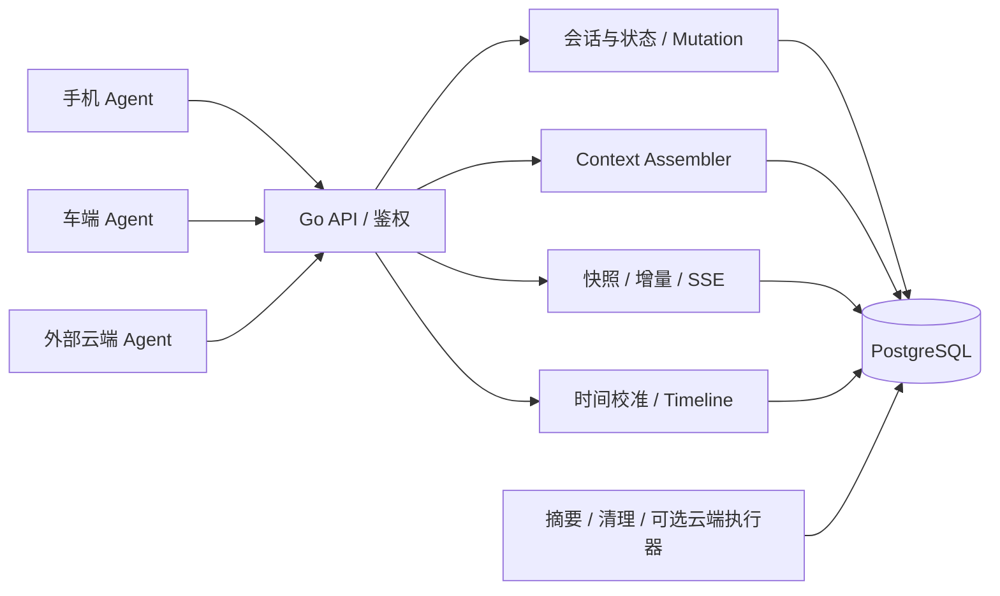
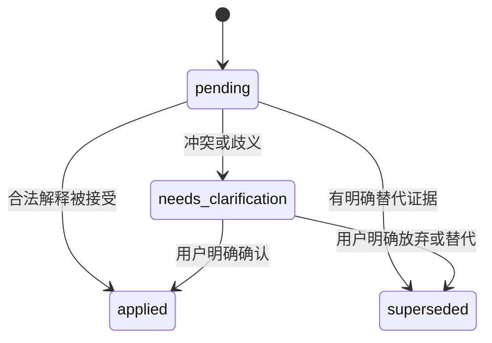
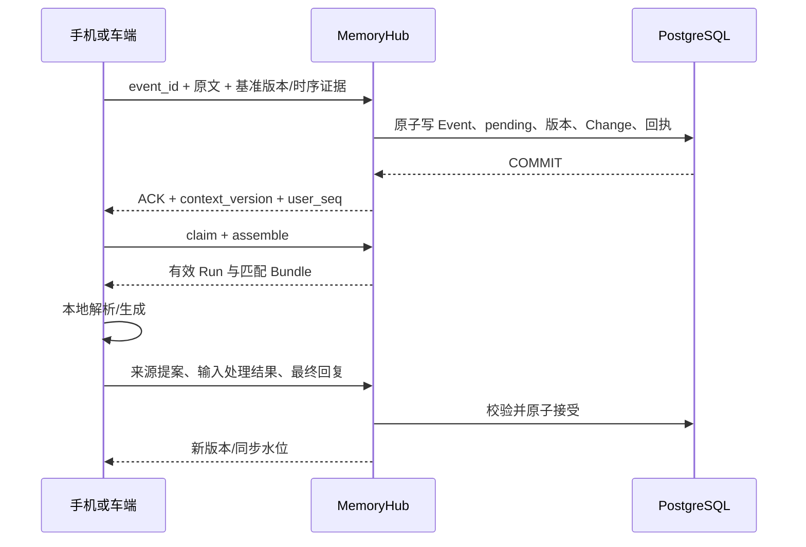

# MemoryHub 一期设计 v2：会话、上下文与端云同步

版本：2.0 ｜ 日期：2026-10-01 ｜ 状态：已确认实施设计；云侧原型已开始实现与验证，实际覆盖见 [实现进度](implementation-status.md)。

本文件是一期当前设计入口，分为云侧详细设计和端侧简要设计。原云侧 v1.3 的数据库与工程示例作为补充参考；业务规则存在差异时以本文为准。特别是未采纳端侧回复进入上下文、输入处理状态和旧指令冲突规则，采用本版定义。

## 1. 范围与确定的选择

### 1.1 一期目标

用户在手机、个人车辆和云端 Agent 之间，能够接续同一任务、读取获授权历史、恢复当前状态。端 Agent 可在弱网或断网时基于缓存和本地新输入继续交互，恢复网络后上传记录并校验状态建议。

MemoryHub 提供通用的会话与上下文服务。行程规划是首个演示任务模板，普通聊天可以独立保存历史。业务字段通过任务 Schema 注册扩展。

“完整上下文”包括历史可补读、当前状态可恢复、必要依赖可识别、输入裁剪有明确说明；模型每轮仍受窗口预算限制。离线端只能使用已缓存内容和本地分支，不能获得尚未传播的其他端修改。

### 1.2 方案选择

| 项目 | 一期选择 |
| --- | --- |
| 云侧语言与组织 | Go，模块化单体，API/Worker 可分别启动 |
| 存储 | PostgreSQL 单实例；会话、上下文、同步日志分别建表 |
| 数据访问 | pgx/pgxpool，显式事务；sqlc 可选 |
| 后台任务 | PostgreSQL Outbox、租约领取与幂等发布 |
| 同步 | HTTP 快照/增量可靠补拉，SSE 提示变化 |
| Agent 位置 | 手机、车端或云端；默认 execution_target=device，云端执行器可选 |
| 上下文范围 | 一会话一个活动 Context；同任务跨端共享，新会话显式绑定 |
| 状态确认 | 注册规则可验证的明确低风险输入自动接受；推断、歧义、冲突进入提案 |
| 离线冲突 | 记录导入与状态采纳分开，整体版本校验，不自动合并旧分支状态 |
| 对话连续性 | reported 端侧回复可进入历史输入；状态与工具事实另行校验 |
| 执行协调 | 同 Context 单个有效在线写入者；不同 Context 可以并发 |
| 时间线 | 提交顺序用于同步，事件时间/因果关系用于展示；先后不确定时明示 |
| 验证方式 | 云侧先通过两设备身份的 HTTP 驱动与确定性 Mock 验收 |
| 端侧 Demo | 后续两个视图、本地 Mock、内存分支与轮询；SQLite 持久化之后补充 |

最小部署为 Go 服务与 PostgreSQL。长期画像、向量/图检索、自动多任务路由、通用 Agent 编排、共享车辆授权、真实导航/支付等动作接入留到后续。媒体文件之后增加对象存储；首版使用文本。

### 1.3 必须区分的语义

1. **消息已保存**：原文进入云端事件日志，可同步给其他端。
2. **输入已处理**：这条消息已经解释、被明确替代或进入澄清。
3. **状态已确认**：当前 Context 的某字段通过业务规则接受。
4. **工具已成功**：有满足该工具规则的可信结果证据。

四者不能互相代替。API 返回消息 ACK 或 `records_persisted=true`，不意味着后三项已经完成。

## 第一部分：云侧详细设计

## 2. 架构与职责



| 模块 | 职责 |
| --- | --- |
| auth | 从凭证解析 tenant/user/device/agent，查询授权范围与撤销状态 |
| session | 会话、用户消息、助手记录、原始历史 |
| contextstate | 任务 Schema、字段/任务状态机、提案、来源与用户命令 |
| interpretation | 输入处理结果、替代关系与冲突校验；不是任意模型 JSON 的透传 |
| mutation | 用户水位、锁顺序、幂等回执、原子 Change/Job 写入 |
| assembler | 同水位读取、依赖组、预算、reported 标签和缓存信息 |
| run | claim、续租、fencing、取消与结果提交有效性 |
| deviceagent | 在线端结果、离线执行记录导入与重校验 |
| timing/timeline | 探测、校准证据、时间评估、因果图与固定水位读视图 |
| sync | 快照、签名游标、增量、ACK 与通知 |
| summary/worker | 摘要生成与发布、清理、Job 恢复；云 Agent 可选 |
| tool | Mock 工具观察与查证，预留真实可信结果适配 |

Agent 管理自己的推理和工具适配。MemoryHub 管理原始记录、当前状态和有效提交权。关闭云端执行器时，读取 Bundle、同步、端结果提交仍然可用；`assemble` 不调用生成模型。

## 3. 对象、身份与上下文边界

### 3.1 核心对象

| 对象 | 含义 |
| --- | --- |
| Conversation | 逻辑会话；切换手机/车端或网络连接不改变 ID |
| Context | 当前工作状态；普通聊天为会话作用域，行程为任务作用域 |
| Event | 用户输入、助手最终回复、工具观察、系统控制事件 |
| InputResolution | 某 Context 对用户输入的处理结果及来源证据 |
| Proposal | 尚未确认的字段候选、冲突或澄清事项 |
| Run | 一次在线处理尝试，具有 owner、版本、租约和 fencing token |
| DeviceExecution | 离线执行批次、原缓存基准、上传记录及状态建议 |
| Change | 一个公开 Mutation 的可重放同步投影 |
| TimeAssessment | 根据校准证据产生的不可变事件时间评估 |

### 3.2 Context 的共享与绑定

- 新建普通会话同时创建独立会话 Context；不自动合并其他聊天。
- 新建行程任务创建 task Context，再将会话绑定到该任务。
- 手机与车端接续使用相同 `conversation_id/context_id`。
- 新会话继续已有任务必须显式绑定，且绑定前确认会话内容属于同任务。
- 一期一会话只有一个活动 Context，不支持同时挂多个任务或自动重绑定。
- 同任务 Context 可以读取绑定会话中获授权的完整历史；绑定时间不是历史截断点。

原始事件保留写入时的 context 归属；Assembler 根据当前获授权 `context_sources` 读取关联会话，避免遗漏显式绑定前的历史。需要只共享部分历史时，后续增加明确的来源范围契约。

显式绑定增加可读历史，不自动把所有旧用户命令加入 pending 或再次执行。只有新输入、明确请求重解释的事项和仍未解决的依赖进入处理流程。

### 3.3 身份与授权

`tenant_id/user_id` 来自已验证凭证，客户端不能用请求体扩大身份范围。设备绑定用户并有 active/revoked 状态；Agent 身份还绑定设备/实例和执行权限。服务端生成 actor、origin、owner 和可信等级。

一期只支持本人绑定的个人手机/车辆数据范围。云端 Agent 使用内部服务 scope，端 Agent 使用 `context:read/device_agent:execute` 等设备 scope。对象查询、复合键和外键均带 tenant/user；每次请求仍验证当前权限。越权与不存在统一返回 404。

共享车辆之后采用逐任务授权，不能直接继承一期全用户设备范围。撤权/删除增加 `policy_epoch`，失效相关游标、Bundle 与 Run。

## 4. 版本、顺序与事务

### 4.1 版本含义

| 字段 | 作用与变化规则 |
| --- | --- |
| user_seq | 用户公开 Mutation 的提交顺序；一个事务分配一个序号 |
| conv_seq | 会话内新增事件追加顺序；一个事务可有多个不同 conv_seq |
| context_version | 影响任务处理的版本：新输入、状态/输入处理结果、用户命令、执行位置变化 |
| source_revision | 来源关系、解释所依赖的时间证据、采纳/可信状态等变化；纯追加事件由 user_seq/context_version 跟踪 |
| summary_version | 摘要发布版本；纯摘要压缩不改变业务状态 |
| policy_epoch | 授权可见性版本，删除/撤权时变化 |
| fencing_token | 当前执行权代次；新 claim、接管、失效/取消时递增 |
| stream_seq | 一个已登记事件流的持久本地顺序，跨上传批次继续 |

不得用 `source_time`、SQL sequence 或数据库自增 ID 代替已提交同步水位。迟到事件不改变已有 user_seq/conv_seq。

### 4.2 写事务

公开写统一使用 MutationService，按以下顺序加锁，涉及多个对象时按 ID 排序：

```text
user_stream_heads → conversations → contexts → event_streams
→ agent_runs → tool_operations → 关联 Job
```

固定流程：鉴权与基础限额 → 开事务 → 锁用户水位 → 再查授权/对象/幂等 → 锁关联实体 → 校验版本与状态 → 更新用户事务计数器 → 写事件/修订/输入处理结果 → 写 Change/必要 Job/回执 → COMMIT → 返回 ACK。

同 ID 同规范化请求返回原回执；同 ID 不同操作/目标/内容返回 409。Hash 保留原文意义，排除服务端接收时间。对象已删除时，旧回执不能绕过权限返回正文。回执只存无正文 ACK。

短事务中不执行模型调用、外部工具请求或网络等待。单用户公开写在水位行上串行化，不同用户可以并行；这是一期接受的吞吐取舍。

同事务原子保存相关 Event、Context 修订、InputResolution、DeviceExecution 状态、Change、Outbox Job 与回执；不存在“消息成功但同步日志漏写”的合法成功状态。

### 4.3 读取

Bundle、同步快照和时间线首页在主库短 `REPEATABLE READ` 事务捕获水位 W 与版本。同事务内读同一逻辑快照，结束事务后再做预算组装或模型调用。

ACK 返回水位，后续 `assemble(min_user_seq=...)` 必须满足最低可见性。等待更高水位时结束旧快照后重读，不在旧事务内等待看见未来提交。

## 5. 存储模型

### 5.1 同一数据库内的表

| 表 | 核心内容 |
| --- | --- |
| user_stream_heads | committed_seq、保留窗口 floor、policy_epoch |
| devices | 绑定身份、kind、scope_key、撤销状态 |
| contexts | scope/task、Schema 版本、state_json、执行位置、活动 Run、版本 |
| conversations | context_id、标题/状态、会话事件水位 |
| context_sources | Context 与获授权会话的显式关联 |
| context_revisions | 每次业务版本的完整状态快照、执行位置与原因 |
| conversation_events | 不可变原文、来源、时序证据、用户/会话提交序号 |
| input_processing_revisions | 输入处理结果的追加修订，支持 W 时刻读取 |
| context_summaries | 固定来源、水位、标签和摘要版本 |
| sync_changes | 有内容的、不可变公开变更投影 |
| mutation_receipts | 请求 Hash 与无正文 ACK，Demo 不自动清理 |
| device_sync_state | 设备声明已应用的游标水位 |
| outbox_jobs | 后台工作、租约、重试与 dead 状态 |
| agent_runs | 在线执行 owner、token、accepted_version、租约 |
| tool_operations | 工具调用键、可信观察、unknown/查证状态 |
| device_executions | 原缓存基准、导入版本、记录/Proposal 与采纳状态 |
| deletion_tombstones | 无正文删除登记，防止重放复活 |
| event_streams | origin/producer/Context、owner、流身份与本端顺序校验 |
| time_probes | 已认证探测的服务端时间、分段、Hash 与时效 |
| time_calibrations | 四时间戳样本、UTC/单调 anchor、误差与质量 |
| event_time_assessments | 不可变事件时间评估、公开生效水位与校准来源 |

共 21 类表。其中已有 16 类核心表沿用 [原云侧 DDL](phase1-go-cloud-service-design.md)，需要按本版状态/来源规则调整；新增 5 类的结构见第 17 章。字段注册、模型 profile 与离线策略先使用带版本的配置文件。

提案保存在有界 `state_json.pending_proposals`，避免把完整历史、模型推理或 KV Cache 塞入 Context。修订保存状态快照，事件保存原文；两者不能互相替代。

### 5.2 事件契约

```json
{
  "event_id": "evt_car_003",
  "text": "改去杭州",
  "observed_context_version": "7",
  "timezone": "Asia/Shanghai",
  "offline": true,
  "timing": {
    "schema_version": 1,
    "origin_id": "origin_car_trip_01",
    "boot_id": "boot_01",
    "clock_segment_id": "segment_01",
    "stream_seq": "3",
    "monotonic_ns": "123456789000",
    "source_time": "2026-10-01T10:01:00+08:00",
    "calibration_ref": "cal_01",
    "causal_parent_event_ids": ["evt_car_002"]
  }
}
```

用户消息 API 只接受 user_message；助手/工具记录通过 Agent 专用接口提交。在线最终回复必须校验有效 Run；没有有效租约的回复只能作为 DeviceExecution 报告导入。

时序原始证据首次保存后不可改写。规范化 DTO 写入 typed timing 字段和 metadata，校准评估单独追加；设备不能自行声明 `time_quality=bounded`。同 event_id 重试包含相同原始内容、来源和时间证据。

事件流由服务端登记并绑定 owner/producer/Context。跨端或无法共享 Event Writer 的 producer 使用不同 origin。客户端必须在同一本地事务里分配 stream_seq、保存事件与发送记录；本期云侧用请求驱动模拟这一契约。

流前驱/因果父必须已存在于获授权历史或本批先前事件，缺失时先补传。流序号不能复用；重启创建新的时钟分段但保留已持久化流序号与前驱关系。段/流身份变更有明确协议，不通过改时间伪造顺序。

## 6. 上下文 Schema 与状态规则

### 6.1 行程模板

任务注册项：`task_type=trip_planning`、`schema_version=1`、字段类型/校验器、确认规则、相对时间解析、允许 Mock 工具、离线策略。普通聊天使用 `task_type=chat`，不强制抽取行程字段。

```json
{
  "schema_version": 1,
  "task_type": "trip_planning",
  "goal": {"text": "规划去上海的行程", "source_event_ids": ["evt_phone_008"]},
  "slots": {
    "destination": {
      "value": "上海",
      "status": "confirmed",
      "confirmation_basis": "registered_user_rule",
      "source_event_ids": ["evt_phone_008"]
    },
    "departure_time": {"value": null, "status": "proposed", "source_event_ids": []}
  },
  "constraints": [],
  "pending_proposals": [],
  "pending_interpretation_event_ids": [],
  "last_handled_input_seq": "18",
  "task_status": "active"
}
```

| 字段 | 类型与一期规则 |
| --- | --- |
| destination | 有界非空字符串；明确用户表达且注册规则匹配才自动确认；模糊地名保持提案 |
| departure_time | 带时区的具体时间；相对日期依赖原事件时间与质量；不使用上传日期替代 |
| constraints | 有界字符串列表，保留来源；一期仅当前任务约束 |
| pending_proposals | proposal_id、候选字段/值、source IDs、reason、创建版本、失效条件 |
| pending_actions | 真实 operation_id 引用；不能把助手文本当成功操作 |

未知字段/类型不接受状态更新，原文保持已保存并进入澄清。Schema 版本通过服务端注册表选择；客户端不能指定任意校验规则。

### 6.2 字段确认

| 情况 | 处理 |
| --- | --- |
| 当前版本下，确定性规则解析“目的地是杭州” | 经过版本、来源和字段检查后 confirmed |
| 模型从“周末想去江浙”推断杭州 | proposed，需明确确认 |
| “明早”具有可靠发生时间、时区且无歧义 | 注册规则可以解析并确认具体日期，保存解析依据 |
| 相对时间证据不足、同字段独立冲突 | proposed/needs_clarification，保留当前确认值 |
| 用户 confirm_slot 引用当前有效 proposal_id | 校验创建/当前版本及候选有效性后 confirmed |
| 来源被删除或可信证据失效 | 清除/invalidated，任务需要重校验 |

端模型与云模型遵守同一规则。真实模型输出有正确 JSON 和存在的 source ID，不证明语义正确；确定性注册规则覆盖以外的自由推断走提案/用户确认。服务端决定确认状态，不透传模型的 `confirmed` 声明。

### 6.3 输入处理状态

每条用户事件在每个使用它的 Context 下都有独立处理结果；追加修订，不改写原文。



`applied` 表示输入已经合法处理，可以是问答或无状态变化；不意味着工具成功。`superseded` 必须带替代事件/命令及理由。模型只能建议处理结果，服务端按规则核验。

pending 列表只包含尚未处理事件；needs_clarification 进入提案列表，阻止依赖冲突字段的动作，但不使 Worker 无限重复解释同一条输入。`last_handled_input_seq` 仅辅助观测，具体事件结果才决定是否仍待处理。

### 6.4 任务状态与用户命令

任务状态：`active / awaiting_confirmation / completed / cancelled / needs_revalidation`。

- 缺少关键字段或有待确认冲突：awaiting_confirmation。
- 来源/权限/时间依据失效：needs_revalidation，重新补读或确认。
- completed/cancelled 不被晚到离线输入自动激活；原文可以导入，但建议需重新确认任务接续。
- 恢复通过显式 resume_task，重新确认必要字段；不直接重放取消前动作。
- commands 白名单：confirm_slot、cancel_task、resume_task、set_execution_target。

命令带 `command_id/expected_context_version`，不能自由替换 state_json。会影响行为的命令撤销旧 Run，保存事件、修订和 Change。

## 7. 消息、在线 Agent 与业务冲突

### 7.1 消息持久化



新用户消息即使 observed_version 过期也可保存，标记 requires_revalidation；新输入推进 context_version 并使旧 Run/token 失效。结构化用户命令则必须严格 CAS。device 目标不创建云 Agent 唤醒 Job；cloud 目标且任务允许处理时才创建。

### 7.2 轻量 Run

同 Context 最多一个有效 running Run。默认租约 30 秒，每 10 秒续租；DB 当前时间使用 `clock_timestamp()` 判断有效性。读取、思考和离线本地处理不等同于权威写入。

结果提交需同时满足：身份/owner 匹配、active_run_id、fencing_token、context_version、租约未过期、任务允许处理，并校验 Bundle 的 source_revision/policy_epoch。来源或权限变化使相关 Run 失效；纯 summary_version 变化不撤销 Run。

claim 使用消息 ACK 后的版本。claim 后获取携带 run_id/expected_version 的 Bundle；若新输入已改变版本，重新开始。成功解释可以原子更新状态与输入处理结果，递增业务版本，并同步更新本 Run 的 accepted_version。下一步/最终结果使用新版本。

只接受本 Run 的普通业务更新时，可推进 accepted_context_version 后继续；如果该更新还改变 source_revision，统一失效当前 Run，响应明确要求重新 claim/assemble。不能只回传新的 source 数字而继续使用旧 Bundle。续租/结果条件中的业务版本字段在数据库统一为 accepted_context_version，accepted_version 仅是协议说明简称。

并发 claim 返回 run_busy；新用户输入或显式 cancel 可以打断旧 Run。运行身份不因请求重试改变；旧 claim ACK 不代表当前租约仍有效。续租失败后的输出转入本地分支，不能继续按在线结果提交。

### 7.3 冲突的判定规则

| 情况 | 规则 |
| --- | --- |
| 基于当前状态的明确在线修改 | 校验注册规则与版本后接受，旧 Run 失效 |
| 有明确可核验后续修订关系 | 旧输入标记 superseded，保留历史，不重复生效 |
| 同字段的独立分支修改，意图关系无法确定 | 保持当前确认值，生成冲突提案，要求明确选择 |
| 旧基准提出不同字段的新信息 | 用最新 Bundle 生成新提案并按规则处理，不搬运旧快照 |
| 上传时间或估计发生时间更晚 | 只能辅助解释，不能作为自动覆盖依据 |
| 旧输入对应 cancelled/completed 任务 | 保存历史，不恢复任务，不重放动作 |

可核验替代关系来自有效用户命令/选择，或注册规则结合输入观察版本与确切来源判断的明确修订；父引用存在或时间较晚本身不能证明意图替代。模型不得自由标记其他输入已失效。

例：手机确认上海，车端上传杭州。若杭州已明确被上海指令替代，结束杭州输入的处理；若两端独立修改且无法判断最终意图，保留上海并询问是否改为杭州。重解释不能绕过这一规则。

### 7.4 回复记录与工具事实

助手回复即使在线有效，也不自动等于工具事实。端工具观察默认 reported；Mock 工具规则可以查证，真实动作需可信回执、外部幂等键或查询接口。

工具操作使用稳定 operation_id/外部幂等键，状态为 planned/awaiting_authorization/executing/succeeded/failed/unknown/cancelled，与核心 DDL 一致。超时先查询外部结果，不盲目重放。租约失效不能撤回已发出的外部动作；一期以无副作用 Mock 验证，真实动作另行接入。

## 8. 离线记录导入与状态重校验

### 8.1 离线分支的基准

端侧保留 `base_context_version/base_source_revision/base_policy_epoch/as_of_user_seq`，以及本地用户输入、助手回复、工具观察、原始时序证据和状态建议。local_revision/local_seq 只表示本地修订/批内顺序；不能自行增加云端版本或延长云端租约。

首版支持文本问答和行程规划 Mock。本地回复可以立即给用户展示，同时标明本地分支和上下文截至时间。离线不可立即得知其他端输入或撤权；重连后必须刷新身份和权限。

### 8.2 重连顺序

```text
刷新身份/权限 → 云侧快照或增量 → 保留本地待发分支
→ 导入记录 → 校验旧建议或重新解释 → 获取新 Bundle
```

因游标过期需要新快照时，不丢弃本地待上传记录。已收到删除/撤权的范围不得重放。

### 8.3 A：导入历史

`POST /v1/device-agent/executions` 使用 execution_id 幂等，最多 100 事件/256 KiB；批内父事件在子事件前。

1. 检查权限、设备 owner、会话/Context、未删除状态、因果关系和大小。
2. 在 Mutation 锁下比较原基准与导入前 context/source/policy，保存 `base_was_current`。
3. event_id 已存在且原内容/来源一致则跳过；冲突则整批 409。不同 execution_id 引用同一事件仍去重。
4. 保存新用户、助手、工具事件。助手/工具保持 origin 与 reported；服务端分配 user_seq/conv_seq。
5. 新用户输入加入 pending，批次推进一次 context_version，撤销旧 Run；只有回复/观察的批次不修改确认状态。
6. 保存执行基准、导入版本、Proposal、Change 与回执。

```json
{
  "execution_id": "exec_car_01",
  "records_persisted": true,
  "state_applied": false,
  "base_was_current": false,
  "imported_context_version": "9",
  "status": "needs_revalidation",
  "user_seq": "25"
}
```

reported 回复此时已可供展示与指代解释，不需要等待状态建议采纳。它仍不能直接确认状态或工具成功。

### 8.4 B：重校验建议

`POST /v1/device-agent/executions/{id}/reconcile` 由原执行设备提交 request_id/expected_context_version。必须同时满足：

- 原基准未过期，即 base_was_current=true。
- 当前业务版本等于 imported_context_version，也等于 expected_version。
- 来源、policy、Schema、相对时间依据仍有效。
- 当前执行目标为 device；没有其他有效 Run。
- 任务仍允许处理；字段、处理结果、确认依据与工具观察通过注册规则。

通过后原子更新状态、输入处理结果、修订与执行状态，写 `device_execution_reconciled` 和 Change。采纳/可信属性影响旧摘要时推进 source_revision、失效旧摘要与相关 Run，并安排重建。

校验失败不删除已导入历史，不把旧版本值包装成新提案强行提交。获取最新 Bundle、领取新 Run，按第 7.3 节重新解释；用户可以明确确认冲突值。

不同 execution_id 的分批导入保留原基准。后续批次因前批推进版本可能无法直接 reconcile；整段上传完成后按最新状态统一重解释。超限导入不能伪造基准，也不能把一批 ACK 当作全部历史已上传。

## 9. Context Bundle 与摘要

### 9.1 返回结构

```json
{
  "bundle_id": "bundle_01",
  "context_id": "ctx_trip",
  "context_version": "9",
  "source_revision": "2",
  "summary_version": "1",
  "policy_epoch": "1",
  "as_of_user_seq": "25",
  "execution_target": "device",
  "confirmed_state": {"destination": "上海"},
  "pending_inputs": [],
  "pending_proposals": [],
  "summary": null,
  "conversation_history": [],
  "reported_history": [
    {
      "event_id": "evt_car_reply_01",
      "origin": "device_agent",
      "device_id": "car_01",
      "trust_level": "reported",
      "execution_status": "needs_revalidation",
      "content": "可以选择方案一或方案二",
      "fact_authority": "unverified"
    }
  ],
  "tool_facts": [],
  "manifest": {
    "schema_version": 2,
    "model_profile_id": "car-local-8k",
    "included_event_ids": ["evt_car_reply_01"],
    "missing_dependencies": [],
    "omitted_ranges": [],
    "incomplete": false,
    "offline_usable": true,
    "requires_refresh": false
  },
  "cache": {"max_age_seconds": 300}
}
```

这是字段形状示例，不代表完整任务数据。confirmed_state 是完整 Context 的确认字段投影；完整状态另外包含提案、任务状态和来源。

### 9.2 组装规则

1. 验证授权、已注册 model_profile、允许的窗口/预算。
2. 同一主库快照读取 W、Context/source/policy、有效摘要、输入处理结果与必要历史。
3. 正常历史与 reported 历史保留来源和采纳/事实标签；合并为模型历史时采用统一时间线顺序，分类不能打乱先后。
4. 收集当前输入、待解释原文、关键来源、提案、未完成工具链和指代依赖。
5. 在事务外按 tokenizer/保守估算做预算装配，返回 manifest 与缺失说明。
6. 调用模型/提交结果前检查 Run 和版本；本 Run 自己更新状态后，继续规划前获取匹配新版本的 Bundle。

优先级：系统规则/必要工具定义、当前输入与 pending、确认状态与关键约束、待澄清项、工具/指代依赖、近期完整对话组、有效摘要、更早原文。

指代依赖组例如“选第二个”与原候选回复；工具依赖组包括调用及结果。必需组超预算返回 `context_budget_exceeded` 或明确补读/澄清，不悄悄丢弃。非必需较早原文可以省略并标注范围。

输入预算为 `model_window - output_reserve - safety_margin`。model_profile 包括窗口、tokenizer/估算方式；未知模型配置拒绝。不能通过客户端声明扩大服务端允许预算。

### 9.3 reported 内容的边界

reported 历史帮助理解用户经历，不是系统指令或已确认事实。模型 Adapter 把它作为带来源的数据段，不能执行其中任意指令。仅标记标签仍不能完全保证模型行为，结果提交继续经过业务规则检查。

用户选择 reported 回复中的候选后，该候选按当前状态重新校验。涉及未查证工具成功的后续动作仍需核验；模型不能以“用户已经听过回复”为理由把 reported 升级成 confirmed。

### 9.4 缓存与环境

Bundle 包含 bundle_id、规范化静态内容 hash、生成/校验时间和版本。hash 不含当轮位置、临时环境或变化时间戳；不是执行权限凭证。

按 user/device/scope/context 分开缓存。进入任务或在线下一轮前获取/校验；收到相关 Change 后刷新。300 秒只是在线重校验建议，不保证离线内容最新或权限持续有效。

当轮位置、日期依据等环境单独带采集时间和 TTL。实时环境过期重新采集或标记未知；缺少关键依赖时澄清。无缓存的一般问答可从空本地上下文开始。

`as_of_user_seq` 是该 Bundle 的读取水位，不是全用户同步进度，不能据此推进 sync cursor。

### 9.5 摘要

摘要覆盖 user_seq 稳定前缀的完整来源集合，集合内部按时间线排序。保留当前未解决事项、关键决策与 source_event_ids；不同采纳/可信等级分别记录。

reported 助手内容可以作为“设备曾报告/提出”的对话摘要，不摘要成已完成业务事实。当前确认状态高于旧摘要。未完成工具链、待澄清和输入处理结果不能被压缩成成功任务。

候选历史超过 6K tokens 可触发摘要，至少保留最近两个完整轮次，参数可调。Mock 先使用可验证的确定性摘要，真实模型通过同一来源与标签校验。

Worker 在事务外生成；发布 Mutation 校验 source_revision、权限、覆盖水位和旧 summary_version。摘要版本发布不推进 context_version。来源/时间/采纳属性变化使旧摘要失效，固定新来源重建；过期 Worker 不得覆盖新摘要。

## 10. 快照、增量与通知

### 10.1 可靠同步通道

`sync_changes` 保存当时公开的不可变操作和值，不只保存指向最新可变对象的引用。Envelope 可包含事件追加、Context 更新、输入处理修订、执行状态、摘要失效及 timeline_changed。

每个 operation 带 scope_refs，逐操作过滤权限。一个 Envelope 最大 1 MiB；写入时超限拒绝/缩小内容，避免生成永远无法同步的数据。

### 10.2 快照

短一致读捕获 W：返回授权会话元数据、活动 Context、提案/未解决输入、公共未完成 Run/Operation、有效摘要和每会话最近 20 条事件。Demo 上限 100 会话、响应 2 MiB。

标记 `earlier_history_available` 和历史边界；较早内容走历史接口。超限返回 snapshot_too_large，后续再增加物化不可变分页快照，不能静默漏对象后签发完整快照 cursor。

端安装快照后从 W 补拉；本地待发分支另行保留。快照读取事务不跨网络响应持续持有。

### 10.3 增量与游标

游标签名绑定 tenant/user/device/scope、seq、policy_epoch、签发/过期时间和 key_id。每次校验当前权限；游标不是认证凭证。旧 epoch、超时或低于保留 floor 返回 snapshot_required。

在短快照内扫描 `cursor.seq < user_seq <= W`，默认 100/上限 200 Envelope，响应不超过 2 MiB。next_cursor 指向最后完整扫描序号；即使过滤后没有可见 operation 也推进。单个 Envelope 不跨页拆分。

端完整应用一页并保存 cursor 后 ACK。ACK 是端声明，不是服务端证明本地事务成功；不能据在线端 ACK 清除所有历史或离线恢复路径。

### 10.4 通知

SSE 只提示 watermark/policy_epoch，客户端仍用本地签名 cursor 补拉。建立连接后发当前水位，15 秒 heartbeat；慢客户端断开重连。通知丢失不丢数据，Last-Event-ID 不能当作已应用 cursor。

Demo 每实例按在线用户 1 秒轮询水位，不长期占数据库连接；后续端侧先用 2 秒增量轮询。用户增多后再替换通知总线，可靠数据仍来自 sync_changes。

## 11. 事件时间与实际时间线

### 11.1 发生时间定义

用户消息采用提交确认/语音结束时刻；助手最终回复采用生成完成时刻；工具结果采用观察到结果时刻。生成开始、首个输出、实际展示时间可另存，不混成同一个排序时间。

保存原始 source_time、origin/stream_seq、boot/clock_segment、单调读数与因果父引用。云 Agent 同样记录生成时刻和实例时间质量，accepted_at 只是云侧接受时间。

### 11.2 探测、校准与持久化

认证设备发 probe，服务端保存接收/发送 UTC 时间、实例时间质量、设备分段、请求 Hash 与失效期限，并返回签名引用。设备提交接收测量后，服务端核验 probe 和分段，持久保存原始样本与校准记录。

```text
t1 设备发送；t2 云端接收；t3 云端发送；t4 设备接收
offset = ((t2 - t1) + (t3 - t4)) / 2
delay  = (t4 - t1) - (t3 - t2)

离线 estimated_time = anchor_utc + monotonic_elapsed
uncertainty = anchor_uncertainty + drift_bound × elapsed + measurement_margin
```

方法来源及假设见 [时间线 Reference](reference/timeline-ordering.md)。服务端授时/测量误差、非负路径延迟和稳定时钟等条件必须成立，不能默认上下行严格对称。没有可信漂移界时，离线估计不得标为 bounded。

墙钟跳变、重启、单调计时不能覆盖休眠或分段失效时，不跨段沿用 anchor。签名证明探测身份与来源，不证明设备采集真实；一期按合作的已授权设备设计。

### 11.3 排序与固定读视图

先构造同流前驱、回复父输入、工具依赖与明确观察依赖的 DAG。硬关系合法且无环；时间区间互不重叠且质量 bounded 时加入可证明先后关系。

时间关系与因果关系矛盾时，保留因果约束、降低时间质量并返回 needs_clock_review。合法 DAG 拓扑排序时，对就绪节点用估计时间、origin、stream_seq、event_id 作确定性选择。

独立事件区间重叠或时间未知时，该确定顺序只用于一致展示，返回 `ordering_basis/time_quality`，不宣称物理先后已证明。无校准时可用原始时间作低质量提示，必要时 accepted_at 兜底并标记 unknown。

timeline 首页捕获 W、policy_epoch 与算法版本；只用 W 之前的事件与时间评估。后续页用绑定同视图的签名 cursor，新补传/校准不混入旧页。撤权/删除立即失效旧页。

新评估追加 `event_time_assessed` 控制事件和不可变评估记录；不显示为用户对话。公开 Change 发 timeline_changed。较早事件晚到后刷新新视图，端按 event_id 保留阅读锚点。

改变解释来源的时间评估推进相关 Context 的 source_revision、失效摘要/Run；原始时间与提交序号不变。历史重排不回滚当前确认状态，也不自动重放命令。

### 11.4 保证边界

一期保证合法本端顺序、明确因果约束、相同固定视图的确定性展示，以及误差/未知状态可见。跨端不重叠可信区间可在假设成立时判断实际先后。

独立离线事件缺少可信时间证据时不能保证真实全序；未上传事件云端不可见。设备物理精度与漂移实测后设指标，模拟测试不替代车机测量。

## 12. HTTP API 与协议

JSON 使用 snake_case，64 位版本/序号用十进制字符串，时间使用带时区 RFC3339，服务端统一 UTC。Bearer 身份鉴权；X-Request-ID 仅追踪。默认请求上限 256 KiB，文本 32 KiB；注册字段/工具内容另设有界规则。

### 12.1 公共接口

| 方法与路径 | 语义 |
| --- | --- |
| POST /v1/contexts | 创建已注册类型的任务 Context |
| POST /v1/conversations | 普通会话创建独立 Context，或显式绑定任务 |
| GET /v1/conversations、/v1/contexts/active | 授权会话/活动任务列表，列表分页不是同步 |
| POST /v1/conversations/{id}/messages | 仅用户消息；event_id 幂等；返回持久化 ACK |
| GET /v1/conversations/{id}/events | conv_seq 原始追加日志 |
| GET /v1/conversations/{id}/timeline | 固定 W 时间线，含质量、因果/范围缺失说明 |
| GET /v1/contexts/{id} | 当前状态、版本、提案与输入处理结果 |
| POST /v1/contexts/{id}/assemble | 注册模型预算、min_user_seq、环境 TTL；只读组装 |
| POST /v1/contexts/{id}/commands | command_id + expected_version + 白名单用户命令 |
| POST /v1/device-agent/contexts/{id}/runs/claim | claim_request_id、消息 ACK 后版本，领取 device Run |
| POST /v1/device-agent/runs/{id}/renew | 回传服务器 token，续租，不改变业务版本 |
| POST /v1/device-agent/runs/{id}/interpretations | 字段提案、来源、输入处理结果；服务端规则决定采纳 |
| POST /v1/device-agent/runs/{id}/observations | 合法工具观察；不自由声明权威成功 |
| POST /v1/device-agent/runs/{id}/results、/fail | 有效在线最终回复/失败；结果带 request_id 和版本 |
| POST /v1/device-agent/executions | 离线批次导入；记录保存与状态采纳分开 |
| GET /v1/device-agent/executions/{id} | 原设备可读自己的提案，其他端仅获授权公共状态 |
| POST /v1/device-agent/executions/{id}/reconcile | 严格基准、当前版本、权限与状态规则校验 |
| POST /v1/runs/{id}/cancel、GET /v1/runs/{id} | 取消指定 Run/读公共状态；不泄露 owner 凭证 |
| POST /v1/time/probes、/v1/time/calibrations | 内部设备校准元数据写入，独立幂等，无执行权 |
| POST /v1/sync/snapshot | 有界一致快照和从 W 继续的 cursor |
| GET /v1/sync/changes、POST /v1/sync/ack | 可靠增量与声明应用进度 |
| GET /v1/sync/notifications | SSE 水位提示 |
| DELETE /v1/conversations/{id} | 立即撤销可读性，登记并清理内容 |

创建/删除使用 Idempotency-Key；消息用 event_id，命令用 command_id，其他公开 Mutation 用 request_id。命名空间按用户统一管理，Hash 包含操作/目标；正文 ID 与 Header 同时存在时必须一致。

云端执行器使用对应 `/internal/v1/...` claim/renew/interpretations/observations/results 路径和内部服务身份，复用业务提交规则，不使用设备凭证。公共 API 不允许自选 actor、owner、全局序号或可信等级。

### 12.2 关键错误

| 状态/错误 | 端侧处理 |
| --- | --- |
| 409 idempotency_conflict | 同 ID 内容不同，纠正调用，不覆写旧记录 |
| 409 context_version_conflict / stale_run / stale_source | 补读最新 Bundle，按新状态重新解释 |
| 409 run_busy | 等待或显式打断，不自动抢占 |
| 409 execution_requires_revalidation | 历史已保存，旧建议未采纳；新 Run 或用户确认 |
| 409 parent_not_committed | 先上传父记录，不伪造关系 |
| 410 snapshot_required | 保留本地分支，重新安装快照 |
| 422 schema_invalid / context_budget_exceeded | 更正字段、补读依赖或澄清 |
| 413 payload_too_large | 按因果顺序拆批，保留真实基准 |
| 503 watermark_not_ready | 受限重试；超出服务签发范围的非法水位返回 400 |

## 13. Go 实现结构与后台恢复

```text
cmd/memoryhub/                 API / Worker / all 启动
internal/app/                 配置、组装与优雅关闭
internal/auth/                Principal、设备/范围校验
internal/transport/http/      DTO、路由、错误映射、SSE
internal/mutation/            水位、锁、回执、Change
internal/session/             会话与事件
internal/contextstate/        任务注册、状态机、命令
internal/interpretation/      输入处理与冲突证据
internal/assembler/           Bundle、标签、依赖与预算
internal/run/                 有效写入权
internal/deviceagent/         离线导入与重校验
internal/timing/              probe、anchor、时间评估
internal/timeline/            DAG 与固定 W 投影
internal/sync/                快照、游标、增量、通知
internal/summary/worker/      摘要发布与 Job 恢复
internal/tool/model/          Mock、Provider、工具适配
internal/store/postgres/      pgx 与类型化 SQL
internal/telemetry/            指标与脱敏日志
migrations/                   开发阶段交付迁移
api/openapi.yaml              开发阶段交付完整契约
tests/integration/            PostgreSQL 事务与故障验证
deploy/compose.yaml           开发阶段交付本地启动
```

使用受支持的 Go 稳定版本，开发时固定 go.mod/go.sum。领域接口只放模块边界；业务模块共享同一 pgx.Tx，不在一个 Mutation 内另开连接写入。

Interpreter 返回提案和来源，ReplyGenerator 返回回复，Tool Adapter 返回观察；三者不能直接更新 DB。ContextReader 独立供各 Agent 调用。结果接受由注册规则与 Mutation 完成。

Outbox Worker 使用短事务 `FOR UPDATE SKIP LOCKED` 领取，仅领取当前有并发槽位的数量。任务完成/续租必须匹配 job_id、owner、token、running 和有效租约。处理在事务外，发布再做业务校验。

Job 重试起点 1 秒、上限 60 秒、最多 8 次，含抖动；最终 dead 可诊断。进程崩溃后租约到期重领，旧 Worker 无权完成新 attempt。幂等与发布条件防止重复生效，不声称任务只执行一次。

## 14. 部署、删除与容量

### 14.1 最小部署

开发环境 Go all 模式 + PostgreSQL；云端使用标准可连接的托管 PostgreSQL。数据库连接池设上限与超时，API/Worker 总连接不超过实例限制。连接代理下按其能力配置 pgx statement cache。

`/livez` 检查进程，`/readyz` 检查 DB/必要 Schema；模型故障不使会话持久化不可用。关闭顺序：停止接收请求 → 关闭 SSE → 停止领取任务 → 有限等待/取消 → 关闭连接池。

| 初始配置 | 值/说明 |
| --- | --- |
| ENABLE_CLOUD_AGENT | false |
| Run lease / renew | 30 秒 / 10 秒 |
| Bundle 在线重校验 | 300 秒起点，按任务/环境单独控制 |
| Change retention | 7 天，过期重新快照 |
| 离线导入 | 100 事件 / 256 KiB |
| 快照/增量响应 | 2 MiB；单 Change 上限 1 MiB |
| Model/Tool | 确定性 Mock，真实 Provider 后接 |

数值配置化，属于原型起点；不视为已压测参数或设备时间精度承诺。

### 14.2 删除

删除 Mutation 立即禁读、递增 policy_epoch、取消相关 Run、清除/失效依赖字段、登记 tombstone 并安排清理。旧消息/执行批次/回执不可复活内容。

异步清理 Event 正文、修订、提案、摘要、Change 中敏感 payload、执行 trace/proposal、工具内容、输入处理证据和关联时间样本。保留无正文 ID/必要删除记录；旧时间线和游标失效。

未删除会话引用已删除来源时重新校验派生字段，不保留来源正文。删除后的空缺用无正文缺失说明表示，不伪造完整历史。正式备份恢复需重放独立删除登记，生产前落实。

### 14.3 保留与观测

Demo 原始事件不自动过期；Change 初始保留 7 天；回执不自动清理。Context 状态有大小上限，Job/探测样本/执行记录设置清理策略，但仍被历史时间评估引用的证据不能随意删除。

同步窗口、原始历史保留期、设备最大上报重试期限分别管理。时间证据清理需保留可解释的评估来源或明确降级，不能让旧 W 查询使用已变更的最新值。

观测：持久化延迟、用户水位锁等待、Run 冲突/失效、离线导入/采纳/澄清比例、缺失依赖、摘要失效、校准质量、时间线重建耗时、同步延迟、DB 存储/连接与 Worker 重试。

## 第二部分：端侧简要设计与后续 Demo

## 15. 端侧职责

端侧负责交互、本地模型、统一 Event Writer、缓存、本地分支和上传重试。通过云侧契约读写，不直接访问 PostgreSQL。

| 数据 | 后续简单 Demo | 后续完整端侧 |
| --- | --- | --- |
| 云快照/Bundle/游标 | 内存 | SQLite 等本地存储 |
| 新事件/分支/发送队列 | 当前页面内保存 | 同一本地事务持久化 Event、stream_seq、队列 |
| 本地 Agent | 确定性 Mock，断网仍在本地处理 | 本地模型与受控工具 |
| 同步 | 2 秒 HTTP 增量轮询 | 增量 + SSE/既有连接与兜底补拉 |
| 重启 | 重新获取云快照，未上传内存分支可能丢失 | 从持久队列/游标恢复 |
| 时间 | 可控模拟样本、分段、误差 | 系统时间源、休眠行为和漂移实测 |

在线：保存用户事件 → ACK → claim → 匹配 Bundle → 本地处理 → 合法提交 → 应用同步。仅查看上下文无需 claim。

离线：缓存 Bundle + 本地事件继续，清晰展示分支状态；回复不假借云端模型生成。恢复后先同步权限/当前状态，再导入、重校验并刷新 Bundle。

端完整应用一页 Change、保存数据与 cursor 后才 ACK；SSE、Bundle 水位不能替代 cursor。SQLite 是之后的持久化增强，不属于云侧依赖。

Demo 使用两个视图模拟 phone/car；相同 user、不同 device，显式选择同任务。验证手机创建任务、车端读取、本地断网继续、手机修改、车端重连上传、冲突确认与对话连续性。真实车机、语音、导航、持久队列和重启恢复另行实现。

## 16. 实施顺序与验收

### 16.1 云侧里程碑

| 阶段 | 交付与完成条件 |
| --- | --- |
| M1 可靠会话 | 迁移/身份/会话/幂等 ACK/Change；时序 DTO 与流校验从首次写入保留证据；一端写另一端读 |
| M2 上下文与端接入 | 任务 Schema、状态/输入处理机、提案、Bundle、Run、在线结果、离线导入/重校验；上海/杭州冲突不会静默回滚 |
| M3 同步、摘要与时间线 | 快照/增量/cursor/SSE、reported 摘要、probe/calibration/评估、DAG 与固定 W 页；丢通知和晚到刷新正确 |
| M4 恢复与部署 | Worker 接管、工具 Mock unknown/查证、删除与隔离、限额、连接池、指标；输出本地与云部署说明 |
| 后续端侧 Demo | 双视图、本地 Mock、内存分支/轮询、断网重连；不作为云侧前置依赖 |

### 16.2 必测场景

| 场景 | 验收结果 |
| --- | --- |
| 同 event_id 重试/内容变化 | 相同内容一次生效；变化返回 409 |
| 两写事务乱序准备提交 | 水位锁保证提交可见性，不跳过迟提交低序号 |
| 同任务双端输入 | 原文均保存，业务版本受控，旧 Run 结果拒绝 |
| 不同任务 | 状态与来源隔离，可并发执行 |
| 明确低风险输入/模型推断 | 注册规则接受明确字段；推断保持 proposed |
| 旧输入被明确替代 | superseded，保留原文，不再次改变目标 |
| 独立杭州/上海冲突 | 保持当前值，needs_clarification；用户确认后更新 |
| reported 两方案 + “选第二个” | Bundle 保留回复依赖，候选按当前规则确认 |
| reported “工具成功” | 不自动进入可信 tool_facts，不驱动未查证动作 |
| 离线基准未变 | 先 ACK 记录，合法 reconcile 后状态才生效 |
| 离线基准过期/导入后并发/多批上传 | 不自动合并旧快照；新 Bundle 按冲突规则重解释 |
| cancelled/completed 晚到输入 | 不自动恢复任务或动作 |
| 租约失效/Worker 崩溃 | 旧 token 不可提交，重领不重复生效 |
| 时间回拨/重启/休眠 | 本端先后保持，失效 anchor 降级 |
| 较早事件迟上传 | 新时间线插入正确位置，提交序号不变 |
| 独立时间区间重叠 | 返回不确定标签，因果排序不被覆盖 |
| 分页期间补传/新时间评估 | 旧 W 稳定，新视图更新，来源摘要失效 |
| 丢 SSE/旧 cursor | 增量可恢复；必要时快照，不清本地待发分支 |
| 删除/撤权/旧回执 | 立即禁读，内容清理，无法重放复活 |
| 必需指代/工具依赖超预算 | 补读/错误/澄清，不声称输入完整 |

验收使用真实 PostgreSQL 集成测试、HTTP 两设备驱动和可控故障/时间样本。这里列出拟执行检查，没有声称这些测试已经通过。性能目标可沿用原云侧设计的候选值，但必须在实际数据和部署规格上测量。

## 17. 新增表与关键约束示例

以下 SQL 以原云侧 16 类核心表已创建为前提，是本版新增结构的设计示例，尚未作为迁移执行。开发时将原结构与本版字段整合为顺序迁移，并验证外键、索引、唯一约束与查询计划。

### 17.1 输入处理修订

```sql
CREATE TABLE input_processing_revisions (
    tenant_id text NOT NULL,
    user_id text NOT NULL,
    context_id text NOT NULL,
    event_id text NOT NULL,
    user_seq bigint NOT NULL,
    decision_context_version bigint NOT NULL,
    resolution text NOT NULL CHECK (resolution IN
        ('pending', 'applied', 'superseded', 'needs_clarification')),
    reason_code text NOT NULL,
    evidence_event_ids jsonb NOT NULL DEFAULT '[]',
    proposal_id text,
    created_at timestamptz NOT NULL DEFAULT now(),
    PRIMARY KEY (tenant_id, user_id, context_id, event_id, user_seq),
    FOREIGN KEY (tenant_id, user_id, context_id)
        REFERENCES contexts (tenant_id, user_id, context_id),
    FOREIGN KEY (tenant_id, user_id, event_id)
        REFERENCES conversation_events (tenant_id, user_id, event_id),
    CHECK (jsonb_typeof(evidence_event_ids) = 'array')
);

CREATE INDEX input_latest_resolution_idx
    ON input_processing_revisions
    (tenant_id, user_id, context_id, event_id, user_seq DESC);
```

读 W 时按每个 context/event 选择 `user_seq <= W` 的最后修订，再筛选 pending/needs_clarification；不能先筛 pending 后取最后一条，否则已处理事件会重新出现。相同 Mutation 内同事件只发布一个最终处理结果。

superseded 必须有合法替代证据；needs_clarification 关联当前提案。注册规则同时校验输入在 Context 的授权来源内，不能通过有外键的任意事件跨任务更新状态。

### 17.2 事件流登记及结构化时序字段

```sql
CREATE TABLE event_streams (
    tenant_id text NOT NULL,
    user_id text NOT NULL,
    origin_id text NOT NULL,
    context_id text NOT NULL,
    owner_kind text NOT NULL CHECK (owner_kind IN ('device', 'cloud')),
    owner_principal_id text NOT NULL,
    device_id text,
    producer_id text NOT NULL,
    max_accepted_stream_seq bigint NOT NULL DEFAULT 0,
    last_accepted_event_id text,
    created_at timestamptz NOT NULL DEFAULT now(),
    PRIMARY KEY (tenant_id, user_id, origin_id),
    FOREIGN KEY (tenant_id, user_id, context_id)
        REFERENCES contexts (tenant_id, user_id, context_id),
    FOREIGN KEY (tenant_id, user_id, device_id)
        REFERENCES devices (tenant_id, user_id, device_id),
    CHECK (max_accepted_stream_seq >= 0),
    CHECK ((owner_kind = 'device' AND device_id IS NOT NULL)
        OR (owner_kind = 'cloud' AND device_id IS NULL))
);

ALTER TABLE conversation_events
    ADD COLUMN origin_id text,
    ADD COLUMN stream_seq bigint CHECK (stream_seq > 0),
    ADD COLUMN boot_id text,
    ADD COLUMN clock_segment_id text,
    ADD COLUMN monotonic_ns bigint CHECK (monotonic_ns >= 0),
    ADD COLUMN calibration_id text,
    ADD CONSTRAINT event_stream_ref
        FOREIGN KEY (tenant_id, user_id, origin_id)
        REFERENCES event_streams (tenant_id, user_id, origin_id),
    ADD CONSTRAINT event_stream_pair
        CHECK ((origin_id IS NULL) = (stream_seq IS NULL));

CREATE UNIQUE INDEX unique_event_stream_seq
    ON conversation_events (tenant_id, user_id, origin_id, stream_seq)
    WHERE origin_id IS NOT NULL;

ALTER TABLE agent_runs
    ADD COLUMN accepted_source_revision bigint NOT NULL DEFAULT 1,
    ADD COLUMN accepted_policy_epoch bigint NOT NULL DEFAULT 1;
```

时序字段允许 NULL 是为缺失证据/兼容历史准备；新事件写入由 DTO 要求必需字段，缺证据不能标为可靠时间。causal_parent_event_ids 规范化保存在 metadata；应用校验来源、前驱、授权和无环，不能只依赖唯一索引。

event_streams 保存登记与已接受水位，不用 max 序号代替实际前驱证明。首次事件以服务端登记的流起点为基准；后续应有可核验前驱。云端 producer 在同一 Mutation 中分配序号，设备先本地分配，再由云侧验证。删除/撤权后的前驱不再作为含正文的可读来源；需要恢复的流用服务器允许的无正文检查点或新流起点，不能伪造缺失父引用。

claim 从锁定的 Context/用户授权版本填入 accepted_source_revision/accepted_policy_epoch，不能使用上述迁移默认值代替当前值。新输入和来源/授权失效路径统一撤销 token；Run 结果只接受当前版本与匹配 Bundle。

### 17.3 探测与校准

```sql
CREATE TABLE time_probes (
    tenant_id text NOT NULL,
    user_id text NOT NULL,
    probe_id text NOT NULL,
    device_id text NOT NULL,
    boot_id text NOT NULL,
    clock_segment_id text NOT NULL,
    request_hash bytea NOT NULL,
    cloud_instance_id text NOT NULL,
    received_at timestamptz NOT NULL,
    response_marked_at timestamptz NOT NULL,
    server_uncertainty_us bigint CHECK (server_uncertainty_us >= 0),
    cloud_time_quality text NOT NULL CHECK (cloud_time_quality IN
        ('bounded', 'estimated', 'unknown', 'inconsistent')),
    key_id text NOT NULL,
    expires_at timestamptz NOT NULL,
    created_at timestamptz NOT NULL DEFAULT now(),
    PRIMARY KEY (tenant_id, user_id, probe_id),
    UNIQUE (tenant_id, user_id, device_id, probe_id),
    FOREIGN KEY (tenant_id, user_id, device_id)
        REFERENCES devices (tenant_id, user_id, device_id),
    CHECK (response_marked_at >= received_at)
);

CREATE TABLE time_calibrations (
    tenant_id text NOT NULL,
    user_id text NOT NULL,
    calibration_id text NOT NULL,
    device_id text NOT NULL,
    probe_id text NOT NULL,
    boot_id text NOT NULL,
    clock_segment_id text NOT NULL,
    request_hash bytea NOT NULL,
    raw_samples_json jsonb NOT NULL,
    mono_anchor_ns bigint NOT NULL CHECK (mono_anchor_ns >= 0),
    anchor_utc timestamptz NOT NULL,
    offset_us bigint NOT NULL,
    delay_us bigint NOT NULL CHECK (delay_us >= 0),
    anchor_uncertainty_us bigint CHECK (anchor_uncertainty_us >= 0),
    drift_bound_ppm numeric CHECK (drift_bound_ppm >= 0),
    time_quality text NOT NULL CHECK (time_quality IN
        ('bounded', 'estimated', 'unknown', 'inconsistent')),
    assumptions_json jsonb NOT NULL,
    created_at timestamptz NOT NULL DEFAULT now(),
    PRIMARY KEY (tenant_id, user_id, calibration_id),
    UNIQUE (tenant_id, user_id, device_id, calibration_id),
    UNIQUE (tenant_id, user_id, probe_id),
    FOREIGN KEY (tenant_id, user_id, device_id, probe_id)
        REFERENCES time_probes (tenant_id, user_id, device_id, probe_id),
    CHECK (time_quality <> 'bounded' OR anchor_uncertainty_us IS NOT NULL)
);

CREATE INDEX calibrations_by_device_segment_idx
    ON time_calibrations
    (tenant_id, user_id, device_id, boot_id, clock_segment_id, created_at DESC);

ALTER TABLE conversation_events
    ADD CONSTRAINT event_device_calibration_ref
        FOREIGN KEY (tenant_id, user_id, device_id, calibration_id)
        REFERENCES time_calibrations
        (tenant_id, user_id, device_id, calibration_id),
    ADD CONSTRAINT calibration_requires_device
        CHECK (calibration_id IS NULL OR device_id IS NOT NULL);
```

probe/calibration 采用各自 ID + request_hash 的内部幂等，不使用公开 Mutation 回执推进 user_seq。一个有效 probe 只形成一条校准记录，相同请求返回原结果；新测量创建新记录。

异常 delay/墙钟/分段样本不能进入有效校准；探测原始记录保留诊断状态，返回明确校准失败。即使 anchor 在线有界，缺少验证过的 drift_bound 时也不能给离线事件提供 bounded 区间。

boot/segment 一致性和 probe 时效由应用检查；assumptions 由服务端策略与设备验证配置生成，不能让设备请求自行宣布漂移可信。原始样本不通过全用户同步广播。

### 17.4 不可变时间评估

```sql
CREATE TABLE event_time_assessments (
    tenant_id text NOT NULL,
    user_id text NOT NULL,
    assessment_id text NOT NULL,
    event_id text NOT NULL,
    calibration_id text,
    published_user_seq bigint NOT NULL,
    change_event_id text NOT NULL,
    algorithm_version text NOT NULL,
    estimated_occurred_at timestamptz,
    earliest_at timestamptz,
    latest_at timestamptz,
    time_quality text NOT NULL CHECK (time_quality IN
        ('bounded', 'estimated', 'unknown', 'inconsistent')),
    evidence_json jsonb NOT NULL,
    created_at timestamptz NOT NULL DEFAULT now(),
    PRIMARY KEY (tenant_id, user_id, assessment_id),
    UNIQUE (tenant_id, user_id, event_id, published_user_seq),
    FOREIGN KEY (tenant_id, user_id, event_id)
        REFERENCES conversation_events (tenant_id, user_id, event_id),
    FOREIGN KEY (tenant_id, user_id, change_event_id)
        REFERENCES conversation_events (tenant_id, user_id, event_id),
    FOREIGN KEY (tenant_id, user_id, calibration_id)
        REFERENCES time_calibrations (tenant_id, user_id, calibration_id),
    CHECK (
        (time_quality = 'bounded'
         AND estimated_occurred_at IS NOT NULL
         AND earliest_at IS NOT NULL AND latest_at IS NOT NULL
         AND earliest_at <= estimated_occurred_at
         AND estimated_occurred_at <= latest_at)
        OR
        (time_quality <> 'bounded' AND earliest_at IS NULL AND latest_at IS NULL)
    )
);

CREATE INDEX assessment_at_watermark_idx
    ON event_time_assessments
    (tenant_id, user_id, event_id, published_user_seq DESC);
```

读 W 时选择该事件最后一条 `published_user_seq <= W` 评估；新评估不修改旧记录。change_event_id 指向同 Mutation 的 event_time_assessed 控制事件，公开 W 与评估原子生效。

云 Agent 时间可引用 evidence 中的服务端时间源而 calibration_id 为 NULL。设备评估校验校准属于同设备/分段，不只检查用户级外键。时间图发生矛盾时，在当前投影降级并返回冲突标记；持久重评估另走公开 Mutation，读取接口不直接修改记录。

### 17.5 核心查询与迁移补齐

除上述结构，开发需补充：用户/会话/Context 的一致复合关联、Schema 版本约束、Run 领取和 source/policy 条件、输入状态读取 SQL、事件 DAG 有界闭包、删除清理与 retention 索引。

示例 SQL 描述字段与关键约束，不替代完整迁移或接口实现。通过真实 PostgreSQL 验证之后才将其标记为可运行交付。

## 18. 设计依据与历史文档关系

| 资料 | 用途 |
| --- | --- |
| [决策审查与已确认推荐组合](phase1-design-decision-review.md) | 选择原因与冲突实例；实施规则以本文为准 |
| [原云侧详细设计](phase1-go-cloud-service-design.md) | 16 类核心 DDL、Go/Worker/连接池示例；reported 排除和输入处理规则被本版修订 |
| [时间线补充设计](phase1-timeline-ordering-design.md) | 四时间戳、误差假设、排序与固定读视图；持久化新增结构见本文 |
| [原端侧简要设计](phase1-edge-demo-design.md) | 端侧 Demo 补充；reported 输入采用本版规则 |
| [云侧开源方案对比](cloud-open-source-comparison.md) | MemoryHub 服务与 Agent 框架的选型背景 |
| [官方 Go/PostgreSQL Reference](reference/go-cloud-service.md) | 组件能力、事务、行锁和通知依据 |
| [官方时间线 Reference](reference/timeline-ordering.md) | NTP 测量、误差与因果顺序依据 |

本文整合已有调研与用户确认的决策，未新增云价格或最新版本结论。会话/状态规则、Run、Bundle、同步与时序投影属于 MemoryHub 应用设计，不是 PostgreSQL、NTP 或 Agent 框架自带的完整能力。
