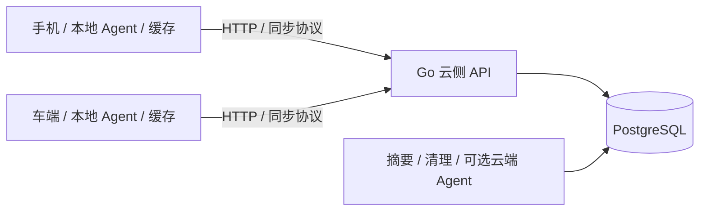

# MemoryHub 一期设计总览：云侧与端侧

版本：1.3 ｜ 日期：2026-10-01 ｜ 状态：设计文档，服务与端侧 Demo 尚未实现。

当前实施基线见 [一期设计 v2](phase1-memory-system-design-v2.md)，已整合用户确认的选择；本文作为原总览补充。

一期建设会话与上下文，支持手机、车端和云端 Agent 接续同一任务。本版将方案拆成两个大块：**当前详细设计和实施云侧 Go 服务；端侧保留边界与简要方案，后续单独开发简单 Demo。** 手机和车端也可以运行本地 Agent；云侧作为独立 MemoryHub，负责提供上下文、记录写入和同步，云端 Agent 执行可选。

文档入口：

| 大块 | 文档 | 详细程度与实施顺序 |
| --- | --- | --- |
| 云侧 | [Go 云侧详细设计](phase1-go-cloud-service-design.md) | 当前重点，覆盖数据、接口、事务、同步服务、Worker、部署与验收 |
| 端侧 | [端侧简要方案与后续 Demo](phase1-edge-demo-design.md) | 当前只定义职责与契约；简单 Demo 后续实施 |

## 一、云侧：当前重点详细设计

### 1.1 建设目标

1. 权威保存用户原始消息、Agent 回复、工具事实；区分提交同步顺序与事件时间/因果时间线。
2. 保存当前目标、槽位、约束、待办和状态来源，使任务可以跨设备接续。
3. 用统一身份、上下文版本和执行权约束，防止旧 Agent 覆盖新用户输入。
4. 提供 Context Bundle、快照、增量、签名游标与通知，供端侧和云端 Agent 获取、缓存与续接上下文。
5. 支持端 Agent 在线结果提交、离线记录导入与重校验，以及摘要、后台任务、取消、工具查证与删除。

会话和上下文使用**同一 PostgreSQL 实例、不同表和数据模型**。会话主要追加事实；上下文更新当前状态并保存修订。它们与同步变化、后台任务和幂等回执在同一事务中提交。

### 1.2 技术与部署

| 部件 | 一期选择 |
| --- | --- |
| 后端语言 | Go |
| 服务组织 | 模块化单体；API 与 Worker 可同进程或分别启动 |
| 数据库 | PostgreSQL；MySQL 作为替代方案说明，不同时维护两套首版实现 |
| 数据访问 | pgx / pgxpool，显式事务；sqlc 可选 |
| 异步任务 | 数据库 Outbox、租约、重试与幂等 |
| 执行位置 | 手机、车端或云端；默认 device，按任务显式切换 |
| 模型 | 端侧本地模型 / 外部 Agent；云端执行器可选，测试使用 Mock |
| 对外服务 | Context Bundle、端 Agent 结果/离线导入、历史分页、快照、Changes、SSE |

首版云侧可以仅用 Go 服务和 PostgreSQL 完成开发与验收。SQLite 是端侧后续的可选本地持久化，不属于云侧存储依赖；Redis、Kafka、向量库也不是一期前置条件。

### 1.3 云侧详细设计的内容

| 设计领域 | 详细文档章节 |
| --- | --- |
| 架构、模块与对象边界 | 第 1～3 章 |
| 表结构、DDL、上下文 schema | 第 4～5 章 |
| 公共 API、云 Agent 与端 Agent 接口 | 第 6 章 |
| 原子写入、幂等、版本、Go 事务骨架 | 第 7 章 |
| Run 租约、fencing、取消、工具恢复与离线分支重校验 | 第 8 章 |
| Bundle 组装、端模型预算、缓存契约与摘要 | 第 9 章 |
| 实际时间线、时钟校准与先后不确定性 | [时间线补充设计](phase1-timeline-ordering-design.md) |
| 云侧快照、增量、游标和通知 | 第 10 章 |
| Worker、工程结构、配置与部署 | 第 11～13 章 |
| 删除、观测、测试与云侧里程碑 | 第 14～17 章 |
| MySQL 适配和官方参考 | 第 18～19 章 |

### 1.4 当前验收方式

使用 Go 集成测试 / HTTP 测试驱动模拟两个 device_id，无需先开发端侧应用：

- 同一消息重复提交只生效一次，ACK 后可以从另一设备身份读取。
- 两个设备同时输入时，原文保留，当前上下文串行更新。
- 端 Agent 可读取符合本地模型预算的 Bundle；关闭云端 Agent 后接口仍可用。
- 用户修改目标后，旧云端或端侧 Run 的结果提交被拒绝。
- 离线记录可幂等导入；旧版本建议不覆盖新状态，导入 ACK 与状态采纳分开。
- 已提交状态可以通过快照和增量按水位读取，丢通知仍可补拉。
- 摘要、Worker 接管、授权隔离与删除通过关键故障测试。

云侧验证会模拟请求重试、断连、旧游标和离线旧版本请求；它验证服务器行为，不等于已经完成手机 / 车端的本地恢复功能。

### 1.5 当前交付与推进顺序

先实现迁移、会话持久化与幂等，再实现 Bundle、端 Agent 接口、版本和离线重校验，之后完成摘要、同步、故障恢复和云端部署；云端 Agent Worker 可选。具体里程碑见云侧详细文档第 17 章。

实际开发应交付 Go 源码、迁移、OpenAPI、Mock 模型 / 工具、集成测试、本地启动配置与部署说明。目前交付的是设计文档。

已有资料：[国内云数据库比较](cloud-database-price-comparison.md)、[Go 官方参考资料](reference/go-cloud-service.md)、[三层总体调研](memory-system-design.md)。长期偏好、跨无关会话提炼、知识图谱与独立长期记忆引擎留到后续。

## 二、端侧：简要方案与后续 Demo

### 2.1 端侧职责

端侧负责交互、本地 Agent/模型、上下文缓存、本地分支和待同步记录。云侧保存全局已提交状态；弱网/断网时端侧基于缓存和本地新事件继续处理，恢复联网后导入并重校验。手机和车端通过 API 访问服务。

| 能力 | 后续简单 Demo | 之后的完整端侧 |
| --- | --- | --- |
| 展示消息与 Context | 两个浏览器视图模拟手机 / 车端 | 原生手机 / 车机交互 |
| 本地 Agent | 端侧 Mock 推理，模拟本地执行 | 本地模型与受控工具 |
| 临时数据 | 内存保存 Bundle、列表、分支和游标 | SQLite 等本地持久化 |
| 同步 | HTTP 快照 + 增量轮询 | 增量 + SSE / 已有实时连接 |
| 页面 / 进程重启 | 重新获取云侧快照 | 从本地游标续拉 |
| 请求超时 | 当前页面内复用 event_id 重试 | 持久化发送队列 |
| 弱网/完全离线 | 当前页面基于缓存 + Mock 继续处理，记录本地结果 | 本地模型、持久执行队列、重连重校验 |

### 2.2 Demo 验证目标

后续建立两个视图，共用 user_id、使用不同 device_id，显式选择相同 conversation_id / context_id。验证“手机说去杭州 → 车端读取 Bundle 并本地处理 → 车端断网继续对话 → 手机修改任务 → 车端重连导入记录但不覆盖手机的新状态”。

首版使用内存状态与增量轮询，减少端侧工程量；SQLite、离线队列、车机 SDK、真实语音与导航接入另行迭代。刷新页面后未确认输入不承诺保留，重新拉取云端已提交内容。

### 2.3 云端与端侧契约

双方统一 event_id、context_id、context_version、source_revision、policy_epoch、execution_id、时间证据/父引用和错误码。同步 cursor 与时间线页 cursor 分开；提交序号不因展示重排而改变。端侧只有在完整应用增量后才保存 / ACK 新 cursor；SSE 水位提示不表示变化已应用。服务器接收输入的 ACK 不表示 Agent 已完成解析或外部工具已执行；离线导入的 records_persisted 不等于 state_applied。离线端无法立即获知其他设备的新修改。

端侧具体模块、缓存与重连规则参见 [端侧简要设计](phase1-edge-demo-design.md)，不作为当前云侧开发的前置依赖。
