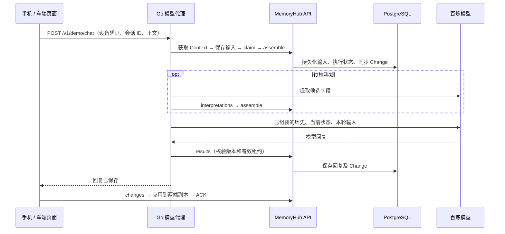

# MemoryHub 对话客户端

更新：2026-10-06。

页面提供实际可用的文本聊天：自由输入、连续追问、会话切换和历史恢复。顶部切换手机 / 车端身份，接续同一个 MemoryHub 会话；Go 服务读取 `LLM_API_KEY` 调用百炼，浏览器无需填写模型 Key。

## 1. 启动与配置

页面地址：<http://127.0.0.1:18080/>。

需要多个页面分别模拟设备、切换账户或测试断开连接时，使用新增的 <http://127.0.0.1:18080/client>，见 [独立客户端说明](independent-client-guide.md)。下文的根路径客户端保留同一页面切换手机/车端的操作方式。

在已有 `.env` 中保留数据库和开发身份配置，补充以下配置。已经填写的 Key 无需重新填写，也不要用示例文件覆盖现有 `.env`。

```dotenv
WEB_DEMO_ENABLED=true
LISTEN_ADDR=127.0.0.1:18080
LLM_BASE_URL=https://dashscope.aliyuncs.com/compatible-mode/v1
LLM_MODEL=qwen-flash
LLM_API_KEY=填写你的百炼APIKey
LLM_TIMEOUT_SECONDS=120
LLM_MAX_TOKENS=1024
LLM_ENABLE_THINKING=false
```

```sh
make db
make migrate
make seed-demo
make run
```

已有迁移和设备身份可以重复执行。当前机器已经启用页面并使用原有模型配置。修改 `.env` 或页面资产后需要重启 `make run`：静态页面嵌入 Go 程序，没有额外的前端构建步骤。

服务只在 `WEB_DEMO_ENABLED=true` 时挂载页面及两个 Demo 接口。未配置模型时仍可查看已有历史，发送按钮不可用。`make chat` 命令行入口仍然保留；详细模型参数见 [百炼接入说明](llm-setup.md)。

## 2. 操作流程

1. 点击“新对话”，直接输入自己的问题。发送第一条消息时自动创建会话，使用正文前 26 个字符作为标题。
2. 默认使用“日常对话”；需要保存目的地、出发时间等任务字段时，在第一条消息前选择“行程规划”。
3. 点击发送按钮或按 Enter；Shift + Enter 换行。页面立即显示输入与处理状态，完整模型回复保存后显示。
4. 持续追问，或切换顶部“车端”，围绕前文继续提问。模型输入由服务读取云端历史组装，页面不自行拼接或伪造回复。
5. 刷新页面或从左侧选择已有会话，重新读取持久化历史。手机尺寸下点击“会话”打开列表。

点击“上下文”打开侧栏，查看共享历史条数、任务状态、已确认字段和待确认提案；“连接信息”展示实际会话 ID、Context ID 和版本。提案的“确认”按钮以当前设备身份提交显式确认命令，不让模型自行确认。

回复支持常用 Markdown 的段落、列表、标题、加粗、代码和链接，也可以复制原始回复。模型生成的 HTML 按文本展示，不执行。发送失败会保留可见提示，不自动重试模型请求；初始连接失败时恢复网络后重新读取当前会话。

日常聊天每轮请求模型一次；行程规划通常请求两次，先提取候选字段，再使用服务校验后的上下文生成回复。当前页面等待完整回复，不逐字流式输出。同一页面一次只发送一轮；多个页面并发仍由 MemoryHub 的版本和 Run 租约保护处理。

## 3. 服务与数据链路



代理复用 `internal/deviceagent.Session`，执行身份绑定请求中的已验证 phone/car 凭证。实际模型计算位于百炼，编排位于 Go 服务；本次未增加后台云 Agent，也未修改 `execution_target=device` 的契约。

浏览器分别维护手机和车端的会话、Context、事件内存副本：

- 初次加载调用 `POST /v1/sync/snapshot`，安装后提交 `POST /v1/sync/ack`。
- 每 3 秒请求 `GET /v1/sync/changes`，分页应用所有变更后 ACK；两端游标分别维护，同一端同步请求串行执行。
- 游标失效时重新获取快照并补齐当前会话。快照每个会话仅带最近 20 条，选择会话后通过 events 分页补齐历史。
- 页面按 `conv_seq` 展示原始记录，标注发送设备与角色；这代表云端提交顺序，跨端实际发生时间的校准仍以已有时间线设计为准。

会话与 Context 使用当前 PostgreSQL 存储；浏览器 `localStorage` 只保存选中的会话 ID 和设备视图，不持久化消息、上下文或凭证。两个设备的输入草稿在内存中独立保存；刷新页面会清空未提交草稿。

## 4. 新增接口

### POST /v1/demo/session

本地开发身份入口，不需要 Bearer。支持 `phone` / `car` / `web`，校验设备有效性；返回 30 分钟的开发凭证。页面在过期前刷新凭证。

```json
{"device_id":"phone"}
```

返回 `token`、`expires_at`、`tenant_id`、`user_id`、`device_id`、`agent_id`、`model` 和 `model_ready`，不会返回模型 Key 或开发签名密钥。省略新增可选身份字段时使用 tenant=demo、user=demo-user、Agent=web-demo；多账户字段与本页身份见 [独立客户端说明](independent-client-guide.md)。生产设备登录与授权尚未实现。

### POST /v1/demo/chat

需要 `Authorization: Bearer <设备开发凭证>`。

```json
{
  "request_id":"turn_每轮唯一ID",
  "conversation_id":"conv_实际会话ID",
  "text":"刚才的测试标记是什么？"
}
```

成功返回：

```json
{
  "request_id":"turn_每轮唯一ID",
  "conversation_id":"conv_实际会话ID",
  "context_id":"ctx_实际上下文ID",
  "reply":"模型实际生成的回复"
}
```

正文上限 32 KiB；身份由凭证确定，浏览器不能指定模型地址、模型 Key 或任意用户身份。代理的内部 MemoryHub 地址来自监听配置，不使用浏览器传入的 Host。两个入口均拒绝浏览器跨站请求，不开放跨域访问。

已完成的请求在进程内缓存 10 分钟：同一用户、设备、request_id 和正文重复请求返回原结果，不重复调用模型；同 ID 修改正文返回 409；同请求正在执行时返回 409 `request_in_progress`。最多保留 512 个请求，达到上限返回 429。此缓存不跨进程、不跨重启，不提供持久化的模型调用去重保证。

模型未配置返回 503；模型失败返回脱敏错误，MemoryHub 的业务错误保留原状态码。页面不自动重试付费请求。失败前输入或字段解释可能已经保存，最终回复失败不会回滚整轮操作，应查看已有历史后再继续。

完整契约见 [OpenAPI](api/openapi.yaml)。原有会话、Context 和同步 API 继续承担数据读写。

## 5. 验证与范围

页面代理及独立客户端的真实 HTTP + PostgreSQL 集成测试使用本地兼容 API 替身，覆盖代理凭证、两端历史、请求去重、正文冲突、默认关闭、跨站拒绝、账户隔离与缺少模型等行为。现有 26 项 Go 测试已通过竞态检测，其中 18 项使用 PostgreSQL。

浏览器验收已使用真实 qwen-flash 完成两轮：手机保存“橙色风筝”，车端未重复提供标记，模型正确回答“橙色风筝”；两端均显示四条记录。刷新后可重新读取历史，记录见 [真实模型验证](real-model-smoke-test.md)。行程提取由已有集成测试验证，本次浏览器验收未额外调用付费模型验证行程流程。

2026-10-06 调整为单一完整聊天窗口后，再使用真实 qwen-flash 验证自由对话：首条消息自动创建会话，手机介绍杭州出行偏好，车端连续追问；回复继承先前偏好，列表与加粗正常展示。刷新恢复历史和设备视图、上下文侧栏读取也已验证。

同时验证 390 × 844 手机尺寸下的会话列表入口和设备切换，手机草稿在切换到车端后独立保留。最新页面资源与代理的两项集成测试在竞态检测下重新通过，Go 构建和 JavaScript 语法检查通过。

当前是网页模拟，尚未实现原生手机 App、车机 SDK、断网本地推理、SQLite 队列、离线输入补传或真实设备时钟采集。浏览器断网时显示等待连接，恢复后拉取云端变化；不承诺断网仍可发送和生成回复。

代码入口：[页面资产](internal/webui/assets/index.html)、[前端同步与交互](internal/webui/assets/app.js)、[Go 模型代理](internal/httpapi/demo.go)、[代理集成测试](tests/integration/web_demo_test.go)。
